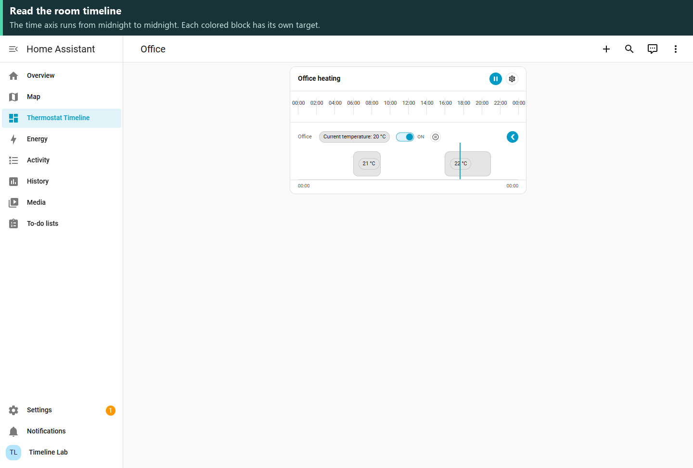

# Thermostat Pro Timeline

 

Schedule heating and cooling for each room from a 24-hour timeline in Home Assistant. The integration runs saved schedules in the background and the dashboard card lets you edit them.

## [Open the user guide](https://qlerup.github.io/thermostat-pro-timeline/)

[Getting started](https://qlerup.github.io/thermostat-pro-timeline/getting-started/installation.html) | [Feature guides](https://qlerup.github.io/thermostat-pro-timeline/card/features/index.html) | [Integration actions](https://qlerup.github.io/thermostat-pro-timeline/integration/services.html) | [Troubleshooting](https://qlerup.github.io/thermostat-pro-timeline/troubleshooting.html)

### Where do I find it?

| Task | Start here |
| --- | --- |
| Pause and resume from my heating automation | [Actions and visual walkthrough](https://qlerup.github.io/thermostat-pro-timeline/#pause-timeline-when-the-heating-is-switched-off) |
| Set a different Away temperature in each room | [Room-specific Away settings](https://qlerup.github.io/thermostat-pro-timeline/#give-one-room-a-different-away-temperature) |
| Show the Summer and Winter selector on the card | [Enable seasonal schedules](https://qlerup.github.io/thermostat-pro-timeline/#find-the-summer-and-winter-selector) |

New to the card? Follow [Add your first thermostat](https://qlerup.github.io/thermostat-pro-timeline/getting-started/quick-start.html) to connect a room, set a temperature block and check the result. The guide includes desktop demonstrations of editing a schedule, pausing a room and configuring sensors.

[Play the timeline demo in the user guide](https://qlerup.github.io/thermostat-pro-timeline/getting-started/quick-start.html#edit-a-scheduled-block)

[Releases and downloads](https://github.com/qlerup/thermostat-pro-timeline/releases) | [Report an issue](https://github.com/qlerup/thermostat-pro-timeline/issues) | [Support the project on Ko-fi](https://ko-fi.com/qlerup) | [Guide source](docs/index.md)
