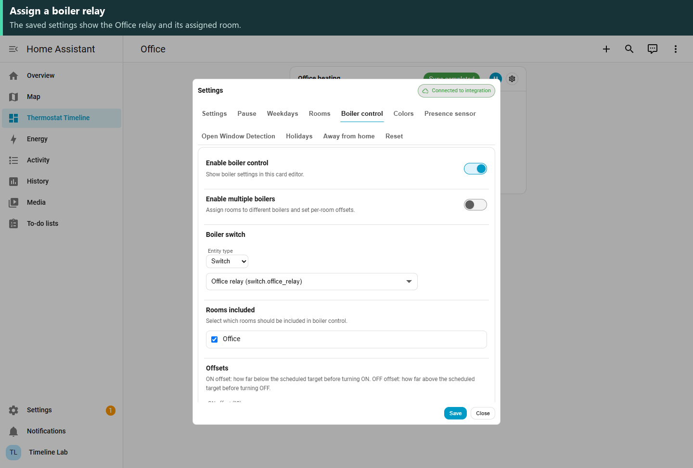
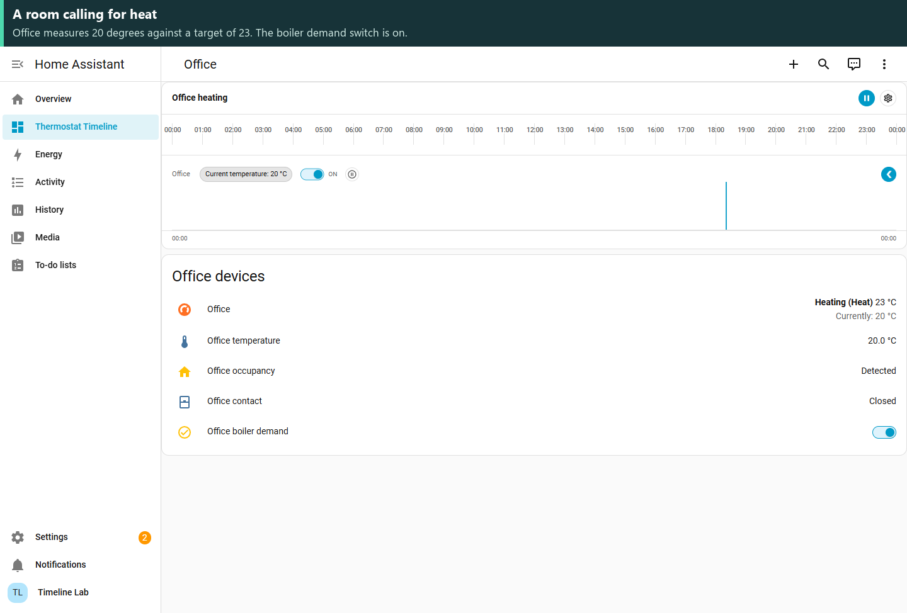
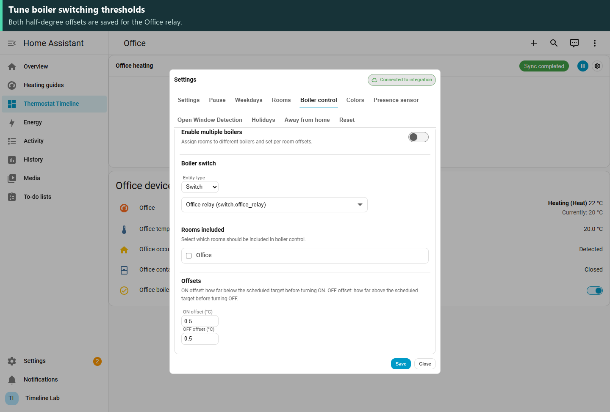
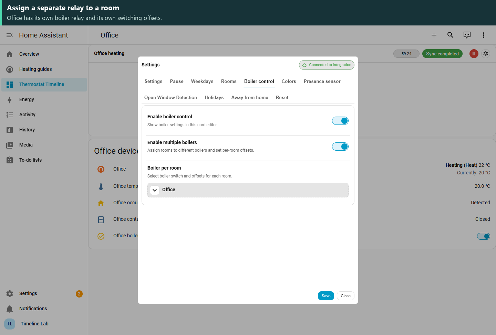
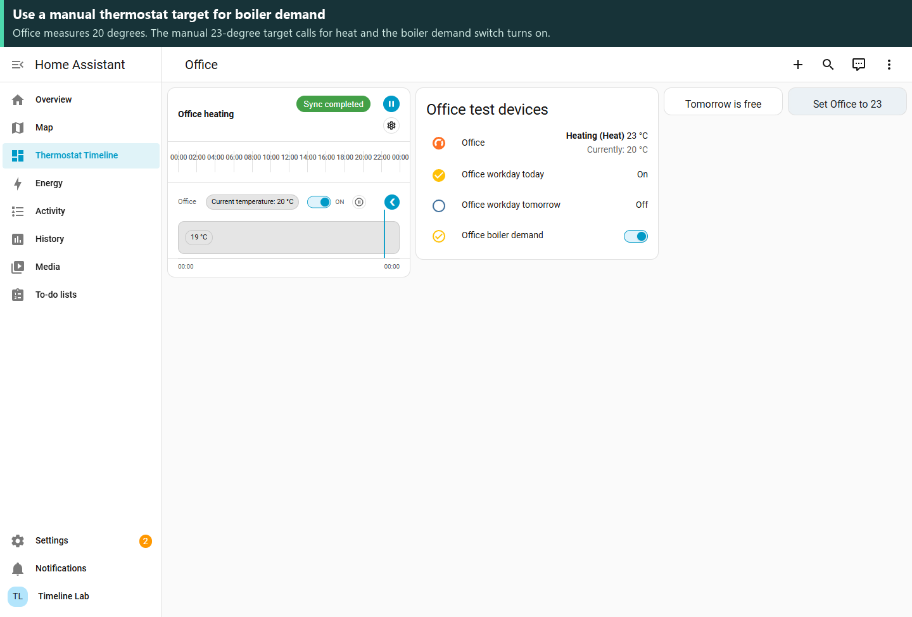

# Boiler control (backend)

- boiler_enabled: true/false to turn on boiler tools in the editor/runtime.
- boiler_switch: switch.* or input_boolean.* to control the boiler/relay.
- boiler_switch_domain: switch | input_boolean (auto‑detected from entity id if omitted).
- boiler_rooms: [ climate.living_room, climate.kitchen ] or omit for all climate rooms.
- boiler_on_offset / boiler_off_offset: °C hysteresis relative to current target.
- boiler_temp_sensor: sensor.* to control boiler by its own temperature if desired.
- boiler_min_temp / boiler_max_temp: clamp when using boiler_temp_sensor.
- boiler_multi_enabled: true/false to enable per‑room boiler assignment.
- boiler_room_settings: per‑room mapping for multi‑boiler mode:
	- climate.living_room:
		- enabled: true/false
		- switch: switch.boiler_1 (or input_boolean.boiler_1)
		- switch_domain: switch | input_boolean (optional if entity id includes domain)
		- on_offset / off_offset: optional per‑room offsets (°C)

## Find the boiler relay settings

Open **Settings > Boiler control** and enable the controls. Select the relay and participating rooms before saving. The walkthrough selects the simulated Office relay, saves and reopens the settings to show the selected relay.

[Play walkthrough](../../images/boiler.gif) | [Full-size GIF](../../images/boiler.gif)

## See a request for heat

Set the participating room above its measured temperature. Office measures 20 degrees and requests 23, so the example boiler switch turns on. Lower the target and check the relay once all participating rooms have cleared their demand. With several rooms assigned, one room can keep the relay on.

[Play walkthrough](../../images/boiler.gif) | [Full-size GIF](../../images/boiler.gif)

## Tune the switching thresholds

Set the on and off offsets under **Boiler control** and save. With a 21-degree target and offsets of 0.5, demand starts below 20.5 degrees and clears at or above 21.5 once all assigned rooms are satisfied. Separate thresholds reduce repeated switching near the target.

[Play walkthrough](../../images/boiler-offsets.gif) | [Full-size GIF](../../images/boiler-offsets.gif)

## Assign rooms to different boilers

Enable **multiple boilers**, expand the room and choose its relay. Give each room its own offsets if needed. Rooms sharing a relay contribute to the demand for that relay.

[Play walkthrough](../../images/multi-boiler.gif) | [Full-size GIF](../../images/multi-boiler.gif)

## Use a manual thermostat target for boiler demand

Use shared storage with automatic temperature control. In **Settings > Boiler control**, enable boiler control, assign the relay and participating rooms, and turn on **Use manual thermostat targets for boiler demand**. Save, then change a room's thermostat target in Home Assistant or at the thermostat.

For example, Office measures 20 degrees and its schedule calls for 19. Raising its thermostat to 23 creates a temporary room override. The relay now calls for heat using 23 as the target, with your existing switching thresholds. Reducing the target can stop demand if the other rooms sharing the relay are also warm enough. The same rule applies to rooms assigned to separate boilers.

At the room's next schedule boundary, or at midnight when no earlier boundary remains, Timeline resumes the schedule and recalculates demand. Setting the thermostat back to the scheduled temperature also ends the override. Turn the option off to base boiler demand on scheduled targets again. The option is off by default.

[Play walkthrough](../../images/boiler-manual.gif) | [Full-size GIF](../../images/boiler-manual.gif)
