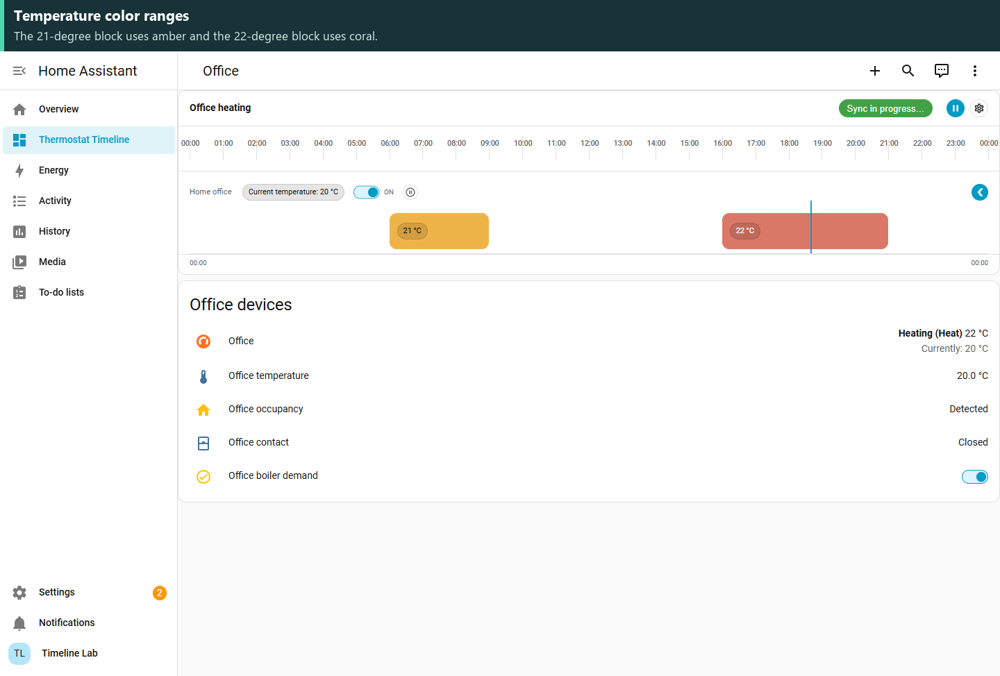
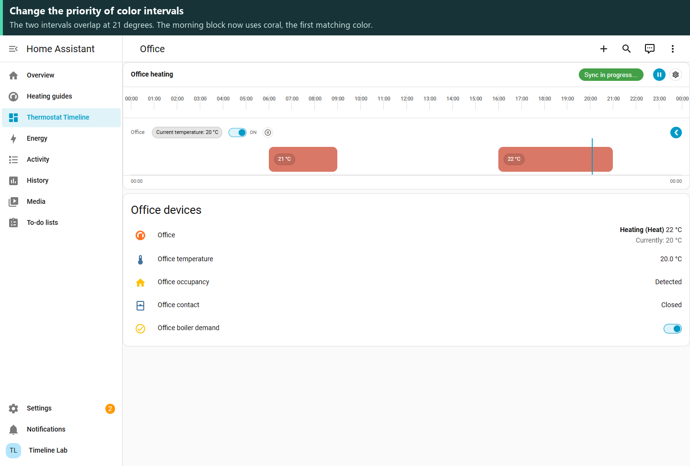

# Color ranges

- color_global: true/false (use a single palette for all rooms when true)
- color_ranges: mapping of room or `*` to intervals:

```yaml
color_global: true
color_ranges:
  "*":
    - { from: 5, to: 18, color: "#4da3ff" }
    - { from: 18, to: 21, color: "#ffd166" }
    - { from: 21, to: 26, color: "#ff7f50" }
```

## Use a shared or per-room palette

Enable the global palette to give the same temperature the same color in every room. With the example above, a 20-degree block appears yellow and a 23-degree block appears orange. To give rooms their own palettes, disable the global option and use each room's entity ID in place of `"*"`. Colors change how blocks appear on the timeline.

## Read a temperature by color

Open **Settings > Colors**, choose a shared or room palette, enter the intervals and save. In this example 21 degrees falls in an amber range and 22 degrees in a coral range. Each block also shows its target as a number.

[](../../images/colors.gif)

[Play walkthrough](../../images/colors.gif) | [Full-size GIF](../../images/colors.gif)

## Reorder temperature colors

In **Settings > Colors**, use **Move interval up** or **Move interval down** in the shared or room palette, then save. When intervals overlap, the first matching interval determines the block color. Move it back to restore the previous priority.

[](../../images/color-order.gif)

[Play walkthrough](../../images/color-order.gif) | [Full-size GIF](../../images/color-order.gif)
