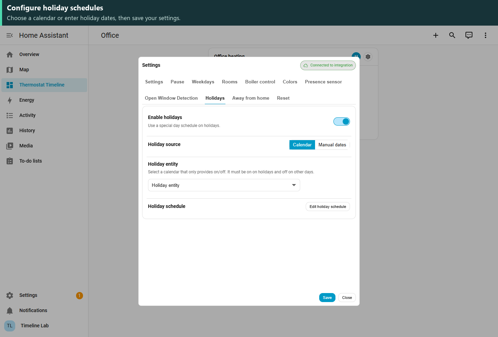
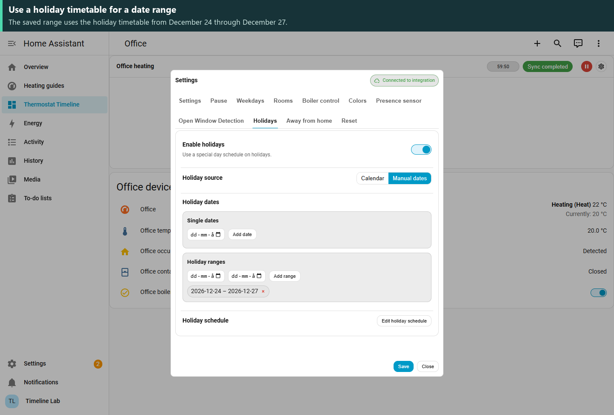
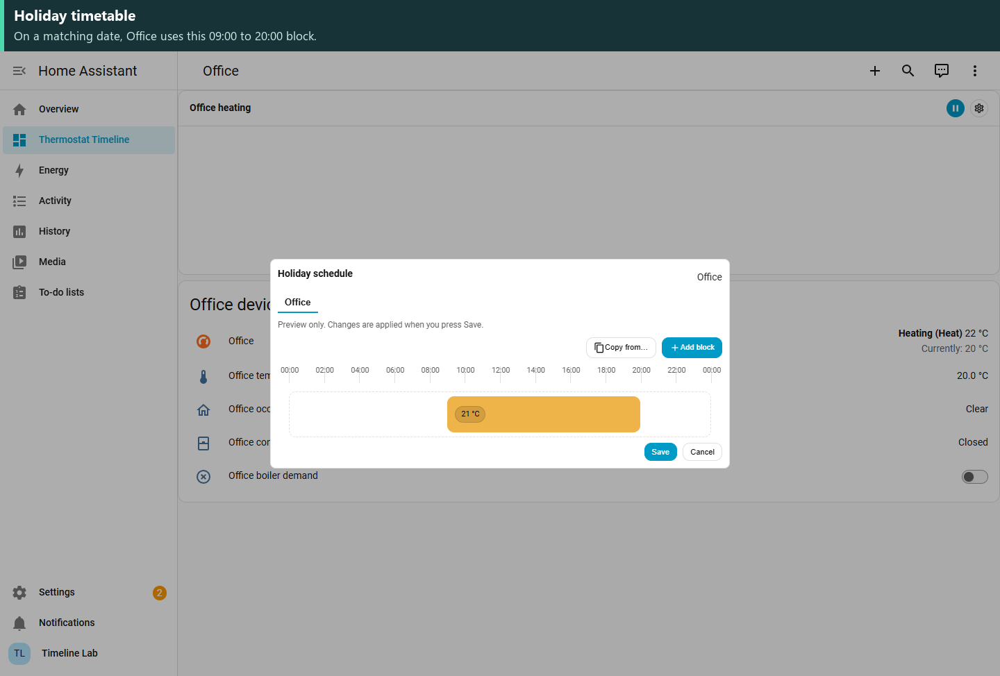
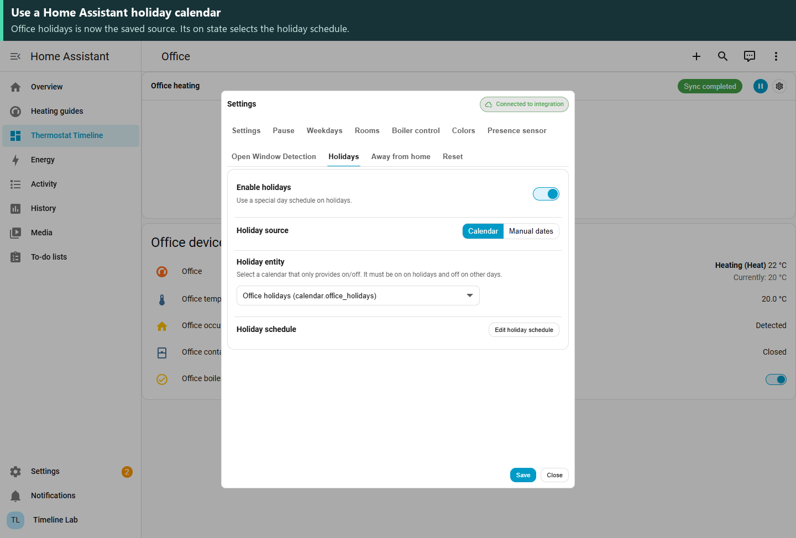
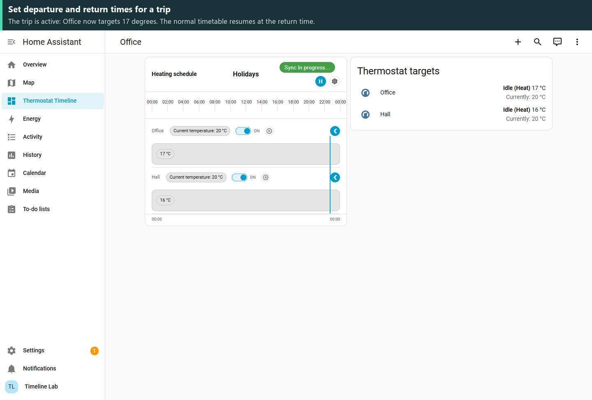

# Holidays

- holidays_enabled: true/false
- holidays_source: calendar | manual
- holidays_entity: calendar.* or a binary sensor that is on during holidays
- holidays_dates: [ "YYYY-MM-DD", ... ] manual date list when using manual source

## Choose a holiday source

Open **Settings > Holidays** and enable holiday schedules. Use a calendar for recurring holidays, or enter specific dates manually. Save the selected source before editing the holiday timetable.

[Play walkthrough](../../images/holidays.gif) | [Full-size GIF](../../images/holidays.gif)

## Schedule a range of dates

For consecutive days, switch to the manual source and add a range using its first and last dates. Save the settings, then edit the holiday timetable to set the temperatures for those days. For an on/off holiday calendar, keep the calendar as the source and maintain the dates in Home Assistant.

[Play walkthrough](../../images/holiday-range.gif) | [Full-size GIF](../../images/holiday-range.gif)

## Give a holiday its own timetable

After selecting the date source, open **Edit holiday schedule**, choose Office, add a block and save. This example uses 21 degrees from 09:00 to 20:00 on matching dates. Adding a date and editing its temperature blocks are separate steps.

[Play walkthrough](../../images/holidays.gif) | [Full-size GIF](../../images/holidays.gif)

## Follow a holiday calendar

Use **Settings > Holidays > Calendar** and select a dedicated holiday calendar. The holiday plan applies while the selected entity is on. An all-day event covers a whole day. Use the [holiday timetable](#give-a-holiday-its-own-timetable) to choose the actual temperatures.

[Play walkthrough](../../images/calendar.gif) | [Full-size GIF](../../images/calendar.gif)

## Set departure and return times for a trip

In **Settings > Holidays**, enable holidays and choose **Manual**. Create the room's holiday timetable first. In the date range controls, choose the departure and return dates and enter either or both times. Select **Add range**, check the interval, then **Save**.

For example, a trip from Friday at 16:00 to Sunday at 12:00 starts using holiday blocks at 16:00 on Friday. At noon on Sunday, the room resumes the schedule that would normally apply at that moment. The recording shows Office using its 17-degree holiday target during a trip. Shared storage and automatic temperature control let the integration handle both transitions with the dashboard closed.

Times use Home Assistant's local time zone. A blank departure time means the start of the first date. A blank return time includes the whole final date. Leave both blank for an ordinary whole-day range. Overlapping trips and whole-day dates keep the holiday timetable active while any entry matches. To cancel a timed trip, remove its interval and save. Rooms without holiday blocks keep their usual schedules.

[Play walkthrough](../../images/holiday-trip.gif) | [Full-size GIF](../../images/holiday-trip.gif)
