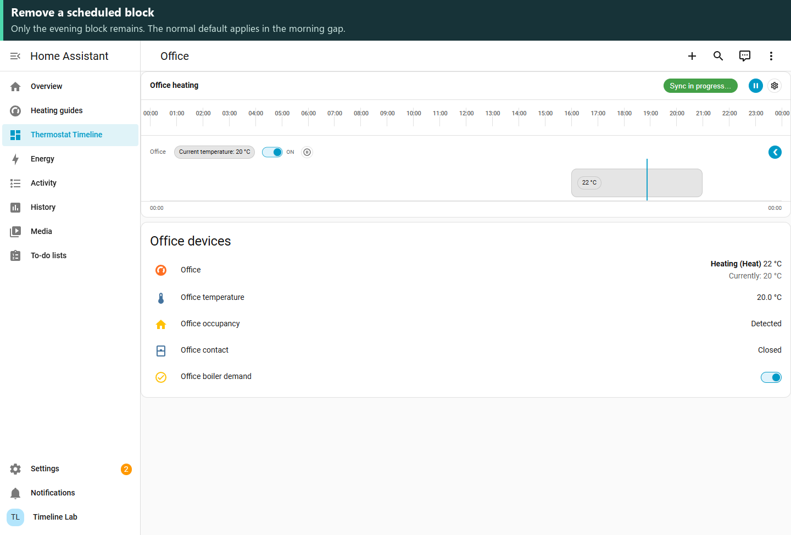
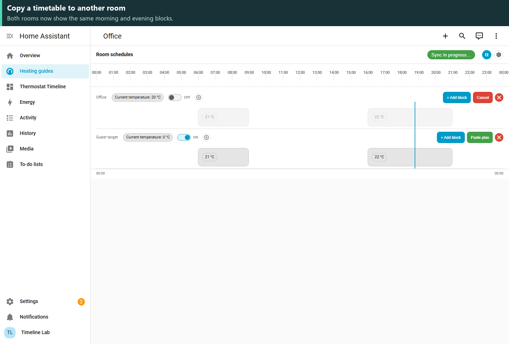
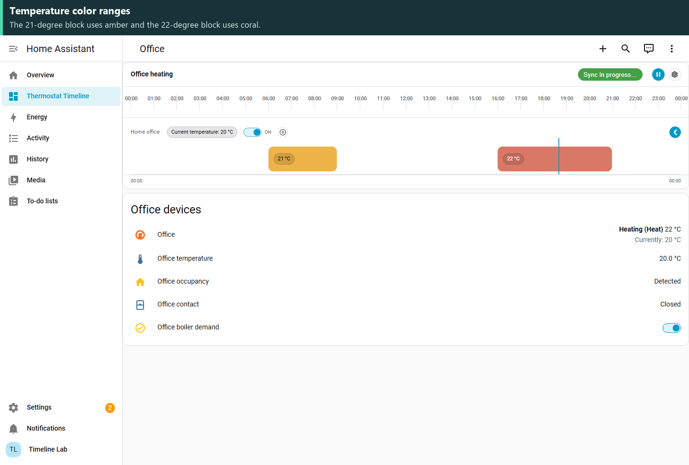
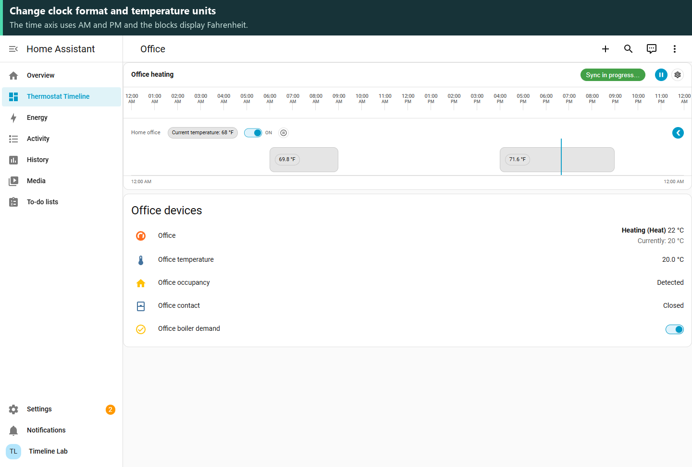
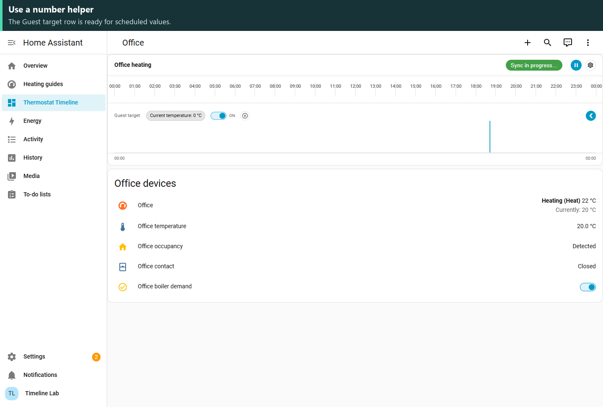
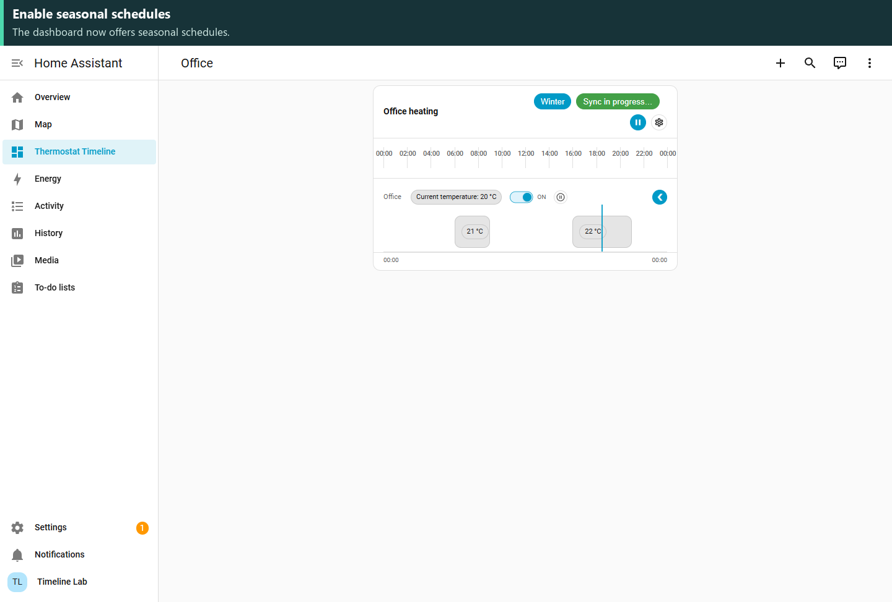
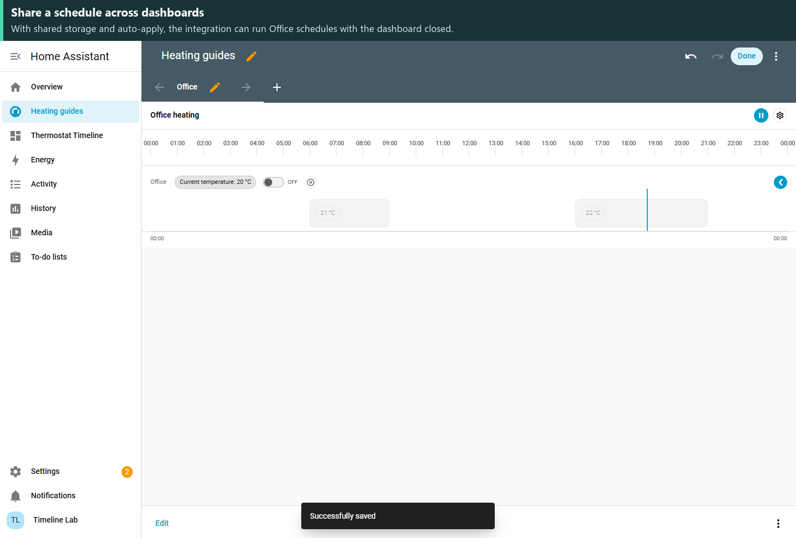
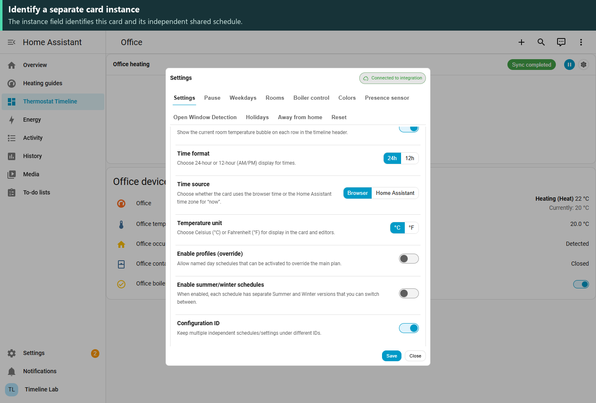
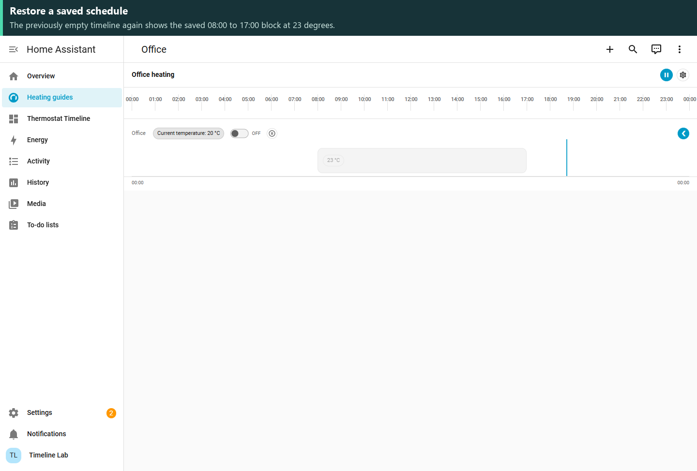

# Feature guides

Choose what you want your heating to do. Open a guide for the setup steps and the result to look for in Home Assistant. Choose **Play walkthrough** on an animated example, or click its still image. Click again to return to the still. Feature titles open the full guide.

## Build and edit a timeline

-   **[Add a midday block](../../getting-started/quick-start.md#add-a-midday-block)**

    Expand the Office row and choose **Add block**.

    

    [Play walkthrough](../../images/add-block.gif) | [Full-size GIF](../../images/add-block.gif)

-   **[Timeline blocks](../../getting-started/quick-start.md#edit-a-scheduled-block)**

    Change the morning block from 21 to 23 degrees and save it.

    

    [Play walkthrough](../../images/edit-block.gif) | [Full-size GIF](../../images/edit-block.gif)

-   **[Delete a block](../../getting-started/quick-start.md#remove-a-block)**

    The recording removes the morning block and saves the remaining evening period..

    

    [Play walkthrough](../../images/delete-block.gif) | [Full-size GIF](../../images/delete-block.gif)

-   **[Copy and paste room plans](rooms.md#copy-a-plan-between-rooms)**

    Reuse a set of blocks on another row.

    

    [Play walkthrough](../../images/copy-plan.gif) | [Full-size GIF](../../images/copy-plan.gif)

-   **[Room defaults and auto-apply](rooms.md#defaults-and-automatic-control)**

    Set the temperature between blocks and keep the schedule running with the dashboard closed.

    

    [Play walkthrough](../../images/defaults.gif) | [Full-size GIF](../../images/defaults.gif)

-   **[Apply current-period edits](rooms.md#apply-a-change-during-the-current-period)**

    Choose whether an edit to the current block or default updates the thermostat immediately.

    

    [Play walkthrough](../../images/apply-edit.gif) | [Full-size GIF](../../images/apply-edit.gif)

-   **[Temperature colors](colors.md)**

    Identify warmer and cooler periods by their colors.

    

    [Play walkthrough](../../images/colors.gif) | [Full-size GIF](../../images/colors.gif)

-   **[Clock, units and language](rooms.md#time-units-and-language)**

    Choose how the card displays time, temperatures and labels.

    

    [Play walkthrough](../../images/clock.gif) | [Full-size GIF](../../images/clock.gif)

## Rooms and thermostat controls

-   **[Room labels and measurements](rooms.md#room-labels-and-external-thermometers)**

    Read the room thermometer beside its scheduled targets.

    

    [Play walkthrough](../../images/room-display.gif) | [Full-size GIF](../../images/room-display.gif)

-   **[Merged thermostats](rooms.md#merged-radiators-and-power-commands)**

    Use one row to send the same target to several radiators and choose when to power them on.

    

    [Play walkthrough](../../images/merge.gif) | [Full-size GIF](../../images/merge.gif)

-   **[Number helpers](rooms.md#schedule-a-number-helper)**

    Write a scheduled value to a helper for another automation to use.

    

    [Play walkthrough](../../images/number-helper.gif) | [Full-size GIF](../../images/number-helper.gif)

-   **[Keep a room timetable with control off](rooms.md#keep-a-timetable-without-sending-commands)**

    Keep the blocks visible while another automation drives the thermostat.

    

    [Play walkthrough](../../images/room-apply.gif) | [Full-size GIF](../../images/room-apply.gif)

-   **[Hold a manual thermostat target](pause.md#hold-a-manual-thermostat-target)**

    With background control enabled, open the climate entity and raise its target.

    

    [Play walkthrough](../../images/manual-hold.gif) | [Full-size GIF](../../images/manual-hold.gif)

-   **[Pause and resume a room](pause.md#pause-one-room-for-an-hour)**

    Set a timed hold, read its countdown and resume the room.

    

    [Play walkthrough](../../images/room-pause.gif) | [Full-size GIF](../../images/room-pause.gif)

-   **[Global pause](pause.md#pause-every-room-with-one-control)**

    Suspend every room schedule with the pause button in the header.

    

    [Play walkthrough](../../images/global-pause.gif) | [Full-size GIF](../../images/global-pause.gif)

-   **[Pause from a binary sensor](pause.md#pause-automatically-from-a-sensor)**

    Suspend scheduled commands across rooms while an external control is on.

    

    [Play walkthrough](../../images/pause-sensor.gif) | [Full-size GIF](../../images/pause-sensor.gif)

## Weekdays, profiles and holidays

-   **[Weekdays and weekends](weekdays.md)**

    Compare a later Saturday start with the working week.

    

    [Play walkthrough](../../images/weekdays.gif) | [Full-size GIF](../../images/weekdays.gif)

-   **[Named profiles](profiles.md)**

    Activate a working-from-home plan and see its daytime block.

    

    [Play walkthrough](../../images/profile.gif) | [Full-size GIF](../../images/profile.gif)

-   **[Summer and winter](seasonal.md)**

    Switch between independently editable seasonal plans.

    

    [Play walkthrough](../../images/season.gif) | [Full-size GIF](../../images/season.gif)

-   **[Holidays](holidays.md)**

    Select the dates, then build the timetable those dates use.

    

    [Play walkthrough](../../images/holidays.gif) | [Full-size GIF](../../images/holidays.gif)

-   **[Follow a holiday calendar](holidays.md#follow-a-holiday-calendar)**

    Use **Settings > Holidays > Calendar** and select a dedicated holiday calendar.

    

    [Play walkthrough](../../images/calendar.gif) | [Full-size GIF](../../images/calendar.gif)

-   **[Holiday date ranges](holidays.md#schedule-a-range-of-dates)**

    Use a holiday plan on several consecutive days.

    

    [Play walkthrough](../../images/holiday-range.gif) | [Full-size GIF](../../images/holiday-range.gif)

## Presence and Away

-   **[Room occupancy](presence-away.md#heat-an-occupied-room)**

    Detect an occupied office and raise its thermostat target.

    

    [Play walkthrough](../../images/occupancy.gif) | [Full-size GIF](../../images/occupancy.gif)

-   **[Occupancy delays](presence-away.md#use-different-entry-and-exit-delays)**

    Set separate waits for entering and leaving a room.

    

    [Play walkthrough](../../images/arrival-delay.gif) | [Full-size GIF](../../images/arrival-delay.gif)

-   **[Away mode](presence-away.md#lower-the-target-when-everyone-leaves)**

    Lower the target after the last selected resident leaves.

    

    [Play walkthrough](../../images/away.gif) | [Full-size GIF](../../images/away.gif)

-   **[Temporarily bypass Away](presence-away.md#temporarily-bypass-away)**

    When Away is active, choose **Resume schedule** in the header to return to the scheduled target.

    

    [Play walkthrough](../../images/away-bypass.gif) | [Full-size GIF](../../images/away-bypass.gif)

-   **[Household combinations](presence-away.md#plan-for-combinations-of-residents)**

    Give different combinations of residents their own timetables.

    

    [Play walkthrough](../../images/presence-combinations.gif) | [Full-size GIF](../../images/presence-combinations.gif)

## Windows and boiler control

-   **[Open windows](open-window.md)**

    Follow a contact opening and see the thermostat switch off.

    

    [Play walkthrough](../../images/window.gif) | [Full-size GIF](../../images/window.gif)

-   **[Boiler demand](boiler.md)**

    Compare the room reading, target and boiler relay state.

    

    [Play walkthrough](../../images/boiler.gif) | [Full-size GIF](../../images/boiler.gif)

-   **[Boiler switching thresholds](boiler.md#tune-the-switching-thresholds)**

    Keep a gap between switching the relay on and off.

    

    [Play walkthrough](../../images/boiler-offsets.gif) | [Full-size GIF](../../images/boiler-offsets.gif)

-   **[Multiple boilers](boiler.md#assign-rooms-to-different-boilers)**

    Assign each room to its own relay.

    

    [Play walkthrough](../../images/multi-boiler.gif) | [Full-size GIF](../../images/multi-boiler.gif)

## Shared schedules and backups

-   **[Shared storage and background control](storage.md#share-schedules-between-dashboards)**

    Run one schedule across multiple dashboards.

    

    [Play walkthrough](../../images/shared-store.gif) | [Full-size GIF](../../images/shared-store.gif)

-   **[Storage, sync and instances](storage.md)**

    Share one plan across dashboards or select a separate instance.

    

    [Play walkthrough](../../images/instance.gif) | [Full-size GIF](../../images/instance.gif)

-   **[Transfer a browser plan](storage.md#transfer-a-browser-schedule-to-shared-storage)**

    Move an existing local schedule into the shared store.

    

    [Play walkthrough](../../images/transfer.gif) | [Full-size GIF](../../images/transfer.gif)

-   **[Create a full backup slot](storage.md#create-a-full-backup-slot)**

    Edit the dashboard card, open **Backup**, choose **New backup** and select **Backup now**.

    

    [Play walkthrough](../../images/backup-action.gif) | [Full-size GIF](../../images/backup-action.gif)

-   **[Automatic backups](storage.md#schedule-recurring-backups)**

    Set a recurring interval in days.

    

    [Play walkthrough](../../images/auto-backup.gif) | [Full-size GIF](../../images/auto-backup.gif)

-   **[Backups and restore](storage.md#save-and-restore-a-backup)**

    Restore a saved slot and see the missing block return.

    

    [Play walkthrough](../../images/restored.gif) | [Full-size GIF](../../images/restored.gif)

-   **[Move backup slots between installations](storage.md#export-and-import-backup-slots)**

    Export, import and choose when to restore.

    

    [Play walkthrough](../../images/backup-file.gif) | [Full-size GIF](../../images/backup-file.gif)

## Automation and diagnostics

Use [integration actions](../../integration/services.md) to manage schedules from an automation. The [HTTP API](../../integration/api.md) exposes the stored configuration and version counters.
