# Feature guides

Choose what you want your heating to do. Open a guide for the setup steps and the result to look for in Home Assistant. Choose **Play walkthrough** on an animated example, or click its still image. Click again to return to the still. Open the same topics under **Feature guides** in the left menu. Type a name in **Find a feature or page** to jump to it, or choose **Search the whole guide** to search instructions and examples.

## Build and edit a timeline

-   **[Learn when to start heating or cooling](learned-starts.md#learn-when-to-start-heating-or-cooling)**

    Use recent room and weather measurements to reach the next block's temperature earlier.

    

    [Play walkthrough](../../images/learn-room.gif) | [Full-size GIF](../../images/learn-room.gif)

-   **[Control an underfloor heating valve](learned-starts.md#control-an-underfloor-heating-valve)**

    Choose open/closed or proportional control for a room's percentage valve.

    [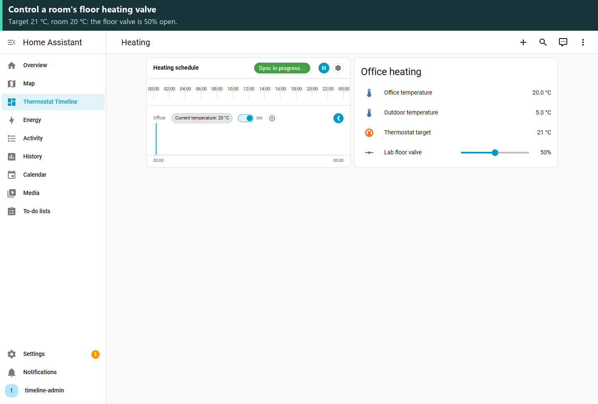](../../images/floor-valve.gif)

    [Play walkthrough](../../images/floor-valve.gif) | [Full-size GIF](../../images/floor-valve.gif)

-   **[Add a midday block](../../getting-started/quick-start.md#add-a-midday-block)**

    Expand the Office row and choose **Add block**.

    [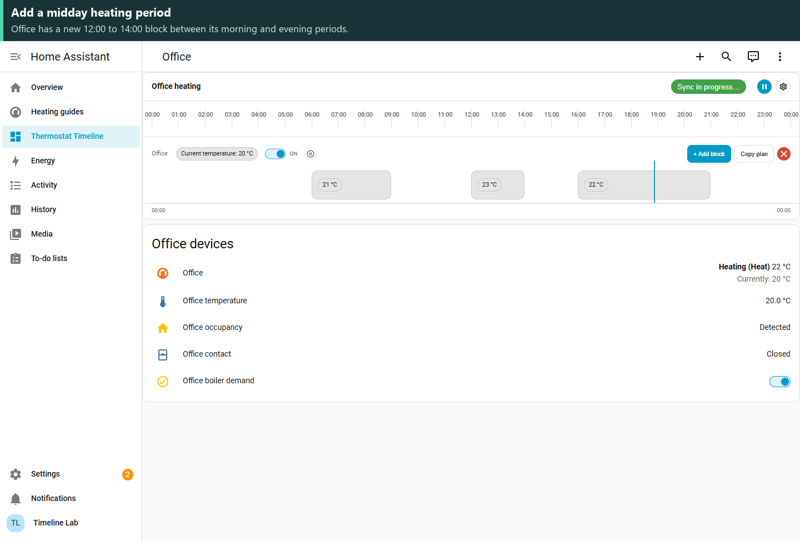](../../images/add-block.gif)

    [Play walkthrough](../../images/add-block.gif) | [Full-size GIF](../../images/add-block.gif)

-   **[Timeline blocks](../../getting-started/quick-start.md#edit-a-scheduled-block)**

    Change the morning block from 21 to 23 degrees and save it.

    

    [Play walkthrough](../../images/edit-block.gif) | [Full-size GIF](../../images/edit-block.gif)

-   **[Choose the HVAC mode for a block](rooms.md#choose-the-hvac-mode-for-a-block)**

    Leave power control to another automation, switch a thermostat off, or schedule a heating or cooling mode.

    [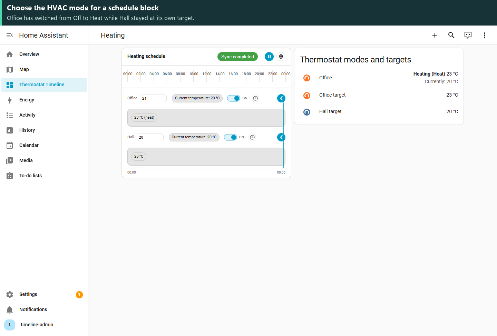](../../images/block-hvac.gif)

    [Play walkthrough](../../images/block-hvac.gif) | [Full-size GIF](../../images/block-hvac.gif)

-   **[Delete a block](../../getting-started/quick-start.md#remove-a-block)**

    The recording removes the morning block and saves the remaining evening period..

    

    [Play walkthrough](../../images/delete-block.gif) | [Full-size GIF](../../images/delete-block.gif)

-   **[Copy and paste room plans](rooms.md#copy-a-plan-between-rooms)**

    Reuse a set of blocks on another row.

    

    [Play walkthrough](../../images/copy-plan.gif) | [Full-size GIF](../../images/copy-plan.gif)

-   **[Room defaults and auto-apply](rooms.md#defaults-and-automatic-control)**

    Set the temperature between blocks and keep the schedule running with the dashboard closed.

    

    [Play walkthrough](../../images/defaults.gif) | [Full-size GIF](../../images/defaults.gif)

-   **[Apply current-period edits](rooms.md#apply-a-change-during-the-current-period)**

    Choose whether an edit to the current block or default updates the thermostat immediately.

    [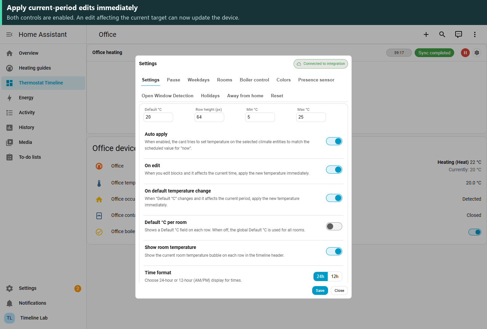](../../images/apply-edit.gif)

    [Play walkthrough](../../images/apply-edit.gif) | [Full-size GIF](../../images/apply-edit.gif)

-   **[Temperature colors](colors.md)**

    Identify warmer and cooler periods by their colors.

    

    [Play walkthrough](../../images/colors.gif) | [Full-size GIF](../../images/colors.gif)

-   **[Clock, units and language](rooms.md#time-units-and-language)**

    Choose how the card displays time, temperatures and labels.

    

    [Play walkthrough](../../images/clock.gif) | [Full-size GIF](../../images/clock.gif)

-   **[Reorder temperature colors](colors.md#reorder-temperature-colors)**

    In **Settings > Colors**, use **Move interval up** or **Move interval down** in the shared or room palette, then save.

    [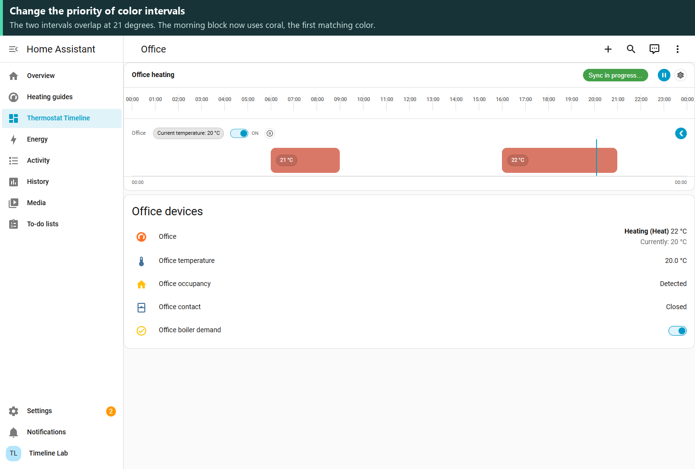](../../images/color-order.gif)

    [Play walkthrough](../../images/color-order.gif) | [Full-size GIF](../../images/color-order.gif)

## Rooms and thermostat controls

-   **[Room labels and measurements](rooms.md#room-labels-and-external-thermometers)**

    Read the room thermometer beside its scheduled targets.

    [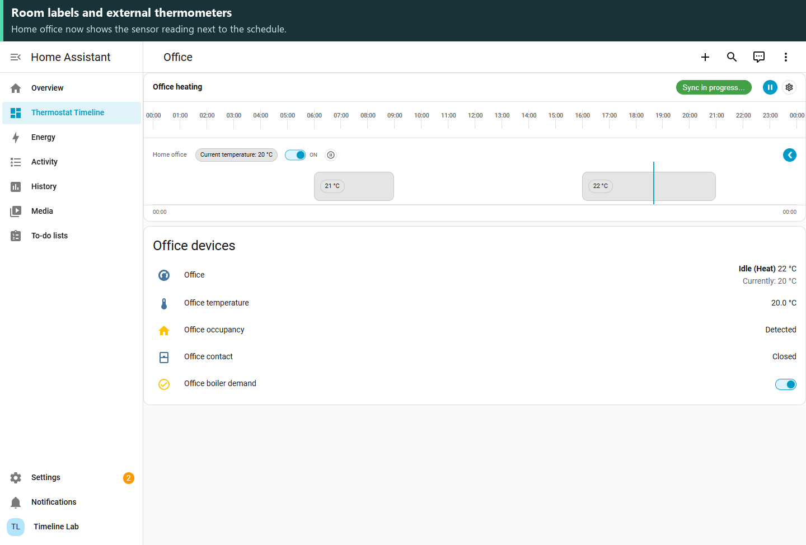](../../images/room-display.gif)

    [Play walkthrough](../../images/room-display.gif) | [Full-size GIF](../../images/room-display.gif)

-   **[Merged thermostats](rooms.md#merged-radiators-and-power-commands)**

    Use one row to send the same target to several radiators and choose when to power them on.

    

    [Play walkthrough](../../images/merge.gif) | [Full-size GIF](../../images/merge.gif)

-   **[Number helpers](rooms.md#schedule-a-number-helper)**

    Write a scheduled value to a helper for another automation to use.

    

    [Play walkthrough](../../images/number-helper.gif) | [Full-size GIF](../../images/number-helper.gif)

-   **[Keep a room timetable with control off](rooms.md#keep-a-timetable-without-sending-commands)**

    Keep the blocks visible while another automation drives the thermostat.

    [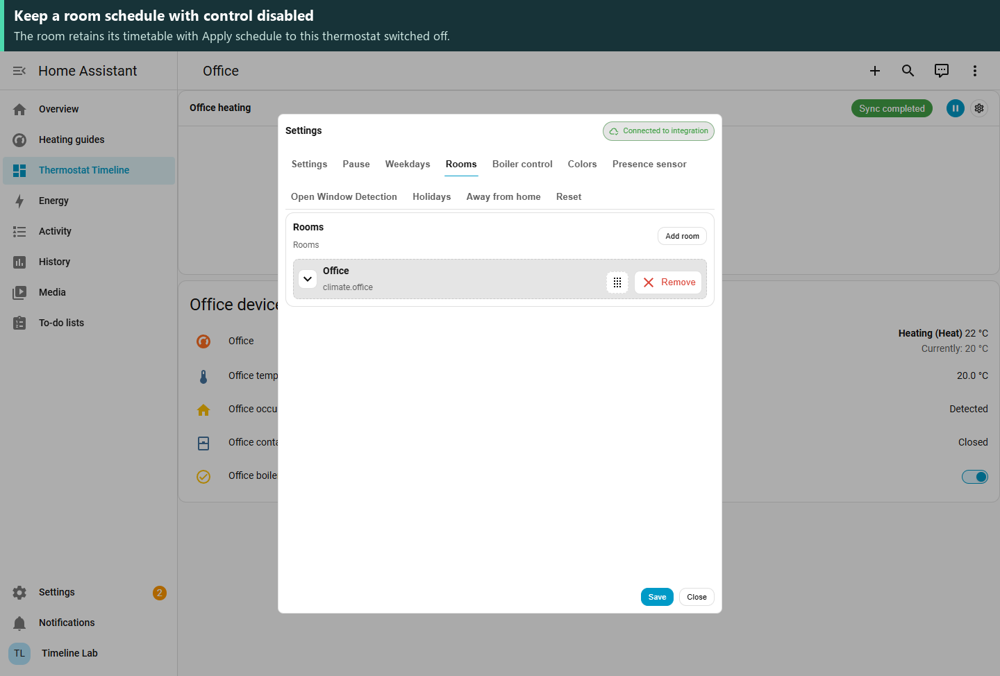](../../images/room-apply.gif)

    [Play walkthrough](../../images/room-apply.gif) | [Full-size GIF](../../images/room-apply.gif)

-   **[Hold a manual thermostat target](pause.md#hold-a-manual-thermostat-target)**

    With background control enabled, open the climate entity and raise its target.

    

    [Play walkthrough](../../images/manual-hold.gif) | [Full-size GIF](../../images/manual-hold.gif)

-   **[Pause and resume a room](pause.md#pause-one-room-for-an-hour)**

    Set a timed hold, read its countdown and resume the room.

    [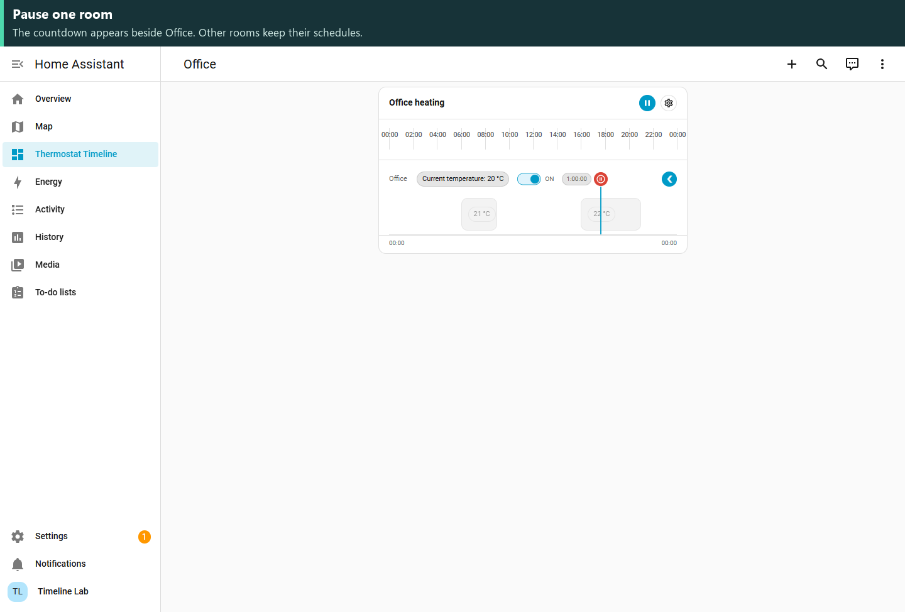](../../images/room-pause.gif)

    [Play walkthrough](../../images/room-pause.gif) | [Full-size GIF](../../images/room-pause.gif)

-   **[Global pause](pause.md#pause-every-room-with-one-control)**

    Suspend every room schedule with the pause button in the header.

    [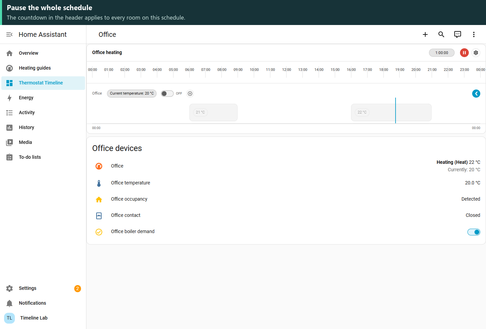](../../images/global-pause.gif)

    [Play walkthrough](../../images/global-pause.gif) | [Full-size GIF](../../images/global-pause.gif)

-   **[Pause from a binary sensor](pause.md#pause-automatically-from-a-sensor)**

    Suspend scheduled commands across rooms while an external control is on.

    [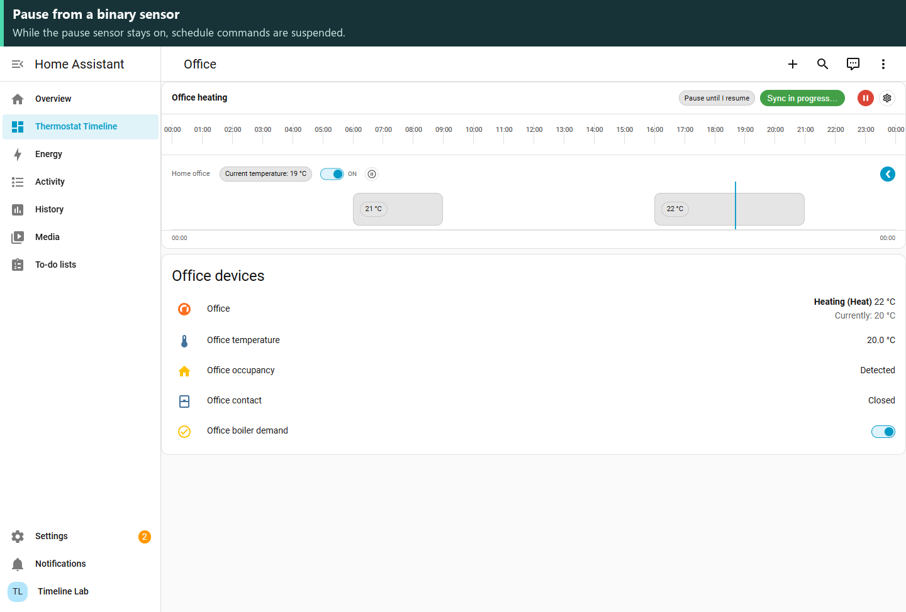](../../images/pause-sensor.gif)

    [Play walkthrough](../../images/pause-sensor.gif) | [Full-size GIF](../../images/pause-sensor.gif)

-   **[Pause and resume from an automation](pause.md#pause-and-resume-from-an-automation)**

    Choose **Thermostat Timeline: Pause schedule** in an automation and select the primary room entity.

    [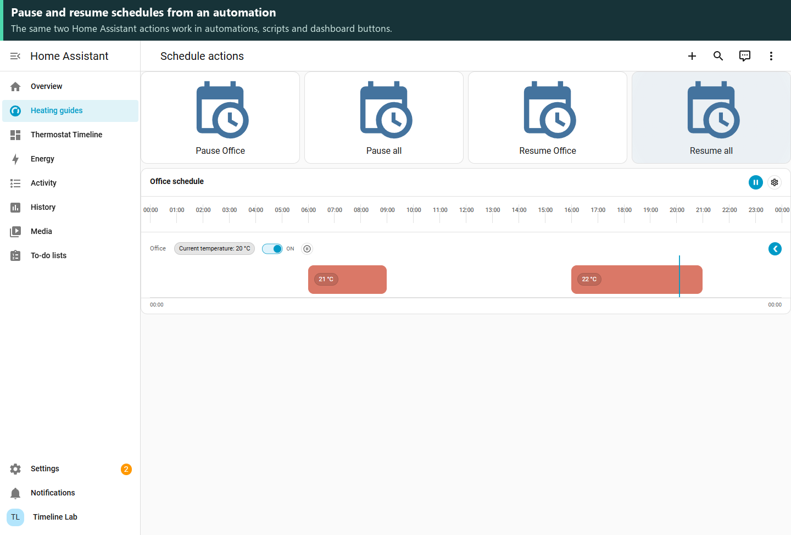](../../images/automation-pause.gif)

    [Play walkthrough](../../images/automation-pause.gif) | [Full-size GIF](../../images/automation-pause.gif)

-   **[Pause the timeline with an alarm](pause.md#pause-the-timeline-with-an-alarm)**

    Select an alarm and the states that should pause the schedule.

    [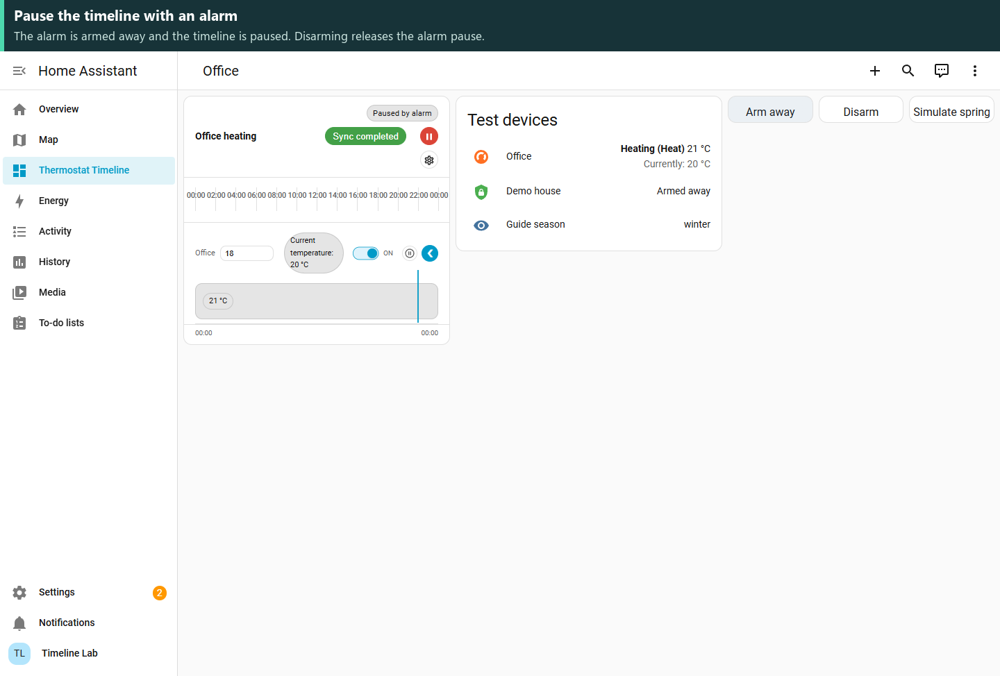](../../images/alarm-pause.gif)

    [Play walkthrough](../../images/alarm-pause.gif) | [Full-size GIF](../../images/alarm-pause.gif)

-   **[Pause a room with a switch](pause.md#pause-a-room-with-a-switch)**

    Let a guest switch pause selected rooms.

    

    [Play walkthrough](../../images/room-pause-control.gif) | [Full-size GIF](../../images/room-pause-control.gif)

-   **[Receive pause and resume notifications](notifications.md#pause-and-resume)**

    Choose which schedule changes send a message and where it goes.

    

    [Play walkthrough](../../images/pause-notifications.gif) | [Full-size GIF](../../images/pause-notifications.gif)

## Weekdays, profiles and holidays

-   **[Weekdays and weekends](weekdays.md)**

    Compare a later Saturday start with the working week.

    

    [Play walkthrough](../../images/weekdays.gif) | [Full-size GIF](../../images/weekdays.gif)

-   **[Named profiles](profiles.md)**

    Activate a working-from-home plan and see its daytime block.

    

    [Play walkthrough](../../images/profile.gif) | [Full-size GIF](../../images/profile.gif)

-   **[Summer and winter](seasonal.md)**

    Switch between independently editable seasonal plans.

    

    [Play walkthrough](../../images/season.gif) | [Full-size GIF](../../images/season.gif)

-   **[Holidays](holidays.md)**

    Select the dates, then build the timetable those dates use.

    

    [Play walkthrough](../../images/holidays.gif) | [Full-size GIF](../../images/holidays.gif)

-   **[Follow a holiday calendar](holidays.md#follow-a-holiday-calendar)**

    Use **Settings > Holidays > Calendar** and select a dedicated holiday calendar.

    [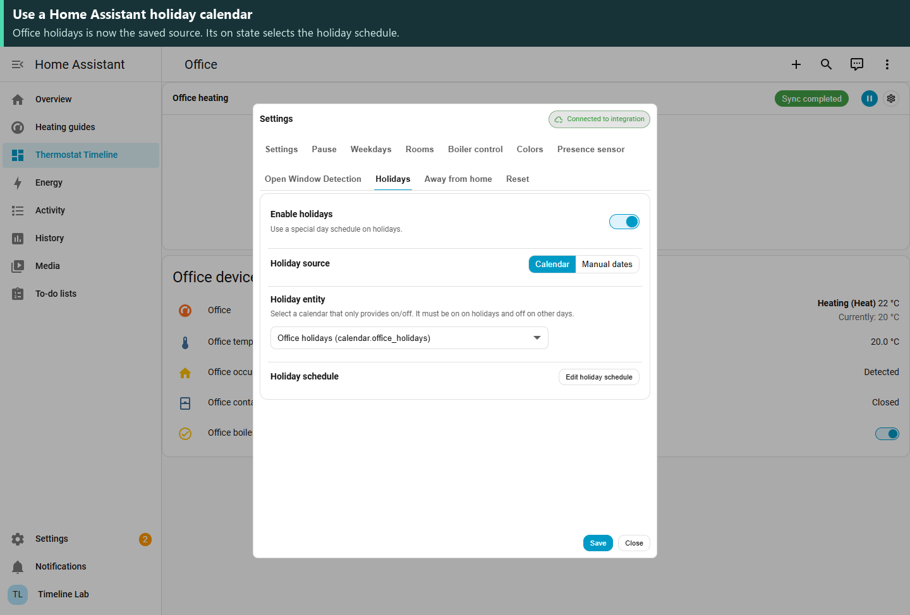](../../images/calendar.gif)

    [Play walkthrough](../../images/calendar.gif) | [Full-size GIF](../../images/calendar.gif)

-   **[Holiday date ranges](holidays.md#schedule-a-range-of-dates)**

    Use a holiday plan on several consecutive days.

    [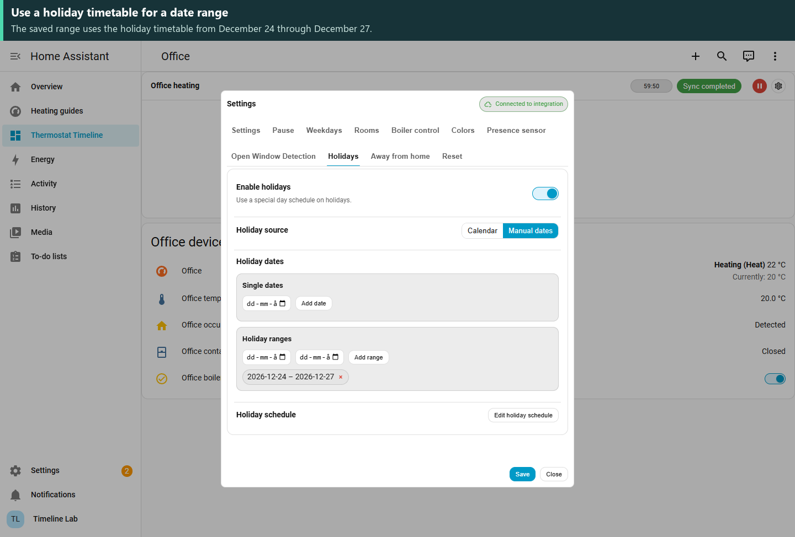](../../images/holiday-range.gif)

    [Play walkthrough](../../images/holiday-range.gif) | [Full-size GIF](../../images/holiday-range.gif)

-   **[Confirm a manual season change](seasonal.md#confirm-a-manual-season-change)**

    Review the seasonal sources, keep the current plan or confirm the switch.

    [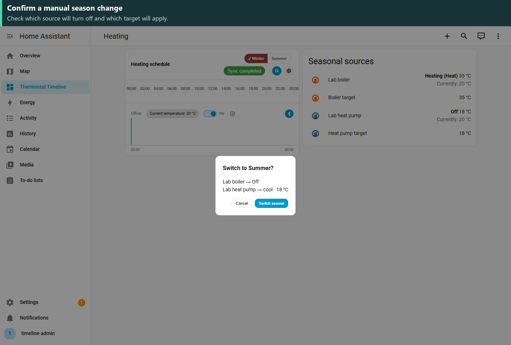](../../images/season-confirm.gif)

    [Play walkthrough](../../images/season-confirm.gif) | [Full-size GIF](../../images/season-confirm.gif)

-   **[Follow a season sensor](seasonal.md#follow-a-season-sensor)**

    Choose which schedule to use in spring and autumn.

    [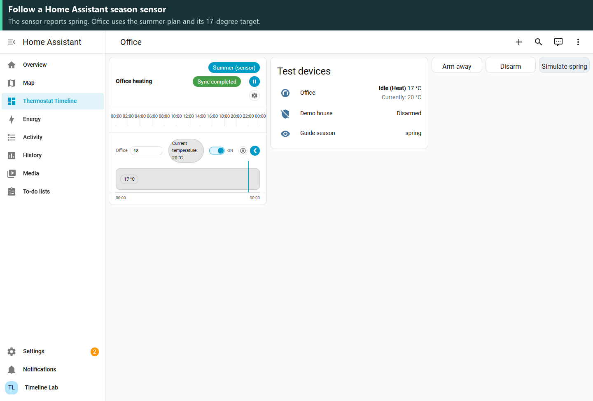](../../images/season-sensor.gif)

    [Play walkthrough](../../images/season-sensor.gif) | [Full-size GIF](../../images/season-sensor.gif)

-   **[Choose a plan with Workday sensors](weekdays.md#choose-a-plan-with-workday-sensors)**

    Select a room timetable using today's and tomorrow's work status.

    [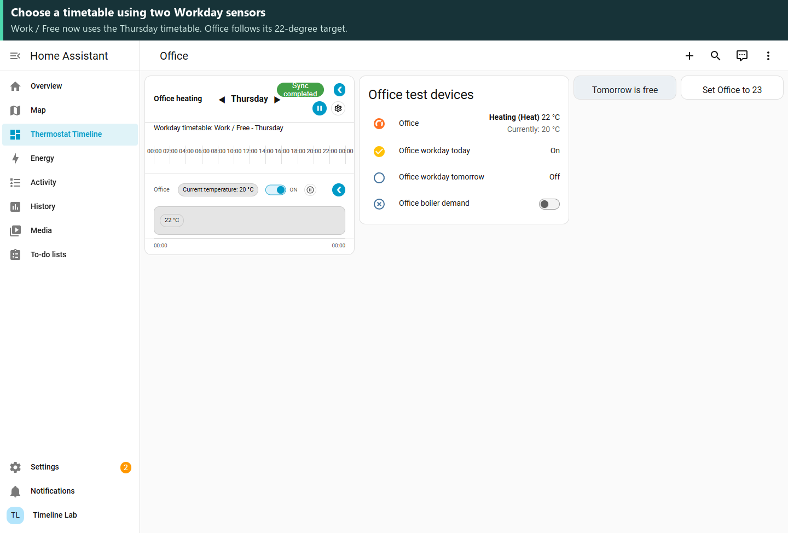](../../images/workday-plans.gif)

    [Play walkthrough](../../images/workday-plans.gif) | [Full-size GIF](../../images/workday-plans.gif)

-   **[Switch a thermostat off in summer](seasonal.md#switch-a-thermostat-off-in-summer)**

    Keep selected thermostats off while other rooms follow their summer plans.

    

    [Play walkthrough](../../images/summer-off.gif) | [Full-size GIF](../../images/summer-off.gif)

-   **[Wait after a seasonal source reports Off](seasonal.md#wait-after-a-seasonal-source-reports-off)**

    Choose how many minutes the previous source must stay off before the next one starts.

    [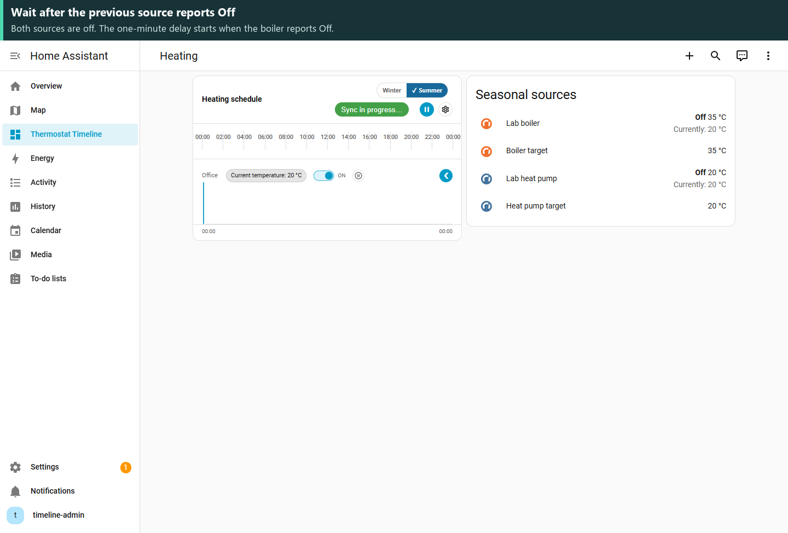](../../images/season-off-delay.gif)

    [Play walkthrough](../../images/season-off-delay.gif) | [Full-size GIF](../../images/season-off-delay.gif)

-   **[Switch heating and cooling sources by season](seasonal.md#switch-heating-and-cooling-sources-by-season)**

    Select a boiler or heat pump for each season and wait for the previous source to report Off.

    [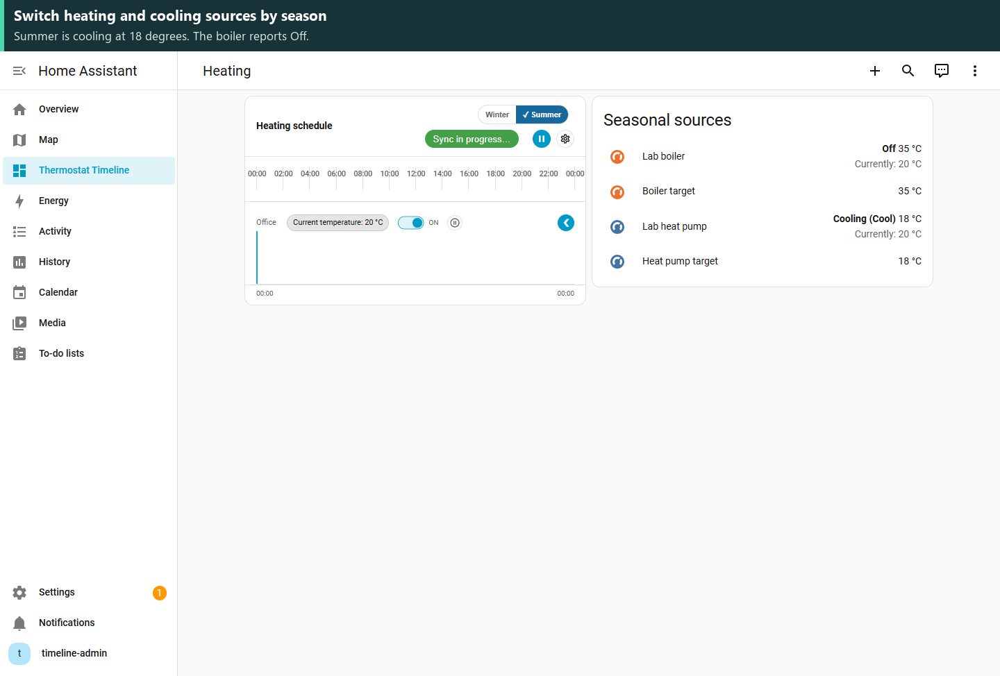](../../images/seasonal-sources.gif)

    [Play walkthrough](../../images/seasonal-sources.gif) | [Full-size GIF](../../images/seasonal-sources.gif)

-   **[Set departure and return times for a trip](holidays.md#set-departure-and-return-times-for-a-trip)**

    Switch to the holiday timetable at departure and resume the normal schedule at the return time.

    [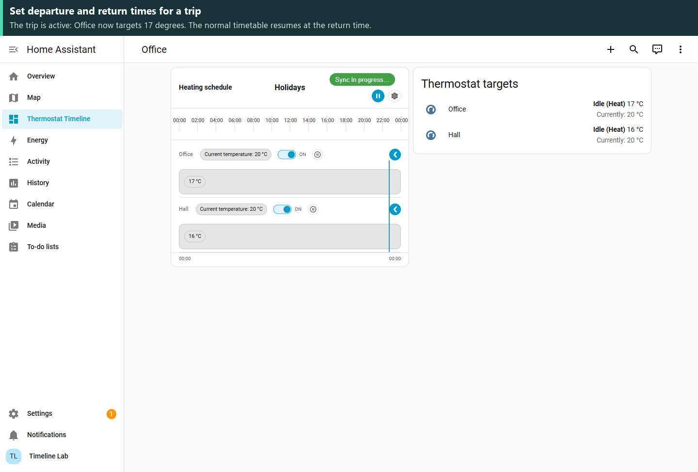](../../images/holiday-trip.gif)

    [Play walkthrough](../../images/holiday-trip.gif) | [Full-size GIF](../../images/holiday-trip.gif)

## Presence and Away

-   **[Room occupancy](presence-away.md#heat-an-occupied-room)**

    Detect an occupied office and raise its thermostat target.

    

    [Play walkthrough](../../images/occupancy.gif) | [Full-size GIF](../../images/occupancy.gif)

-   **[Occupancy delays](presence-away.md#use-different-entry-and-exit-delays)**

    Set separate waits for entering and leaving a room.

    

    [Play walkthrough](../../images/arrival-delay.gif) | [Full-size GIF](../../images/arrival-delay.gif)

-   **[Away mode](presence-away.md#lower-the-target-when-everyone-leaves)**

    Lower the target after the last selected resident leaves.

    

    [Play walkthrough](../../images/away.gif) | [Full-size GIF](../../images/away.gif)

-   **[Temporarily bypass Away](presence-away.md#temporarily-bypass-away)**

    When Away is active, choose **Resume schedule** in the header to return to the scheduled target.

    [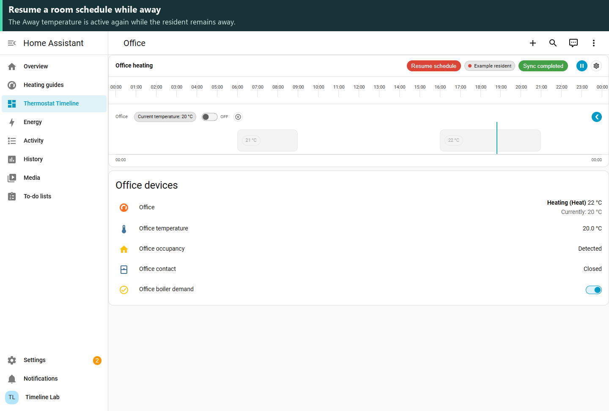](../../images/away-bypass.gif)

    [Play walkthrough](../../images/away-bypass.gif) | [Full-size GIF](../../images/away-bypass.gif)

-   **[Household combinations](presence-away.md#plan-for-combinations-of-residents)**

    Give different combinations of residents their own timetables.

    

    [Play walkthrough](../../images/presence-combinations.gif) | [Full-size GIF](../../images/presence-combinations.gif)

-   **[Set a room-specific Away target](presence-away.md#set-a-room-specific-away-target)**

    In the Away settings, enable **Use a room-specific Away target** for a room, enter its temperature and save.

    [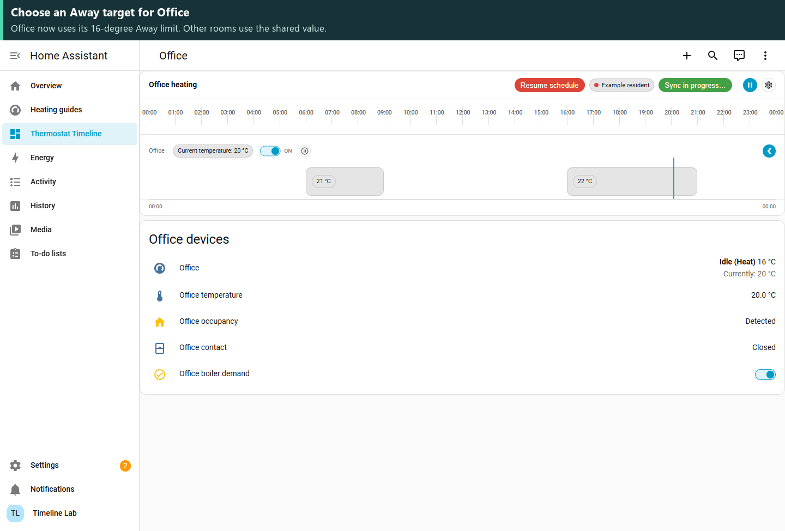](../../images/away-room-limit.gif)

    [Play walkthrough](../../images/away-room-limit.gif) | [Full-size GIF](../../images/away-room-limit.gif)

-   **[Increase the scheduled target when occupied](presence-away.md#increase-the-scheduled-target-when-occupied)**

    In **Settings > Presence sensor**, assign a sensor and enable **Increase the scheduled target when occupied** for that room.

    

    [Play walkthrough](../../images/occupied-offset.gif) | [Full-size GIF](../../images/occupied-offset.gif)

-   **[Use an economy temperature when a room is empty](presence-away.md#use-an-economy-temperature-when-a-room-is-empty)**

    Set a per-room difference for heating or cooling after the occupancy sensor clears.

    [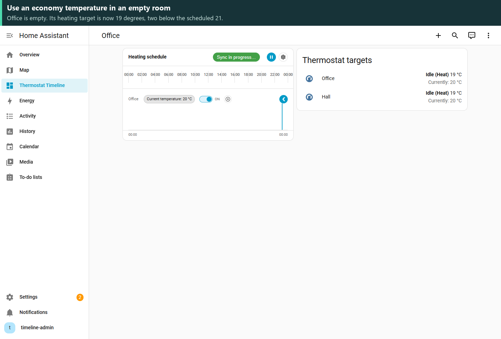](../../images/vacancy-economy.gif)

    [Play walkthrough](../../images/vacancy-economy.gif) | [Full-size GIF](../../images/vacancy-economy.gif)

-   **[Follow a person in one or more rooms](presence-away.md#follow-a-person-in-one-or-more-rooms)**

    Link rooms to a resident and see their thermostat targets change on departure and return.

    [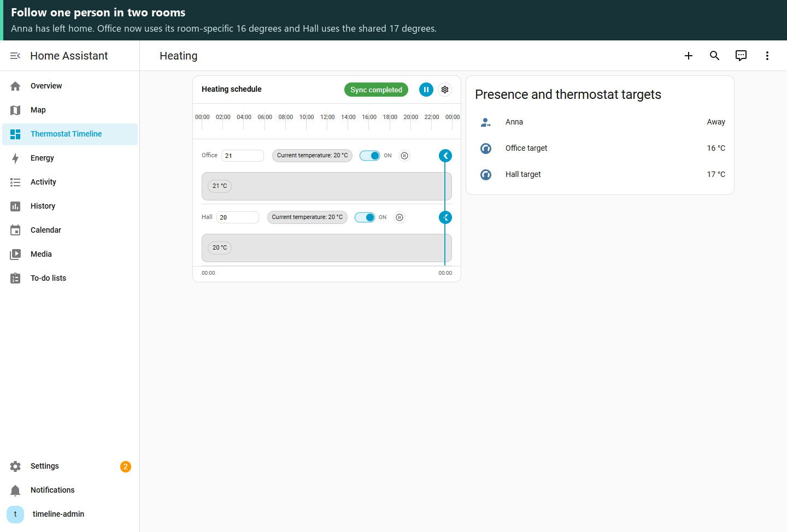](../../images/follow-person.gif)

    [Play walkthrough](../../images/follow-person.gif) | [Full-size GIF](../../images/follow-person.gif)

## Windows and boiler control

-   **[Open windows](open-window.md)**

    Follow a contact opening and see the thermostat switch off.

    

    [Play walkthrough](../../images/window.gif) | [Full-size GIF](../../images/window.gif)

-   **[Boiler demand](boiler.md)**

    Compare the room reading, target and boiler relay state.

    

    [Play walkthrough](../../images/boiler.gif) | [Full-size GIF](../../images/boiler.gif)

-   **[Boiler switching thresholds](boiler.md#tune-the-switching-thresholds)**

    Keep a gap between switching the relay on and off.

    

    [Play walkthrough](../../images/boiler-offsets.gif) | [Full-size GIF](../../images/boiler-offsets.gif)

-   **[Multiple boilers](boiler.md#assign-rooms-to-different-boilers)**

    Assign each room to its own relay.

    

    [Play walkthrough](../../images/multi-boiler.gif) | [Full-size GIF](../../images/multi-boiler.gif)

-   **[Use a manual thermostat target for boiler demand](boiler.md#use-a-manual-thermostat-target-for-boiler-demand)**

    Let a temporary room target call for heat until the next schedule boundary.

    

    [Play walkthrough](../../images/boiler-manual.gif) | [Full-size GIF](../../images/boiler-manual.gif)

## Shared schedules and backups

-   **[Shared storage and background control](storage.md#share-schedules-between-dashboards)**

    Run one schedule across multiple dashboards.

    

    [Play walkthrough](../../images/shared-store.gif) | [Full-size GIF](../../images/shared-store.gif)

-   **[Storage, sync and instances](storage.md)**

    Share one plan across dashboards or select a separate instance.

    

    [Play walkthrough](../../images/instance.gif) | [Full-size GIF](../../images/instance.gif)

-   **[Transfer a browser plan](storage.md#transfer-a-browser-schedule-to-shared-storage)**

    Move an existing local schedule into the shared store.

    [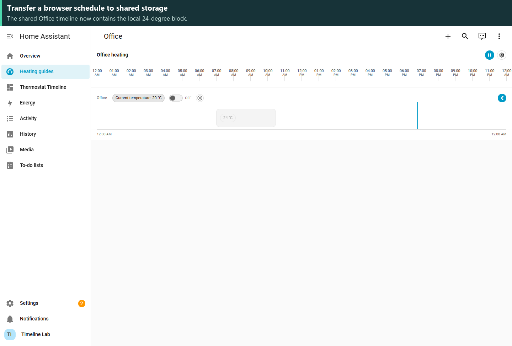](../../images/transfer.gif)

    [Play walkthrough](../../images/transfer.gif) | [Full-size GIF](../../images/transfer.gif)

-   **[Create a full backup slot](storage.md#create-a-full-backup-slot)**

    Edit the dashboard card, open **Backup**, choose **New backup** and select **Backup now**.

    

    [Play walkthrough](../../images/backup-action.gif) | [Full-size GIF](../../images/backup-action.gif)

-   **[Automatic backups](storage.md#schedule-recurring-backups)**

    Set a recurring interval in days.

    

    [Play walkthrough](../../images/auto-backup.gif) | [Full-size GIF](../../images/auto-backup.gif)

-   **[Backups and restore](storage.md#save-and-restore-a-backup)**

    Restore a saved slot and see the missing block return.

    

    [Play walkthrough](../../images/restored.gif) | [Full-size GIF](../../images/restored.gif)

-   **[Move backup slots between installations](storage.md#export-and-import-backup-slots)**

    Export, import and choose when to restore.

    

    [Play walkthrough](../../images/backup-file.gif) | [Full-size GIF](../../images/backup-file.gif)

## Fan, climate and presence profiles

-   **[Schedule a fan speed](room-air.md#schedule-fan-speed)**

    Set a room default and override it for one timeline block.

    [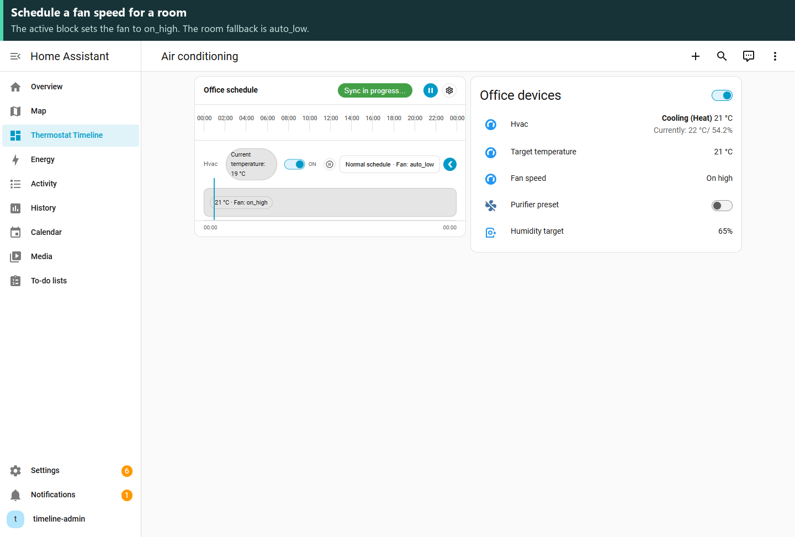](../../images/room-fan-block.gif)

    [Play walkthrough](../../images/room-fan-block.gif) | [Full-size GIF](../../images/room-fan-block.gif)

-   **[Smart Fan and quiet hours](room-air.md#smart-fan-and-quiet-hours)**

    Choose speeds for temperature targets, heating or cooling gaps and nighttime.

    [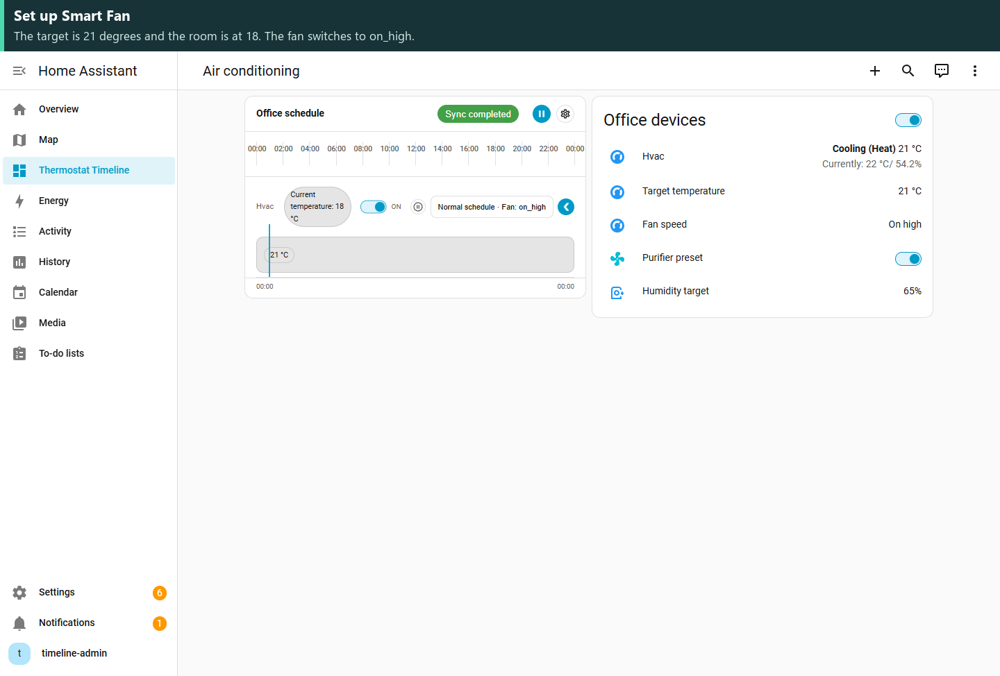](../../images/smart-room-fan.gif)

    [Play walkthrough](../../images/smart-room-fan.gif) | [Full-size GIF](../../images/smart-room-fan.gif)

-   **[Seasonal heat, cool and automatic off](room-air.md#seasonal-modes-and-off-at-target)**

    Control the HVAC mode, target tolerance and restart gap.

    [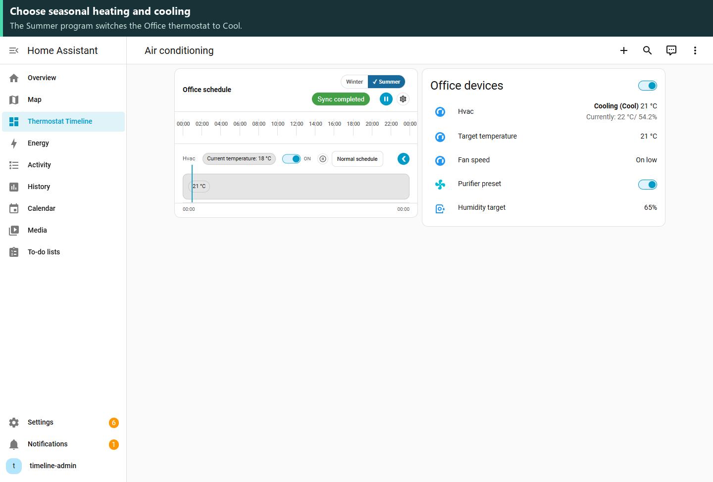](../../images/room-climate-season.gif)

    [Play walkthrough](../../images/room-climate-season.gif) | [Full-size GIF](../../images/room-climate-season.gif)

-   **[Comfort and economy](room-air.md#comfort-and-economy)**

    Adjust the current block based on occupancy, temperature limits and the alarm.

    [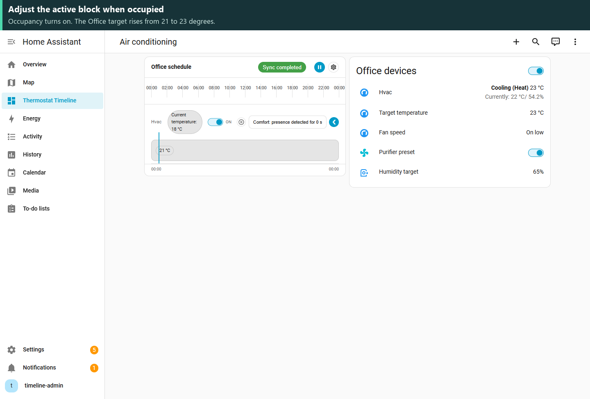](../../images/room-presence-comfort.gif)

    [Play walkthrough](../../images/room-presence-comfort.gif) | [Full-size GIF](../../images/room-presence-comfort.gif)

-   **[Sensor-controlled air treatment](room-air.md#start-air-treatment-from-sensor-readings)**

    Start and stop room devices using separate thresholds for humidity or PM2.5.

    [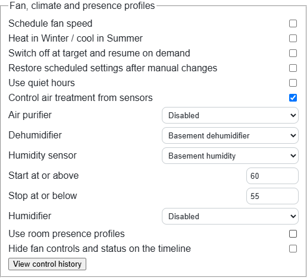](../../images/sensor-air-treatment.gif)

    [Play walkthrough](../../images/sensor-air-treatment.gif) | [Full-size GIF](../../images/sensor-air-treatment.gif)

-   **[Air treatment and seasonal notifications](notifications.md#air-treatment-and-seasonal-changes)**

    Send a message when a device confirms a change or the active season switches.

    [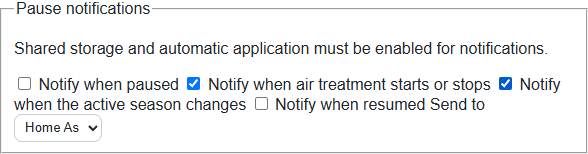](../../images/air-season-notifications.gif)

    [Play walkthrough](../../images/air-season-notifications.gif) | [Full-size GIF](../../images/air-season-notifications.gif)

-   **[Occupied air treatment](room-air.md#purifiers-and-humidity)**

    Choose purifier speeds and humidity targets for each room profile.

    [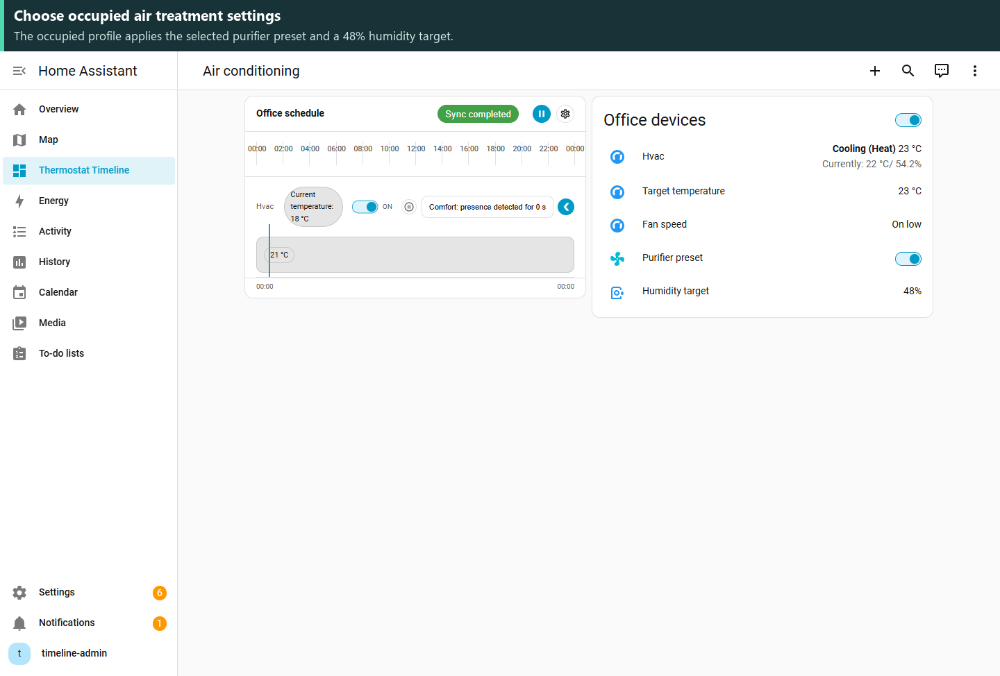](../../images/room-air-treatment.gif)

    [Play walkthrough](../../images/room-air-treatment.gif) | [Full-size GIF](../../images/room-air-treatment.gif)

-   **[Profiles and control history](room-air.md#profiles-and-control-history)**

    See when the room changed profile and why.

    

    [Play walkthrough](../../images/room-air-history.gif) | [Full-size GIF](../../images/room-air-history.gif)

## Automation and diagnostics

- **[Integration actions](../../integration/services.md)** to manage schedules from an automation.
- **[HTTP API](../../integration/api.md)** for stored configuration and version counters.
