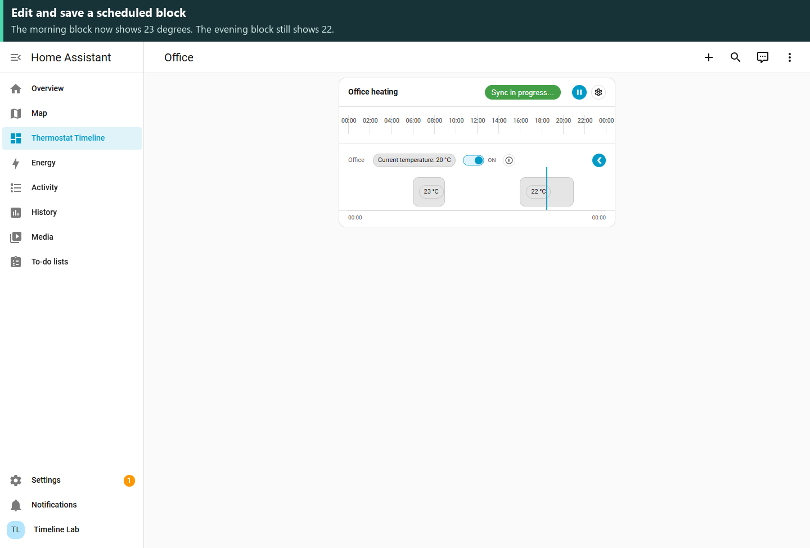
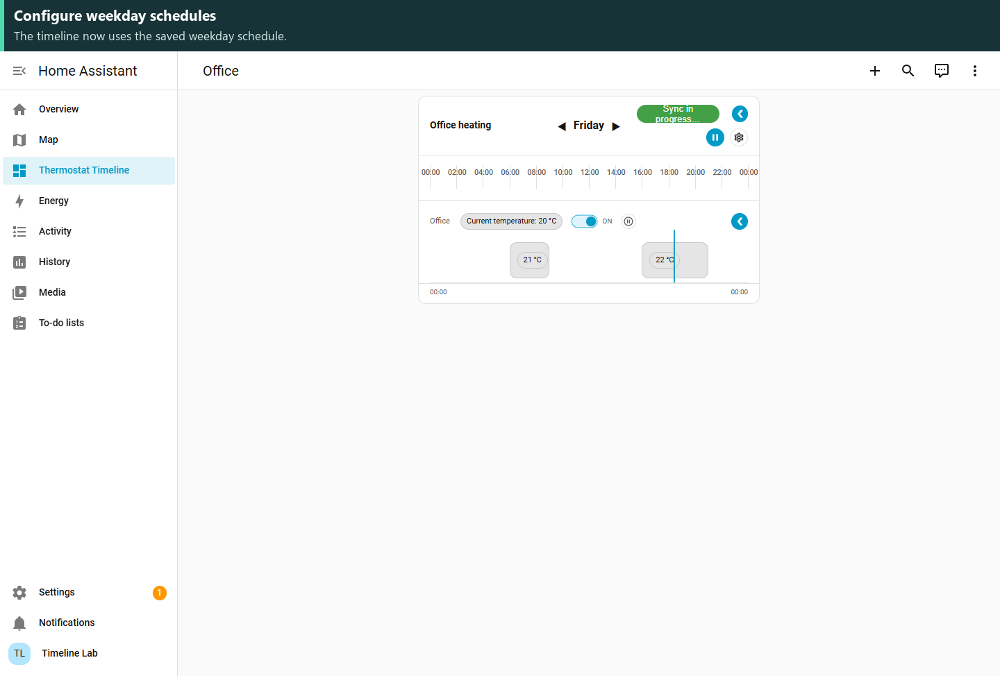
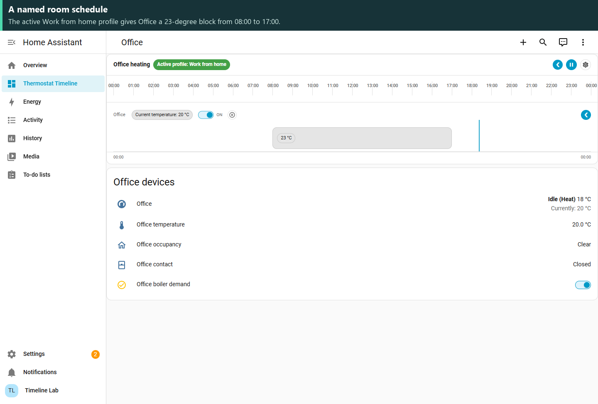
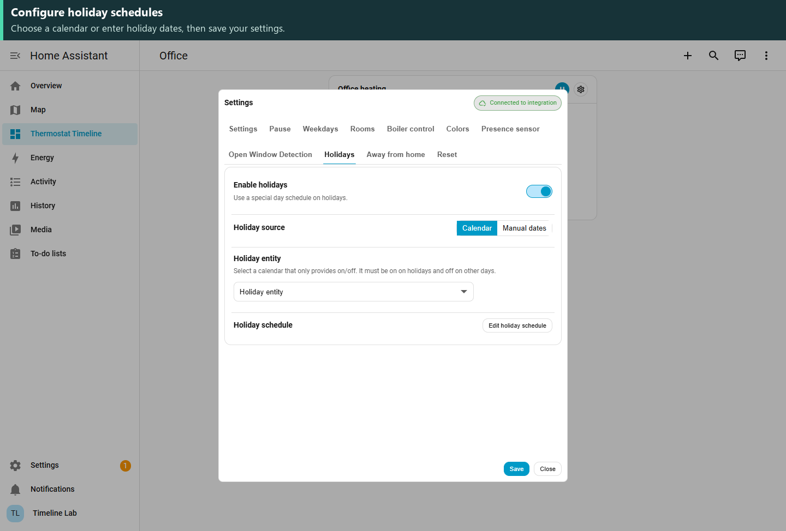
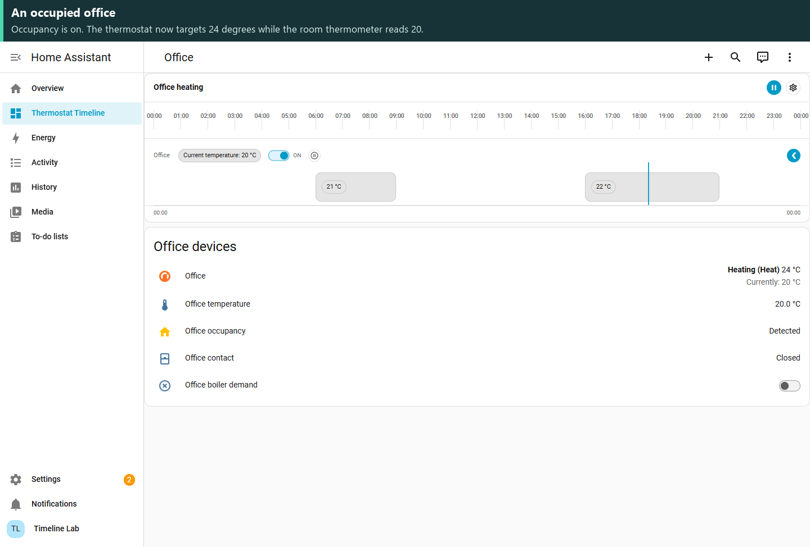
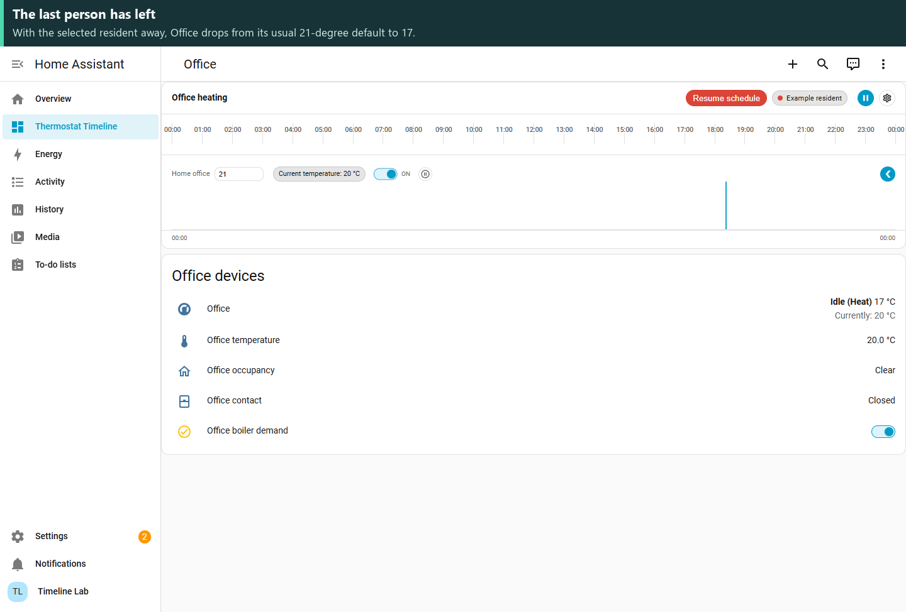
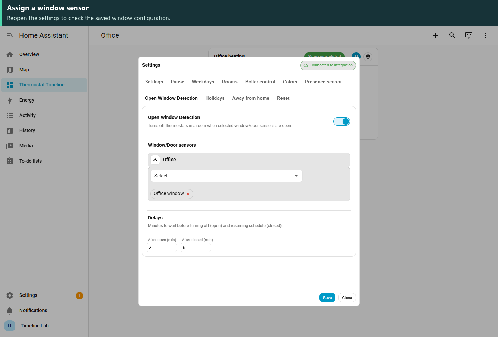
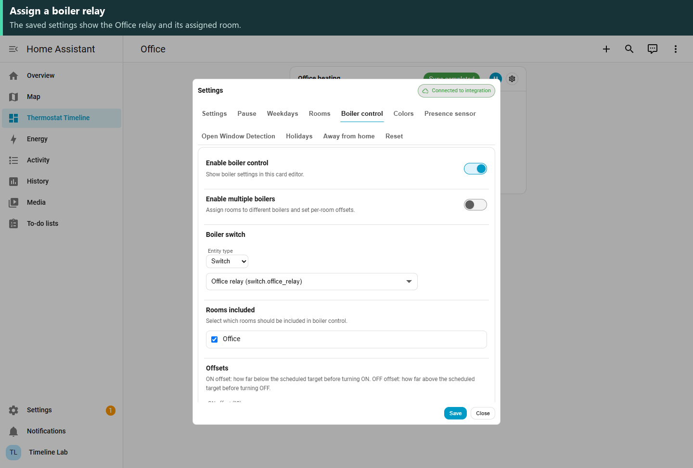

# Feature guides

Choose what you want your heating to do. Open a guide for the setup steps and the result to look for in Home Assistant. Choose **Play walkthrough** on an animated example, or click its still image. Click again to return to the still. Feature titles open the full guide.

## Planning a room

-   **[Timeline blocks](../../getting-started/quick-start.md#edit-a-scheduled-block)**

    Change the morning block from 21 to 23 degrees and save it.

    

    [Play walkthrough](../../images/edit-block.gif) | [Full-size GIF](../../images/edit-block.gif)

-   **[Room defaults and auto-apply](rooms.md#defaults-and-automatic-control)**

    Set the temperature between blocks and keep the schedule running with the dashboard closed.

-   **[Room labels and measurements](rooms.md#room-labels-and-external-thermometers)**

    Read the room thermometer beside its scheduled targets.

    

-   **[Merged thermostats](rooms.md#merged-radiators-and-power-commands)**

    Use one row to send the same target to several radiators and choose when to power them on.

-   **[Number helpers](rooms.md#schedule-a-number-helper)**

    Write a scheduled value to a helper for another automation to use.

    

-   **[Temperature colors](colors.md)**

    Identify warmer and cooler periods by their colors.

    

## Choosing which plan runs

-   **[Weekdays and weekends](weekdays.md)**

    Compare a later Saturday start with the working week.

    

    [Play walkthrough](../../images/weekdays.gif) | [Full-size GIF](../../images/weekdays.gif)

-   **[Named profiles](profiles.md)**

    Activate a working-from-home plan and see its daytime block.

    

-   **[Holidays](holidays.md)**

    Select the dates, then build the timetable those dates use.

    

    [Play walkthrough](../../images/holidays.gif) | [Full-size GIF](../../images/holidays.gif)

-   **[Summer and winter](seasonal.md)**

    Switch between independently editable seasonal plans.

    

    [Play walkthrough](../../images/season.gif) | [Full-size GIF](../../images/season.gif)

## Responding to people and devices

-   **[Room occupancy](presence-away.md#heat-an-occupied-room)**

    Detect an occupied office and raise its thermostat target.

    

-   **[Away mode](presence-away.md#lower-the-target-when-everyone-leaves)**

    Lower the target after the last selected resident leaves.

    

-   **[Open windows](open-window.md)**

    Follow a contact opening and see the thermostat switch off.

    

    [Play walkthrough](../../images/window.gif) | [Full-size GIF](../../images/window.gif)

-   **[Boiler demand](boiler.md)**

    Compare the room reading, target and boiler relay state.

    

    [Play walkthrough](../../images/boiler.gif) | [Full-size GIF](../../images/boiler.gif)

## Overrides and shared settings

-   **[Pause and resume a room](pause.md#pause-one-room-for-an-hour)**

    Set a timed hold, read its countdown and resume the room.

    

    [Play walkthrough](../../images/room-pause.gif) | [Full-size GIF](../../images/room-pause.gif)

-   **[Manual targets and global pause](pause.md)**

    Keep a manual target until the next boundary or suspend all rooms with one button or sensor.

-   **[Backups and restore](storage.md#save-and-restore-a-backup)**

    Restore a saved slot and see the missing block return.

    

-   **[Storage, sync and instances](storage.md)**

    Share one plan across dashboards or select a separate instance.

-   **[Clock, units and language](rooms.md#time-units-and-language)**

    Choose how the card displays time, temperatures and labels.

