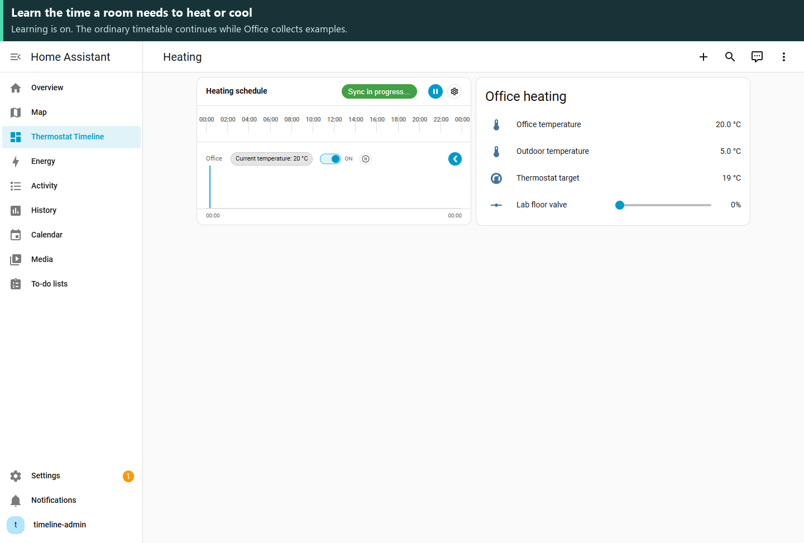
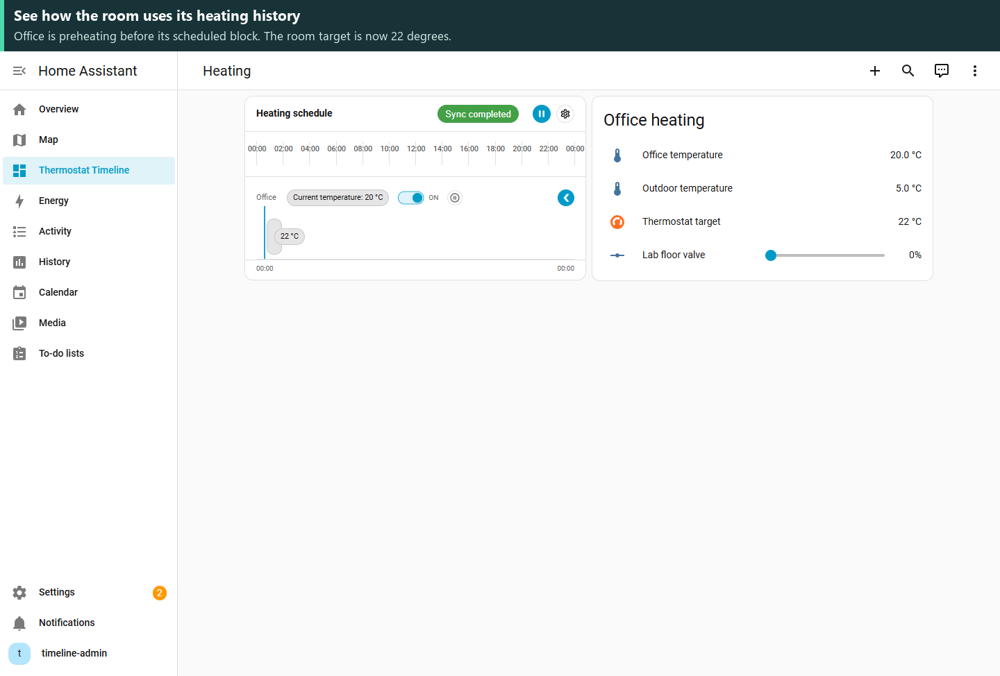
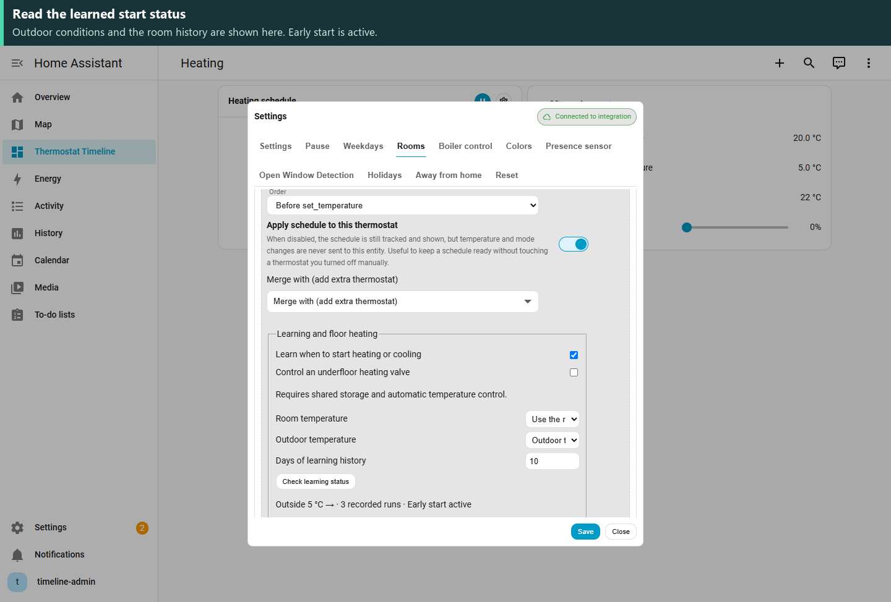
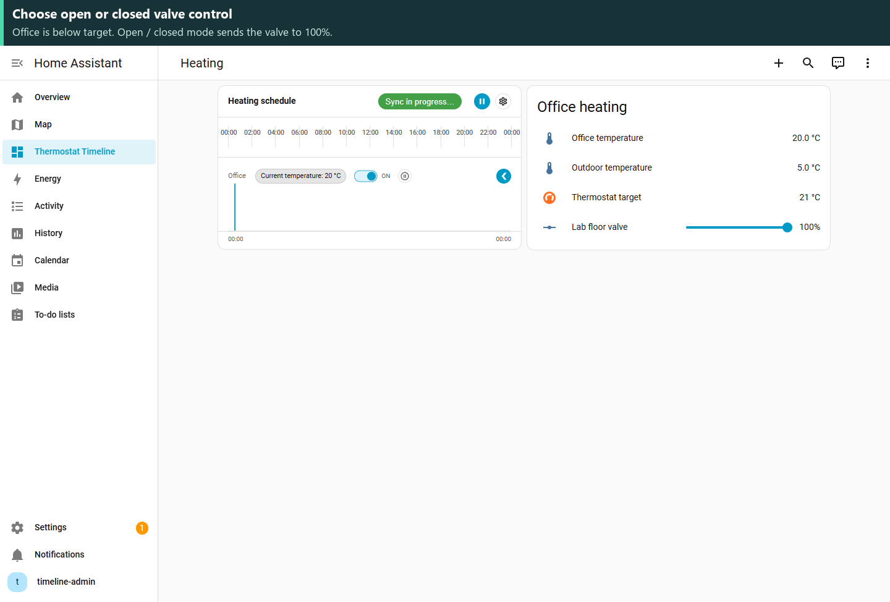
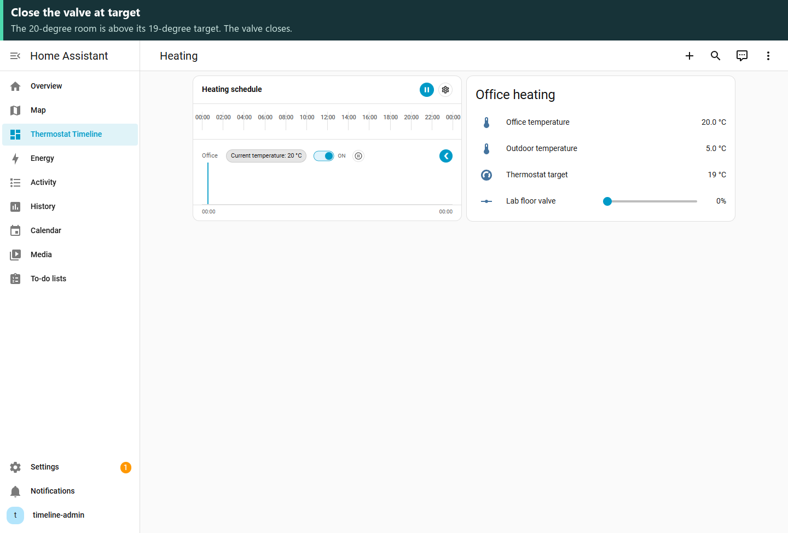

# Learned starts and underfloor valves

## Learn when to start heating or cooling

If a block starts at 07:00 and asks for 21 °C, a learned start can apply 21 °C before 07:00 so the room has time to reach it. The block keeps its original start and end times. Each room learns separately. Both room features on this page are off by default and require shared storage and automatic temperature control.

1. Open the card settings, choose **Rooms**, and expand the climate room you want to use.
2. Under **Learning and floor heating**, enable **Learn when to start heating or cooling**. Use the room's temperature reading or select a separate indoor temperature sensor.
3. Choose **Outdoor temperature** from a temperature sensor or weather entity. For a weather entity, Timeline reads its current temperature.
4. Set **Days of learning history** and save. The default is **7**. For example, with 10 selected the integration retains the last 10 days of completed runs and discards older ones. A shorter setting also trims existing history.

[Play setup walkthrough](../../images/learn-room.gif) | [Full-size GIF](../../images/learn-room.gif)

### Where learning data lives

Home Assistant reads and writes `/config/.storage/thermostat_timeline.thermal_history`. Each Timeline instance and room has its own records in this file. Completed runs contain timestamps, indoor and outdoor temperatures in Celsius, target, duration and observed minutes per degree. The integration also checkpoints a run in progress. After a restart, it reloads the file and discards an interrupted run if there is a measurement gap longer than two minutes. Completed runs survive restarts.

To read a room's data while Home Assistant is running, request `GET /api/thermostat_timeline/state?thermal_room=climate.office` with Home Assistant authentication. The `thermal_history` field contains `completed` and `in_progress`. Add `instance_id` to read another Timeline instance. Home Assistant handles file updates; include the file in your Home Assistant configuration backup.

### How the start time is learned

The integration observes changes in measured room temperature while the thermostat is heating or cooling toward a stable target. If the thermostat omits its heating/cooling activity attribute, Timeline uses the selected mode, setpoint and measured progress. A run needs at least three minutes and 0.3 °C of progress to count. Heat and cool runs are tracked independently. Until a room has three usable runs in the current mode, it follows its ordinary timetable. Turning learning off stops collection. Existing runs remain available until they age out within the selected window.

For the next block in today's active timetable, Timeline compares up to five past runs with similar indoor and outdoor starting temperatures. It uses their measured minutes per degree and the remaining indoor temperature difference to estimate a lead time. For example, a room warming at 15 minutes per degree would need about 30 minutes to go from 19 to 21 °C. A cold day can produce a different estimate as the room collects examples in colder weather.

The integration checks the next three hours. A predicted need must persist for one minute before an early start. It keeps the early target through to the block. A change to the timetable or an unavailable temperature source triggers a fresh evaluation. Room pauses, schedule update controls and open-window suspension still apply. Learning runs in Home Assistant with the dashboard closed.

Choose **Check learning status** in the room settings to see the outdoor temperature and trend, recorded run count and the current estimate or active early start. The example below uses three simulated heating runs. The thermostat reaches its scheduled **target setting** of 22 °C before the block begins. The measured room temperature is still 20 °C.

[Play early-start walkthrough](../../images/learned-start.gif) | [Full-size GIF](../../images/learned-start.gif)

## Control an underfloor heating valve

Use this feature for a room with a motorized valve exposed as a writable Home Assistant **number** from 0 to 100 percent. Each valve belongs to one room. A climate room uses its current thermostat setpoint in Heat mode. A room backed by an input number uses that helper as its setpoint and needs a separate indoor temperature sensor.

If the manifold only exposes valve channels, create a **Number** helper in Home Assistant for the room's target temperature. Add the helper as the room entity in the card, assign an indoor temperature sensor, and select the manifold channel as the floor valve below. Each room uses its own helper and valve.

1. Open **Settings → Rooms** and expand the room.
2. Enable **Control an underfloor heating valve**. Select the room temperature source and the valve's percentage entity.
3. Choose **Valve control** and save.

| Control | What the valve does |
| --- | --- |
| Open / closed | Opens to 100% when the room is at least 0.3 °C below target and closes at the target. Inside that band it keeps its open or closed position. |
| Proportional opening | Opens by 50 percentage points per degree below target, rounded to the device's supported step. A 0.5 °C gap gives about 25%, a 1 °C gap gives 50%, and a gap of 2 °C or more gives 100%. At or above target it closes. |

[Play valve walkthrough](../../images/floor-valve.gif) | [Full-size GIF](../../images/floor-valve.gif)

Control updates about every 30 seconds. While enabled and managing the room, Timeline requests 0% if the indoor reading is missing, the climate room switches out of Heat, or open-window detection suspends it. A paused schedule or disabled room updates suspend valve commands. Turning valve control off leaves its last position available for manual control.

### Switch to open / closed control

With the same 21 °C target and 20 °C room, switch **Valve control** to **Open / closed**. Saving changes the valve from 50% to fully open. When the target drops below the measured temperature, the valve closes.

[Play walkthrough](../../images/floor-valve-binary.gif) | [Full-size GIF](../../images/floor-valve-binary.gif)

