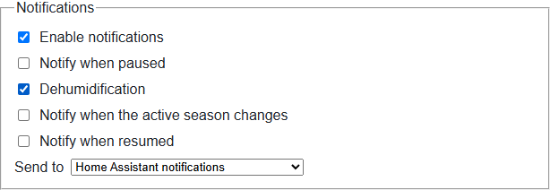
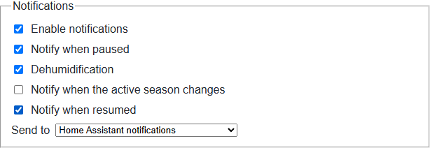

# Notifications

Open the card settings and select **Notifications**. Turn on **Enable notifications**, select the events you want, choose a destination and save. Use **Home Assistant notifications** for the built-in panel or choose a configured notification destination.

The switch requires shared storage and automatic application. Switching it off silences Timeline and hides the event and destination settings. Your selections are remembered. If you previously selected notification events, the switch starts enabled after upgrading.

## Air treatment and seasonal changes

Select **Air purification**, **Dehumidification** and **Humidification** independently. Each choice appears when at least one active room has a sensor and device configured for that function. For example, select only **Dehumidification** to receive the basement dehumidifier's start and stop messages. Leave **Notify when the active season changes** unchecked to keep seasonal switches silent. The master switch remembers these individual choices when you switch it off and on again. After a commanded transition is confirmed, the message includes the room and triggering reading. For example, the basement dehumidifier starts when its humidity sensor reports 62%. See [sensor-controlled air treatment](room-air.md#start-air-treatment-from-sensor-readings).

Enable summer/winter schedules to see the season option. With that event selected, switching from Winter to Summer sends one message. Return to **Notifications** after editing another tab to see which events are available.

[Play walkthrough](../../images/air-season-notifications.gif) | [Full-size GIF](../../images/air-season-notifications.gif)

## Pause and resume

Pause and resume events are available whenever shared automatic scheduling is active. A global pause produces one message for the instance. A room resumes when its last pause clears. Opening the dashboard during an existing pause does not send a retrospective message.

[Play walkthrough](../../images/pause-notifications.gif) | [Full-size GIF](../../images/pause-notifications.gif)
