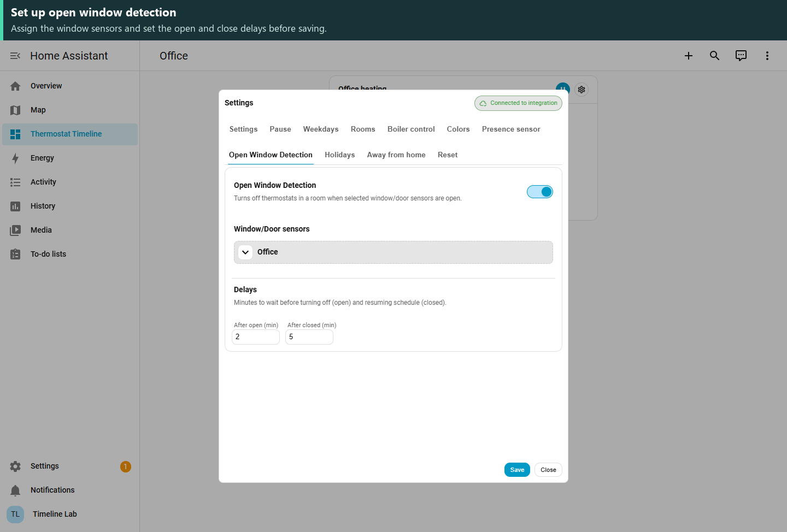

# Open Window Detection (OWD)

In the settings gear, open **Open Window Detection**. Enable it, choose a room, and assign the window or door sensors for that room. Set an opening delay long enough to ignore a briefly opened door. The closing delay lets the room settle before scheduled heating resumes.

To verify the mapping, open the assigned sensor for longer than the opening delay, then close all assigned sensors and wait for the closing delay. Use a simulated room first if the thermostat also has its own window detection.

## Set up window detection

Open **Settings > Open Window Detection** and enable the feature. Assign the contact sensor to its room and set separate opening and closing delays before saving.

[Play walkthrough](../../images/window.gif) | [Full-size GIF](../../images/window.gif)

## Settings

- open_window:
	- enabled: true/false
	- sensors: { climate.living_room: [ binary_sensor.window_living, binary_sensor.door_balcony ] }
	- open_delay_min: minutes to wait before turning off when open
	- close_delay_min: minutes to wait before resuming when closed
