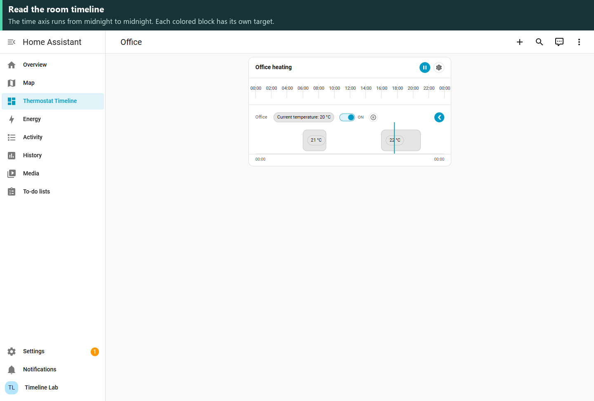
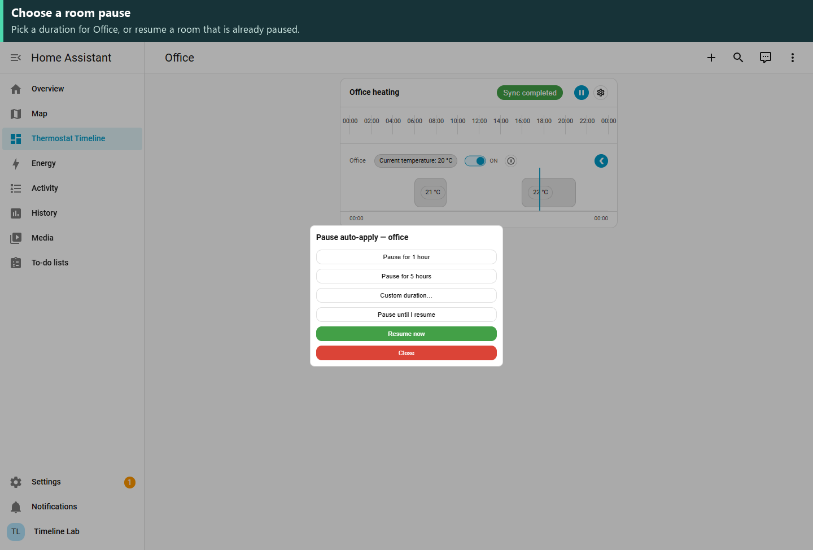
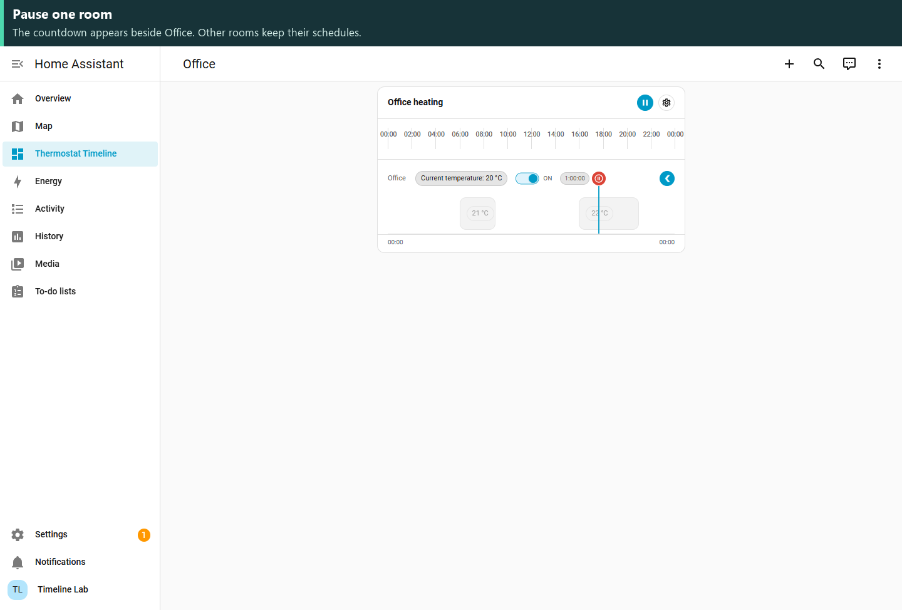
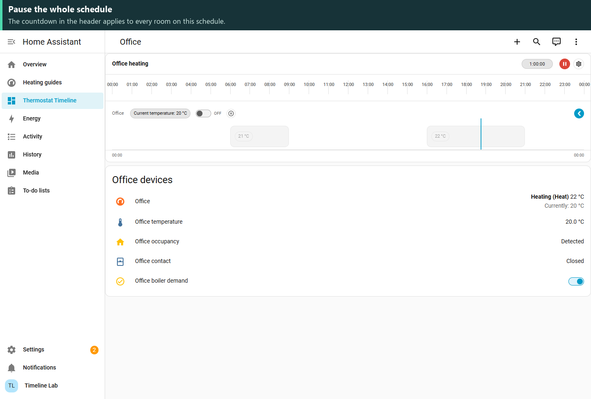
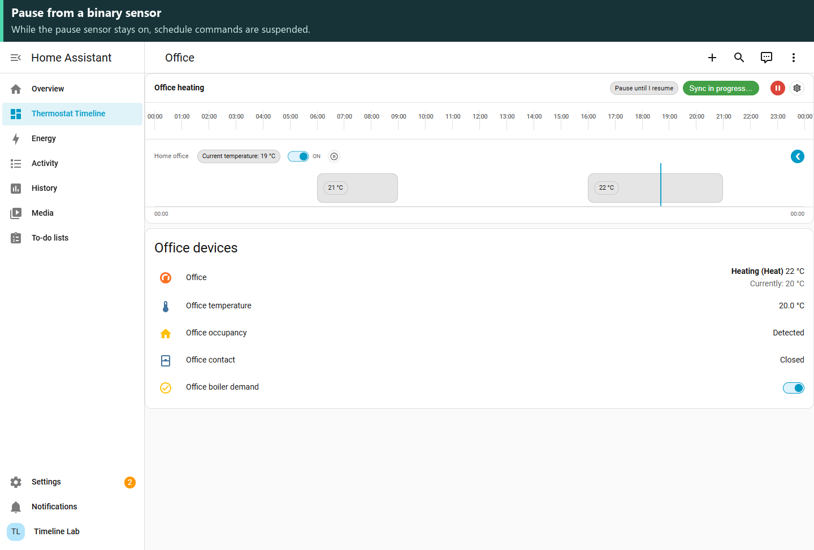

# Room pauses and manual targets

[Play walkthrough](../../images/room-pause.gif) | [Full-size GIF](../../images/room-pause.gif)

**Pause one room.** On the room row, select the small pause-circle beside the schedule toggle. Choose one hour, five hours, a custom duration or an indefinite pause. Other rooms can continue following their schedules.

[Play walkthrough](../../images/room-pause.gif) | [Full-size GIF](../../images/room-pause.gif)

**Resume a room.** Open the same room's pause menu and select resume. A global pause still applies. To pause the entire schedule, use the pause button in the header beside the settings gear.

**Adjust a thermostat manually.** With background auto-apply enabled, a detected manual change to a climate target creates a timed room pause. For example, a change from 21 to 22.5 degrees during a block lasts until the room’s next effective block start or end, or until midnight. Returning to the scheduled target cancels the generated hold. An explicit room pause takes precedence.

**After a restart.** Timeline saves the hold. The thermostat integration restores its own temperature. Opening an existing shared dashboard in v3.3.3 reads the shared schedule without saving the browser’s copy over it.

## Pause one room for an hour

Choose the pause circle on the **Office row**, then **one hour**. A countdown beside the room confirms which schedule is paused.

[Play walkthrough](../../images/room-pause.gif) | [Full-size GIF](../../images/room-pause.gif)

## Resume a paused room

Open the same room menu and choose the resume action. The room countdown disappears. Check the global pause button if the schedule still appears suspended.

[Play walkthrough](../../images/room-resume.gif) | [Full-size GIF](../../images/room-resume.gif)

## Pause every room with one control

Enable the header pause button, then select it to suspend schedule commands across rooms. For an external control, enable the pause sensor and choose a binary sensor that stays on throughout the pause. When the global pause clears, rooms without a separate hold can follow their schedules again. Pausing leaves each thermostat at its current setting.

[Play walkthrough](../../images/global-pause.gif) | [Full-size GIF](../../images/global-pause.gif)

## Pause automatically from a sensor

Enable the external pause sensor in **Settings > Pause**. Select a binary sensor and save. While it is on, Timeline suspends its schedule commands. When it clears, a room with its own manual hold can remain paused.

[Play walkthrough](../../images/pause-sensor.gif) | [Full-size GIF](../../images/pause-sensor.gif)

## Hold a manual thermostat target

With background control enabled, open the climate entity and raise its target. Close the thermostat dialog. Reloading the dashboard shows the saved room hold. Its countdown runs to the next effective schedule boundary.

[Play walkthrough](../../images/manual-hold.gif) | [Full-size GIF](../../images/manual-hold.gif)
