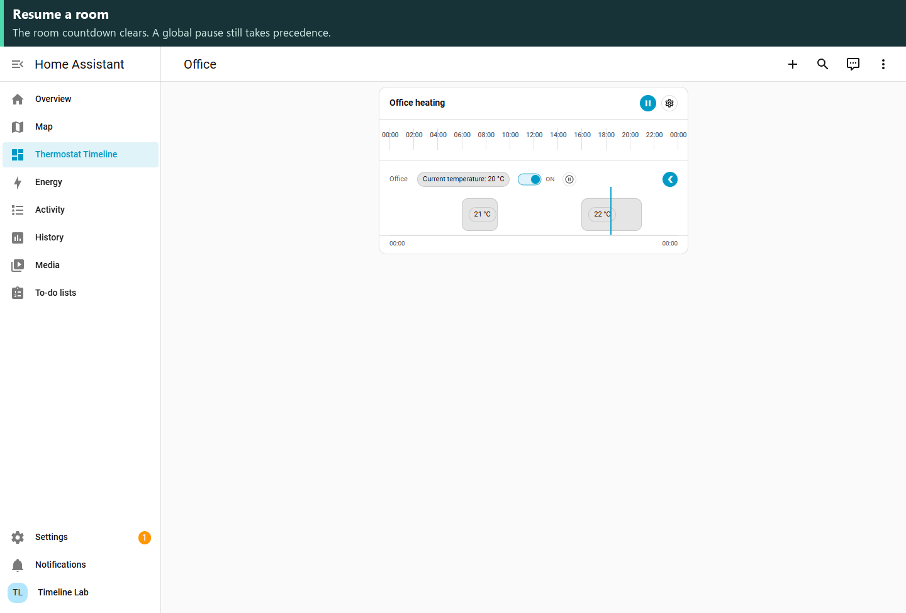
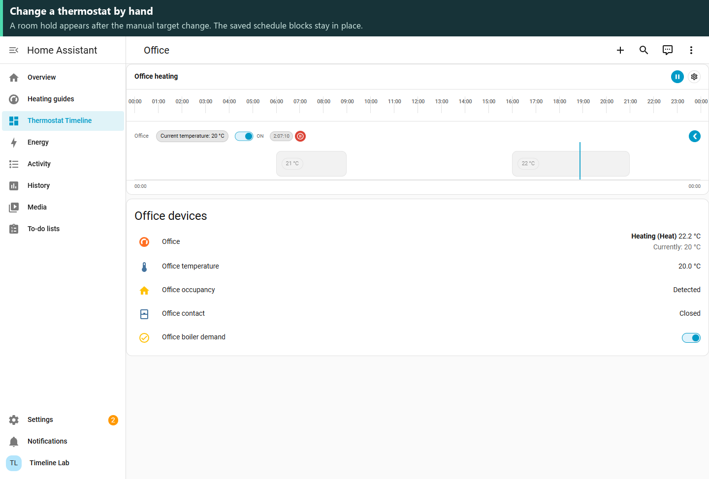
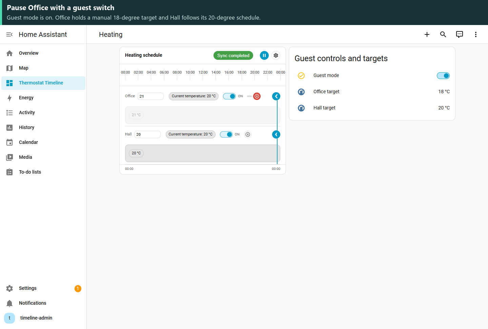

# Room pauses and manual targets

[Play walkthrough](../../images/room-pause.gif) | [Full-size GIF](../../images/room-pause.gif)

**Pause one room.** On the room row, select the small pause-circle beside the schedule toggle. Choose one hour, five hours, a custom duration or an indefinite pause. Other rooms can continue following their schedules.

[Play walkthrough](../../images/room-pause.gif) | [Full-size GIF](../../images/room-pause.gif)

**Resume a room.** Open the same room's pause menu and select resume. A global pause still applies. To pause the entire schedule, use the pause button in the header beside the settings gear.

**Adjust a thermostat manually.** With background auto-apply enabled, a detected manual change to a climate target creates a timed room pause. For example, a change from 21 to 22.5 degrees during a block lasts until the room’s next effective block start or end, or until midnight. Returning to the scheduled target cancels the generated hold. An explicit room pause takes precedence.

**After a restart.** Timeline saves the hold. The thermostat integration restores its own temperature. Opening an existing shared dashboard in v3.3.3 reads the shared schedule without saving the browser’s copy over it.

## Pause one room for an hour

Choose the pause circle on the **Office row**, then **one hour**. A countdown beside the room confirms which schedule is paused.

[Play walkthrough](../../images/room-pause.gif) | [Full-size GIF](../../images/room-pause.gif)

## Resume a paused room

Open the same room menu and choose the resume action. The room countdown disappears. Check the global pause button if the schedule still appears suspended.

[Play walkthrough](../../images/room-resume.gif) | [Full-size GIF](../../images/room-resume.gif)

## Pause every room with one control

Enable the header pause button, then select it to suspend schedule commands across rooms. For an external control, enable the pause sensor and choose a binary sensor that stays on throughout the pause. When the global pause clears, rooms without a separate hold can follow their schedules again. Pausing leaves each thermostat at its current setting.

[Play walkthrough](../../images/global-pause.gif) | [Full-size GIF](../../images/global-pause.gif)

## Pause automatically from a sensor

Enable the external pause sensor in **Settings > Pause**. Select a binary sensor and save. While it is on, Timeline suspends its schedule commands. When it clears, a room with its own manual hold can remain paused.

[Play walkthrough](../../images/pause-sensor.gif) | [Full-size GIF](../../images/pause-sensor.gif)

## Hold a manual thermostat target

With background control enabled, open the climate entity and raise its target. Close the thermostat dialog. Reloading the dashboard shows the saved room hold. Its countdown runs to the next effective schedule boundary.

[Play walkthrough](../../images/manual-hold.gif) | [Full-size GIF](../../images/manual-hold.gif)

## Pause and resume from an automation

Choose **Thermostat Timeline: Pause schedule** in an automation and select the primary room entity. Enter a duration in minutes or leave it blank for an indefinite pause. Omit the room to pause the entire instance. **Resume schedule** clears the pause for the selected scope. For example, resuming Office during a global pause still leaves Office paused until the global pause ends.

[Play walkthrough](../../images/automation-pause.gif) | [Full-size GIF](../../images/automation-pause.gif)

## Pause the timeline with an alarm

Open **Settings > Pause** and enable **Pause when the alarm matches**. Choose your `alarm_control_panel` entity. Select each state that should suspend the timeline, for example **armed away** and **armed vacation**, then save. To turn the rule off, clear its switch and save.

Arm the panel in one of the selected states. Scheduled temperature updates stop. Disarm it, or switch to an unselected state, to resume the current schedule. A manually paused room, a global pause or an active binary pause sensor still holds its own pause. If the configured alarm is unavailable, the timeline waits for a known state. An empty selection has no effect.

[Play walkthrough](../../images/alarm-pause.gif) | [Full-size GIF](../../images/alarm-pause.gif)

## Pause a room with a switch

1. Open the card settings, choose **Rooms**, and expand the room to control.
2. Under **Pause this room while the selected control is on**, choose a toggle helper, switch or binary sensor. For example, choose a **Guest mode** toggle for Office. Select the same control in another room to pause both together.
3. Save, then turn the control on. The room's existing pause indicator lights up. Guests can change the thermostat target while other rooms continue their schedules.
4. Turn the control off. The room resumes the **current** schedule once all its pauses have cleared. A separate manual room pause, global pause or alarm pause still applies. If the selected control is unavailable, the room stays paused until Home Assistant sees it off. Choose **No pause control** and save to unlink it.

[Play walkthrough](../../images/room-pause-control.gif) | [Full-size GIF](../../images/room-pause-control.gif)

## Receive pause and resume notifications

With shared storage and automatic application enabled, open **Settings > Pause > Pause notifications**. Select **Notify when paused**, **Notify when resumed**, or both. Choose **Home Assistant notifications** for the built-in notification panel, or select one of your configured notification destinations. Save the settings. Both events are off by default.

Turn on a room's guest switch to receive a pause message. When the last pause for that room clears, a resume message follows. If the switch clears while the room still has a manual pause, the integration waits. A global pause or resume produces one message for the whole schedule. Individual room holds still apply after a global resume. Opening a dashboard or enabling notifications while a pause is already active does not send a retrospective message.

[Play walkthrough](../../images/pause-notifications.gif) | [Full-size GIF](../../images/pause-notifications.gif)
