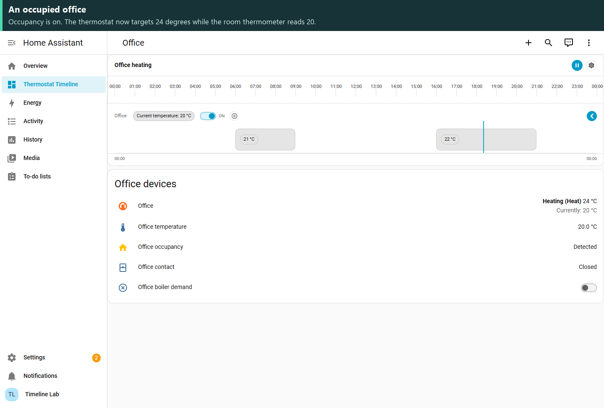
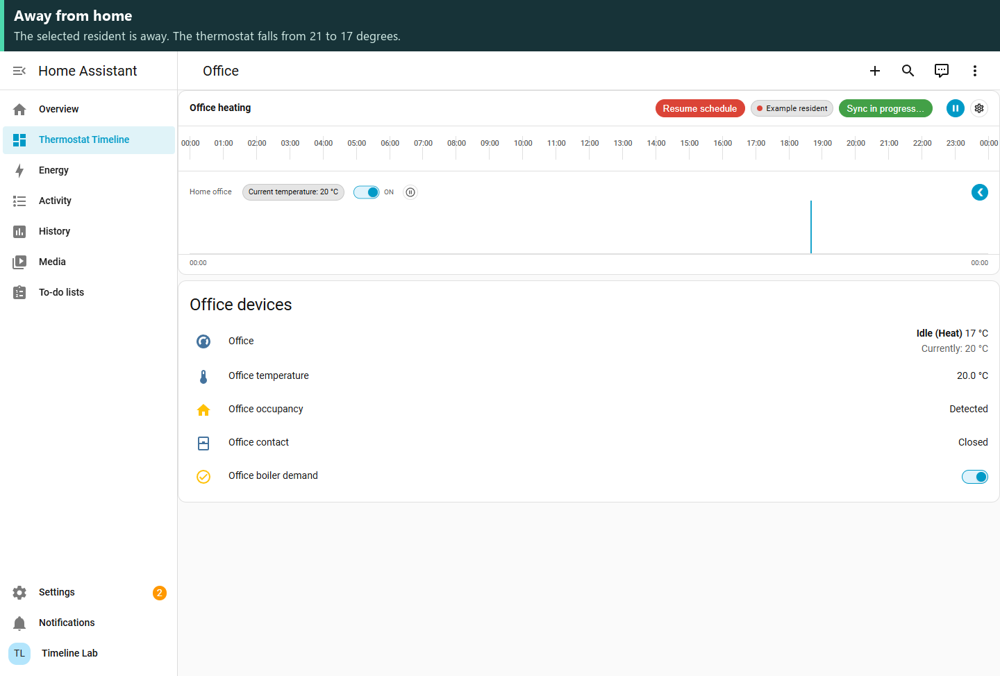
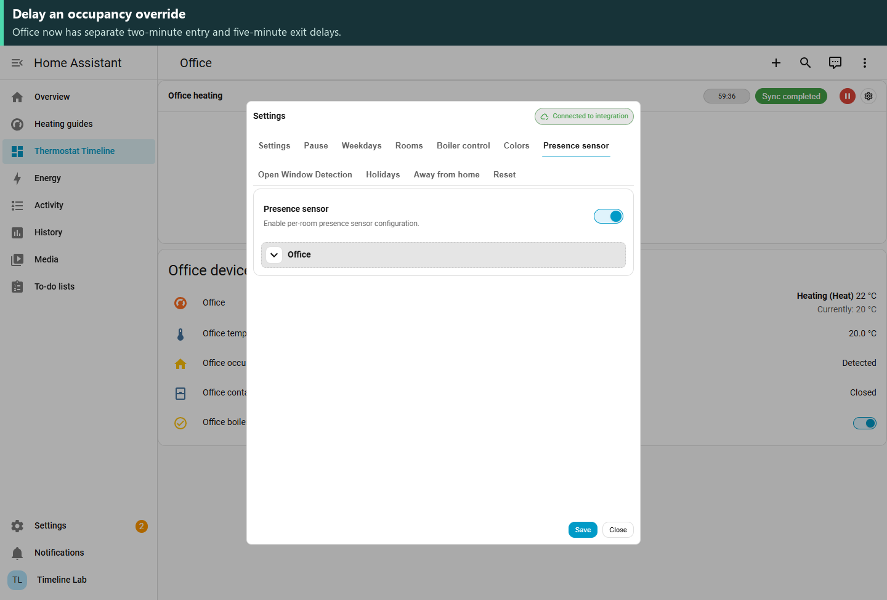
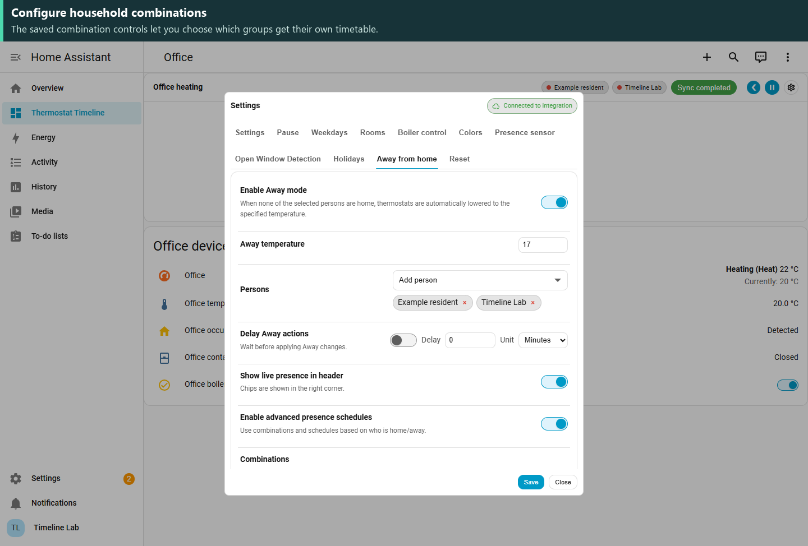
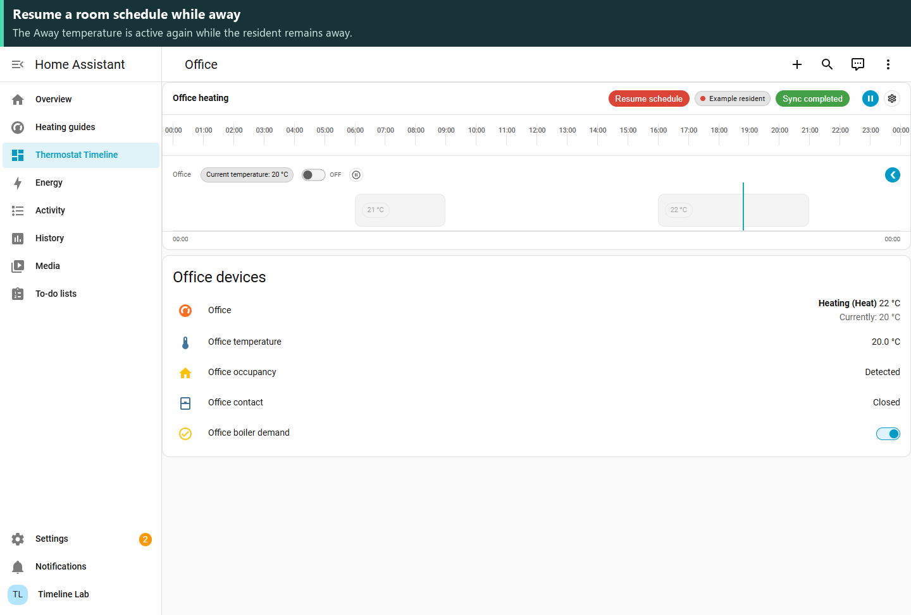
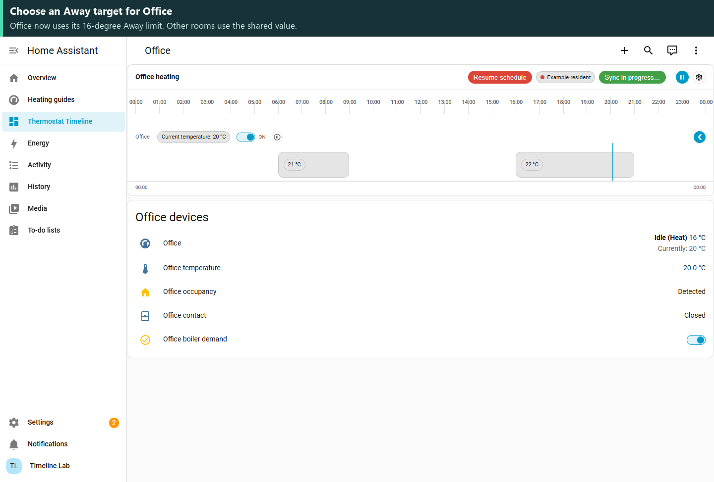
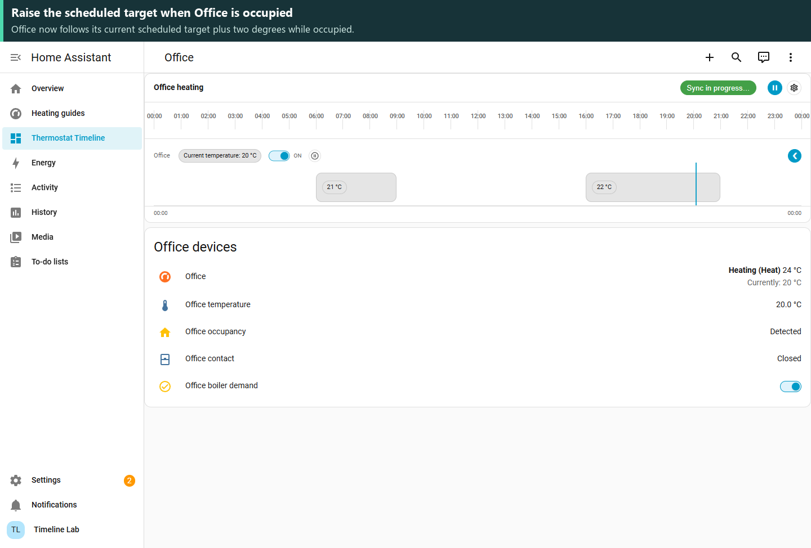

# Presence schedules and Away mode

## Choose the trigger

For a house-wide setback, open the settings gear and choose the Away tab. Select the people who count as home and enter the temperature to use when everyone is away. Test with one room before adding delays or enabling combinations.

For an occupied office, use the Presence sensor tab instead. Pair the office thermostat with its binary occupancy sensor. Choose the occupied target and separate entry and exit delays. A motion sensor measures occupancy, not identity. For a plan specific to one person, use named people and the advanced presence combinations.

## Heat an occupied room

In **Settings > Presence sensor**, enable the feature, select the Office occupancy sensor and enter 24 degrees. Save, then trigger the sensor and wait for the entry delay. Home Assistant reports occupancy and the thermostat target rises to 24 while the thermometer still reads 20.

[Play walkthrough](../../images/occupancy.gif) | [Full-size GIF](../../images/occupancy.gif)

## Lower the target when everyone leaves

In **Settings > Away**, select the residents, enable Away, set 17 degrees and save. When the last selected person leaves and the departure delay expires, the scheduled 21-degree target falls to 17. A schedule already below the Away temperature stays lower. When someone returns, check the effective scheduled target again.

[Play walkthrough](../../images/away.gif) | [Full-size GIF](../../images/away.gif)

## Configuration reference

- presence_sensor_enabled: true/false to configure per‑room presence.
- presence_sensors: { climate.living_room: binary_sensor.motion_living }.
- presence_sensor_temps: { climate.living_room: 21 } temperature when presence is ON.
- presence_sensor_delays: { climate.living_room: { on_s: 60, off_s: 300 } } delays in seconds.
- presence_sensor_delay_units: { climate.living_room: minutes } optional units; supports seconds | minutes.
- away:
	- enabled: true/false
	- target_c: 17 (target when nobody home)
	- persons: [ person.me, person.partner ]
	- advanced_enabled: true/false (combinations editor)
	- combos: object of enabled presence combinations (usually managed in UI)
	- delay_enabled, delay_value, delay_unit: optional delay before applying Away.

## Use different entry and exit delays

Open the presence sensor settings for the room. Choose seconds or minutes and set each delay separately. The example waits two minutes before using the occupied temperature and five minutes before returning to the normal schedule.

[Play walkthrough](../../images/arrival-delay.gif) | [Full-size GIF](../../images/arrival-delay.gif)

## Plan for combinations of residents

Under **Away from home**, select the people to track and enable advanced combinations. Choose the combinations that need a timetable. Open the presence schedule editor and set the blocks for each group. A household with two residents can plan differently for either resident at home and both together. Enable live presence in the header to see the current household state.

[Play walkthrough](../../images/presence-combinations.gif) | [Full-size GIF](../../images/presence-combinations.gif)

## Temporarily bypass Away

When Away is active, choose **Resume schedule** in the header to return to the scheduled target. Choose **Resume Away temp** to reinstate the setback. The bypass also clears on the next change into or out of Away.

[Play walkthrough](../../images/away-bypass.gif) | [Full-size GIF](../../images/away-bypass.gif)

## Set a room-specific Away target

In the Away settings, enable **Use a room-specific Away target** for a room, enter its temperature and save. With simple Away active, a room set to 16 °C uses 16 °C when its schedule calls for 21 °C and stays at 15 °C when scheduled for 15 °C. Disable the room option to use the shared Away target again.

[Play walkthrough](../../images/away-room-limit.gif) | [Full-size GIF](../../images/away-room-limit.gif)

## Increase the scheduled target when occupied

In **Settings > Presence sensor**, assign a sensor and enable **Increase the scheduled target when occupied** for that room. Enter the increase and save. With a 2 °C increase, an occupied room scheduled for 19 °C targets 21 °C. The configured sensor delays still apply. Disable this option to use the fixed occupied target again.

[Play walkthrough](../../images/occupied-offset.gif) | [Full-size GIF](../../images/occupied-offset.gif)
