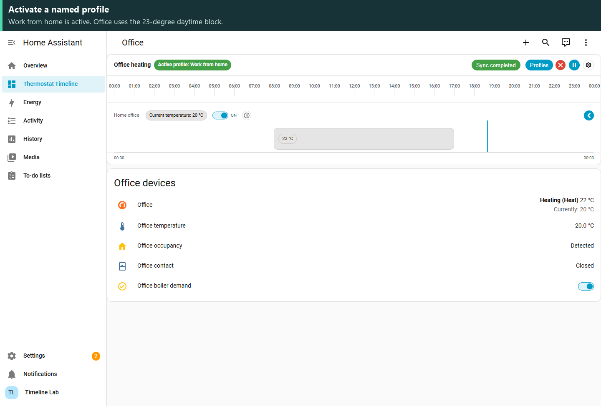

# Room profiles

A profile is a named day schedule for one room. For example, save a **Work from home** plan for the office with a warmer morning block.

## Create a profile

Enable profiles in the card settings (or set `profiles_enabled: true`). Open the room's **Profiles** dialog, give the plan a name, edit its blocks and choose **Save new profile**.

## Activate or change a profile

Select a saved profile to preview its blocks. Choose **Activate** to use it for that room and check the active profile name. To revise it, edit its blocks and choose **Save changes to selected profile**. Choose **Deactivate** to return the room to its normal schedule.

## Recognize the active profile

After activation, the card header names the active profile. Office now shows its 08:00 to 17:00 block at 23 degrees. Deactivate the profile to return to the ordinary timetable.

[Play walkthrough](../../images/profile.gif) | [Full-size GIF](../../images/profile.gif)
