# Fan, climate and presence profiles

Open **Settings → Rooms**, expand the thermostat and find **Fan, climate and presence profiles**. Enable only the controls you want for that room, then save. Use shared storage and automatic application so Home Assistant can operate the devices while the dashboard is closed. A paused room or suspended window schedule takes precedence.

## Schedule fan speed

Enable **Schedule fan speed**. Leave **Fan device** on the room thermostat or select a separate fan. Choose **Room fan speed** for the fallback between blocks. Double-click a timeline block, choose its fan speed, save the block, then save the timeline. The selector uses the modes the device advertises. Separate fans can offer presets and percentage steps. A thermostat with its own internal program may need to be put in its external-control preset first. The integration leaves that choice to you.

[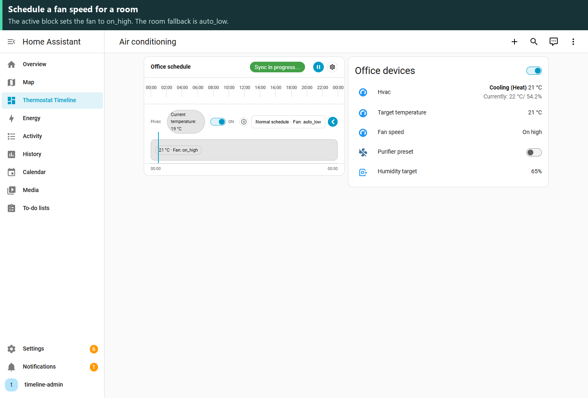](../../images/room-fan-block.gif)

[Play walkthrough](../../images/room-fan-block.gif) | [Full-size GIF](../../images/room-fan-block.gif)

## Smart Fan and quiet hours

Select **Add threshold** under **Fan by scheduled target** to associate speeds with targets. Alternatively, use **Smart Fan** to respond to the difference between the target and the measured room temperature. For example, set a quiet fallback, medium at 1 °C and high at 3 °C. In cooling mode the gap grows as the room gets warmer than its target. The highest threshold reached wins within each table. Enter as many thresholds as your room needs.

The room default applies first, followed by target thresholds, Smart Fan, an explicit block speed, a profile speed and finally the quiet-hours speed. Leave a selector empty to use the preceding rule. Enable **Use quiet hours** and choose start and end times, including periods that cross midnight. **Hide fan controls and status on the timeline** keeps scheduling active while hiding the block control and status badge.

[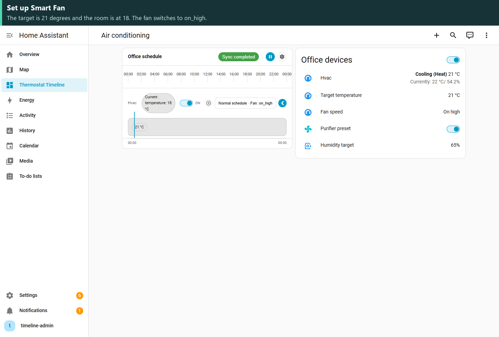](../../images/smart-room-fan.gif)

[Play walkthrough](../../images/smart-room-fan.gif) | [Full-size GIF](../../images/smart-room-fan.gif)

[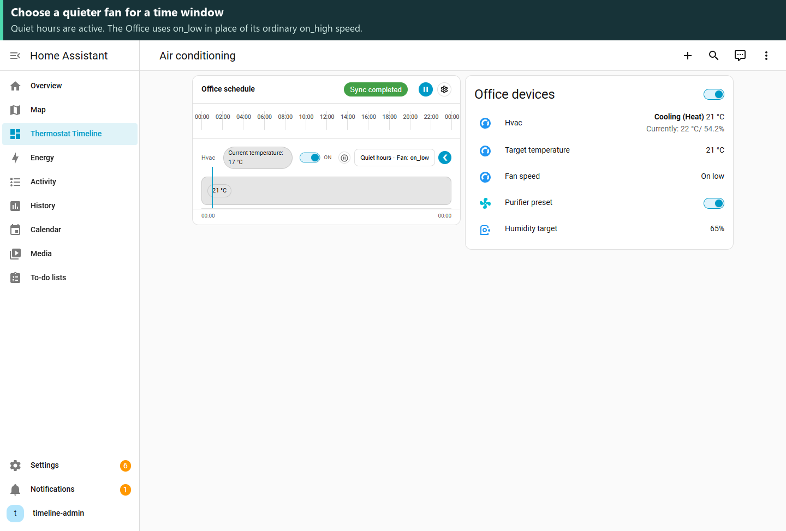](../../images/room-night-fan.gif)

[Play walkthrough](../../images/room-night-fan.gif) | [Full-size GIF](../../images/room-night-fan.gif)

## Seasonal modes and off at target

Enable seasonal schedules and **Heat in Winter / cool in Summer** for a thermostat that supports both modes. An explicit HVAC mode on a block takes priority. Enable **Restore scheduled settings after manual changes** when the schedule should recover the temperature, fan and HVAC mode after a device adjustment. Choose the fallback mode outside blocks. Use an explicit Timeline pause for a temporary manual hold.

**Switch off at target and resume on demand** is independent. For a heating target of 21 °C, a tolerance of 0.2 °C, five minutes at target and an additional restart gap of 0.3 °C, the thermostat can switch off after five continuous minutes at or above 20.8 °C. Heating resumes below 20.5 °C. Cooling uses the opposite direction. Home Assistant remembers when Timeline switched the thermostat off so it can resume after a restart.

[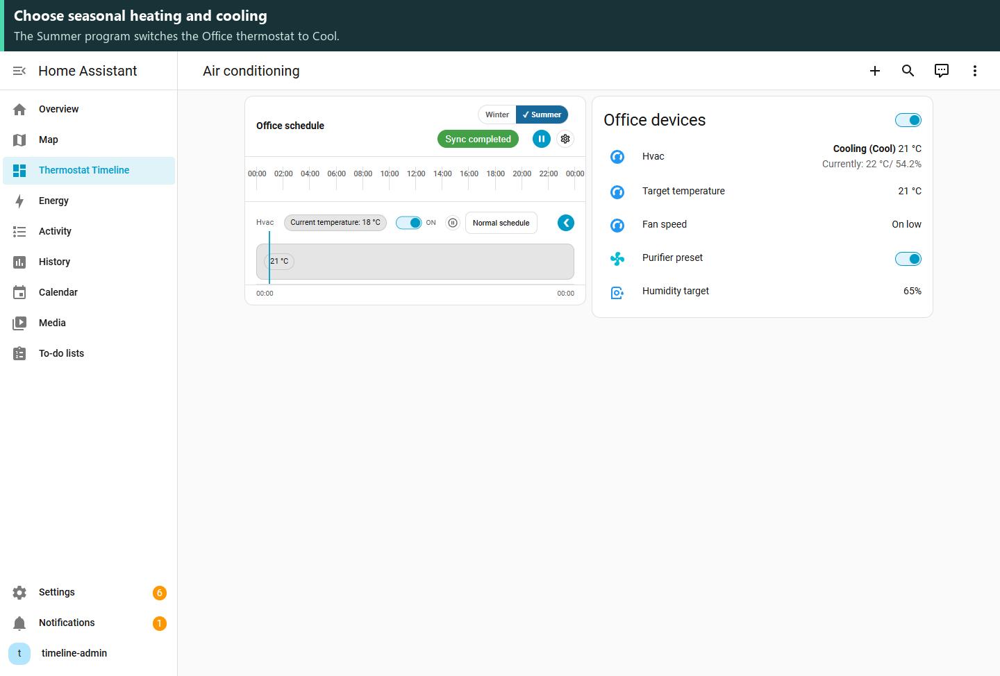](../../images/room-climate-season.gif)

[Play walkthrough](../../images/room-climate-season.gif) | [Full-size GIF](../../images/room-climate-season.gif)

[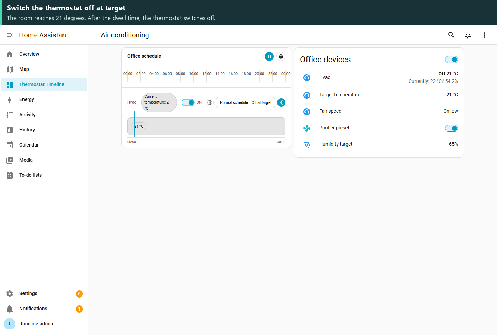](../../images/room-target-off.gif)

[Play walkthrough](../../images/room-target-off.gif) | [Full-size GIF](../../images/room-target-off.gif)

## Comfort and economy

Enable **Use room presence profiles**, choose a binary presence sensor and select **automatic**. Set the presence and absence delays in seconds. Set **Comfort adjustment** to 2 °C to turn a 21 °C heating block into 23 °C while occupied. Cooling subtracts the same adjustment. An economy adjustment of zero returns to the current schedule when the room empties. A positive economy adjustment lowers heating or raises cooling. Each block keeps its own target, including blocks that start while the room is occupied.

Set a maximum boosted heating target and choose **clamp**, **skip** or **fan_only**. Clamp limits the increase. Skip suppresses both the increase and the comfort fan override. Fan only allows the occupied fan speed without increasing the target. If the measured temperature has already reached the limit, the heating boost stops. **Maximum boost minutes** ends automatic comfort after the configured time. Zero keeps it active while occupied.

Select an alarm entity to suppress presence changes while it reports **armed_away**. Enable **Use economy settings while armed away** for maintenance heating or cooling. An unavailable configured alarm also suppresses comfort. An unavailable occupancy sensor falls back to the schedule. Room presence profiles replace the basic presence temperature adjustment in this room.

[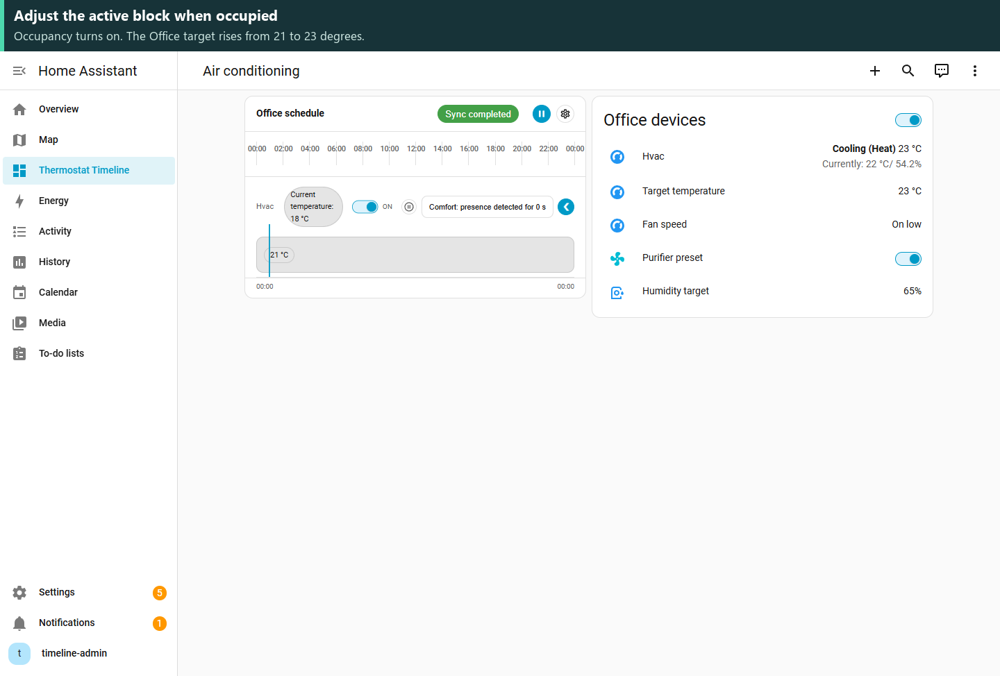](../../images/room-presence-comfort.gif)

[Play walkthrough](../../images/room-presence-comfort.gif) | [Full-size GIF](../../images/room-presence-comfort.gif)

[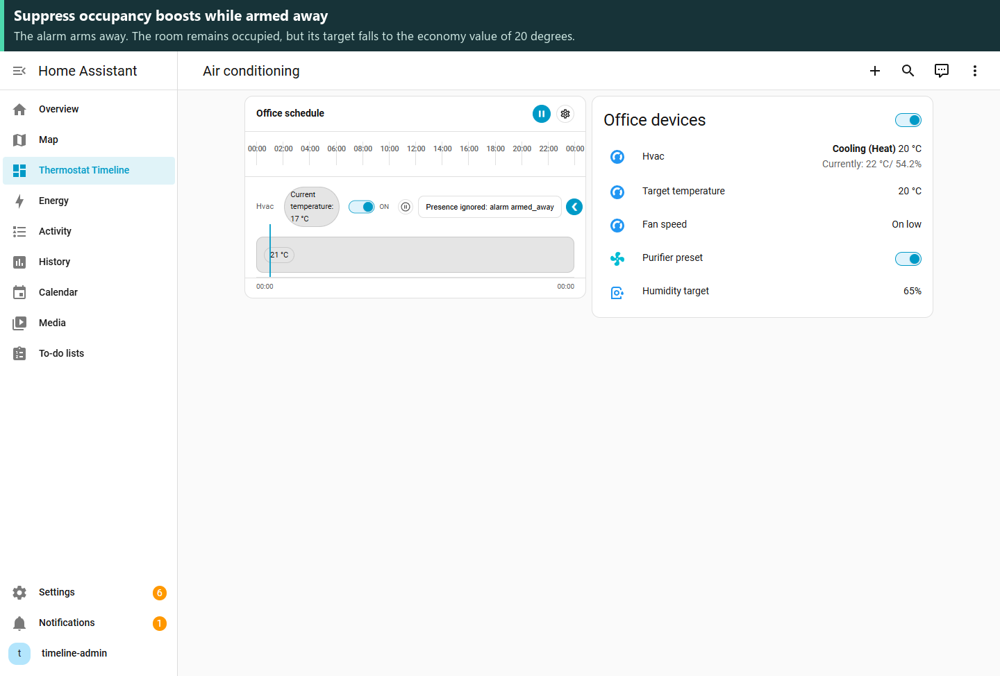](../../images/room-alarm-economy.gif)

[Play walkthrough](../../images/room-alarm-economy.gif) | [Full-size GIF](../../images/room-alarm-economy.gif)

## Purifiers and humidity

Under room presence profiles, enable **Adjust air treatment by profile**. Select a purifier exposed as a Home Assistant fan, a humidifier or dehumidifier, or both. Choose a supported purifier speed and relative humidity target for each profile. For example, choose a quiet occupied preset and 48% humidity, then an economy preset and 40% while empty. Humidity targets apply to a running device. Leave a field empty to release the override. Timeline restores the previous setting when its last setting is still in effect.

[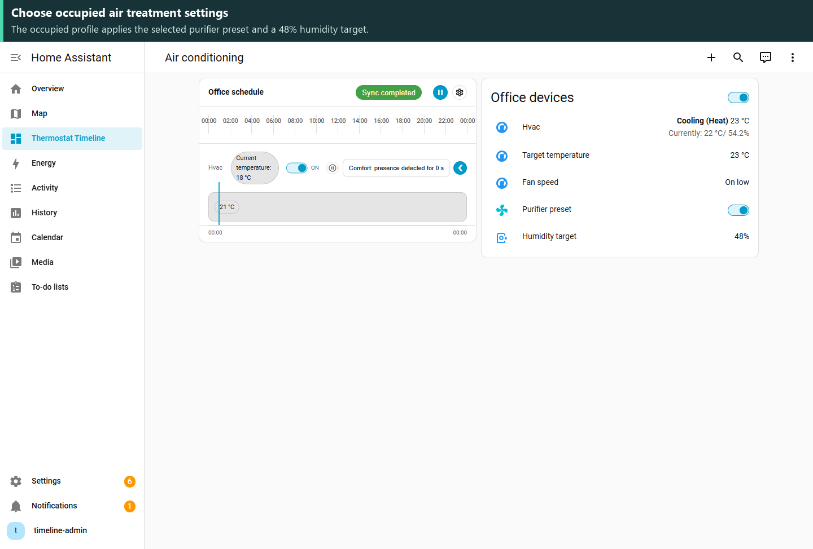](../../images/room-air-treatment.gif)

[Play walkthrough](../../images/room-air-treatment.gif) | [Full-size GIF](../../images/room-air-treatment.gif)

## Profiles and control history

Click the room status to switch profiles directly from the timeline. Under **Active profile**, choose **comfort**, **eco**, **night** or **schedule** to select that behavior manually. Return to **automatic** for sensor control. Night has its own temperature adjustment and fan speed. When quiet hours are configured, an occupied room can use Night automatically. The configured alarm takes precedence over a selected profile.

Click the room status beside the thermostat, or **View control history** in room settings. The latest 50 transitions per room include their time, reason and selected fan speed. Home Assistant retains them in its configuration storage across restarts.

[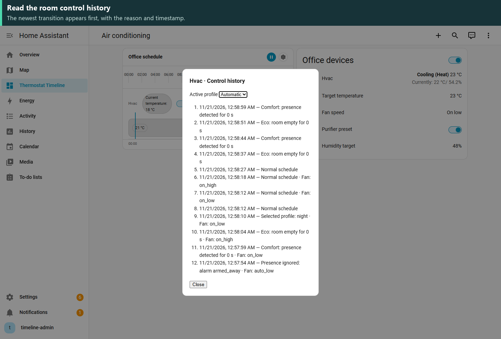](../../images/room-air-history.gif)

[Play walkthrough](../../images/room-air-history.gif) | [Full-size GIF](../../images/room-air-history.gif)

[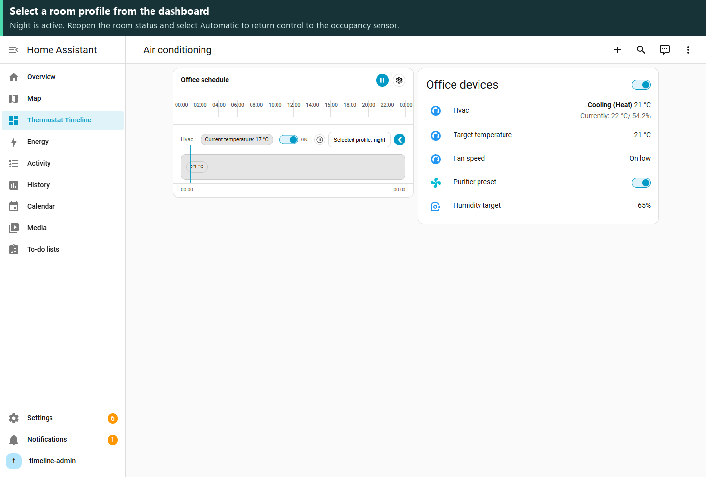](../../images/room-quick-profile.gif)

[Play walkthrough](../../images/room-quick-profile.gif) | [Full-size GIF](../../images/room-quick-profile.gif)

## Start air treatment from sensor readings

Open **Settings > Rooms**, select the room, and enable **Control air treatment from sensors**. Select the device first, then its sensor. For a purifier, use a fan and a PM2.5 sensor. For a humidifier or dehumidifier, choose the corresponding humidity device and a sensor reporting relative humidity in percent. Use separate devices for humidifying and dehumidifying.

For example, choose the basement dehumidifier and its humidity sensor. Enter **60** for start and **55** for stop, then save. With automatic application active, 62% starts the device. At 58% it keeps running. At 55% it stops. A humidifier uses the reverse direction. Purifier thresholds use the sensor's displayed units. Unavailable readings suspend decisions. The room's existing pause controls also apply.

[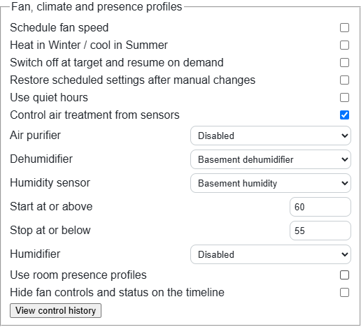](../../images/sensor-air-treatment.gif)

[Play walkthrough](../../images/sensor-air-treatment.gif) | [Full-size GIF](../../images/sensor-air-treatment.gif)

Open **View control history** to see confirmed starts and stops. To receive these as notifications, see [air treatment and seasonal notifications](notifications.md#air-treatment-and-seasonal-changes).
