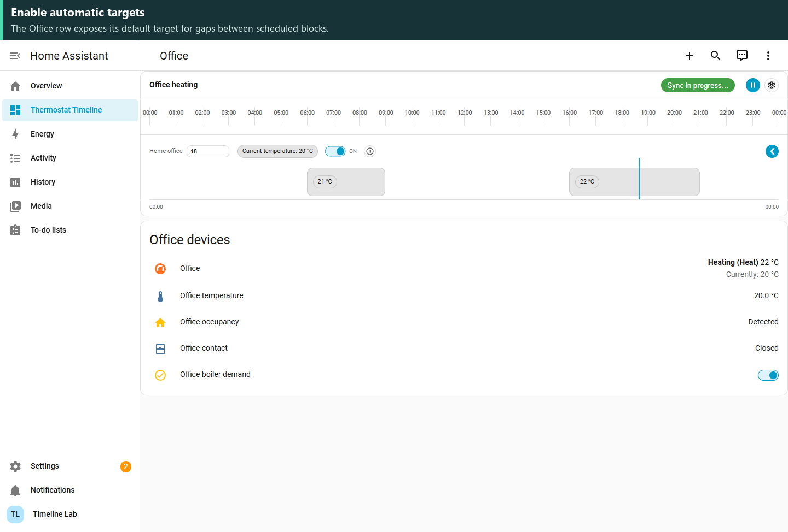
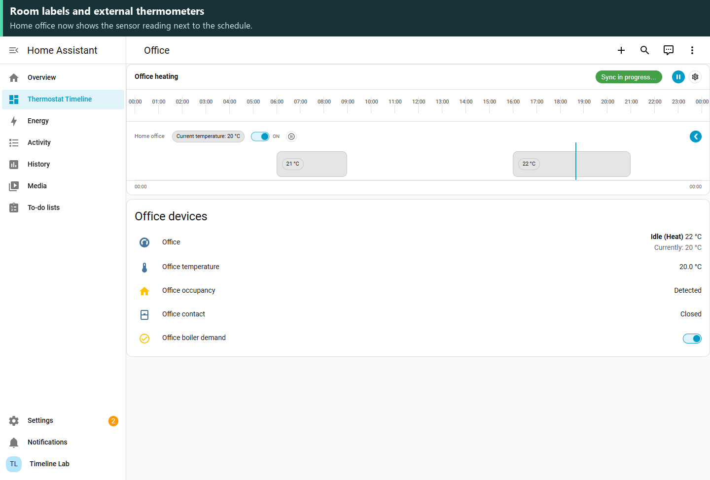
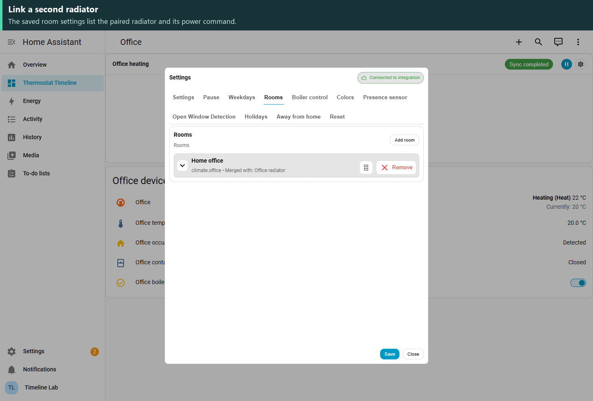
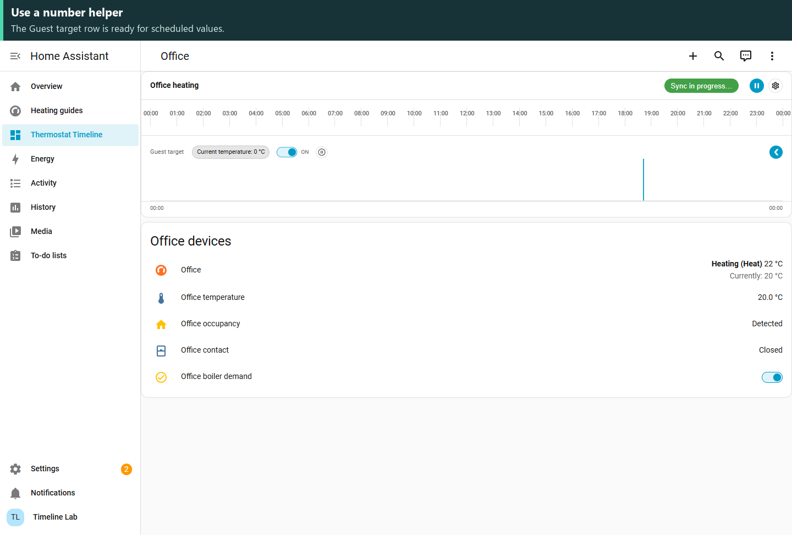
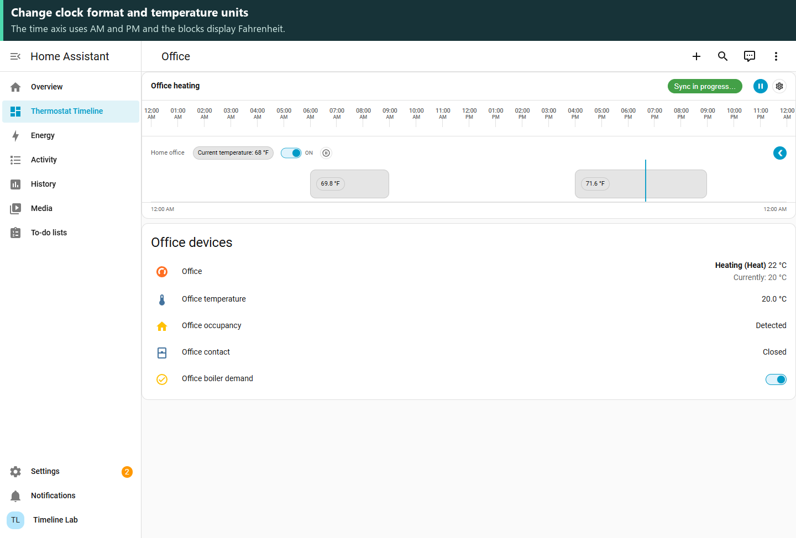
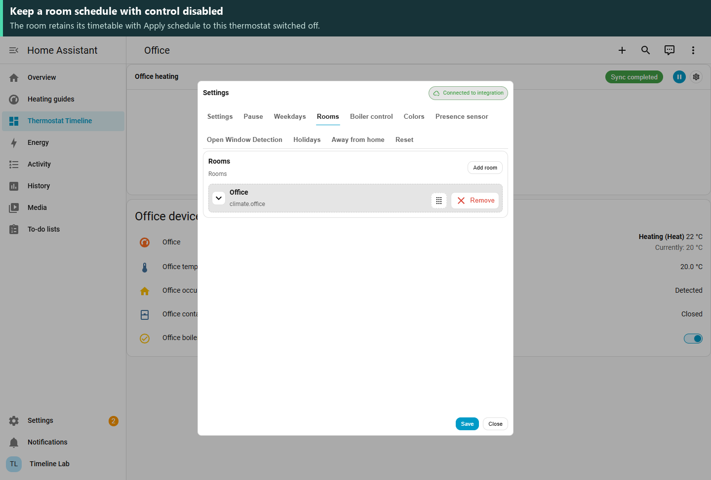
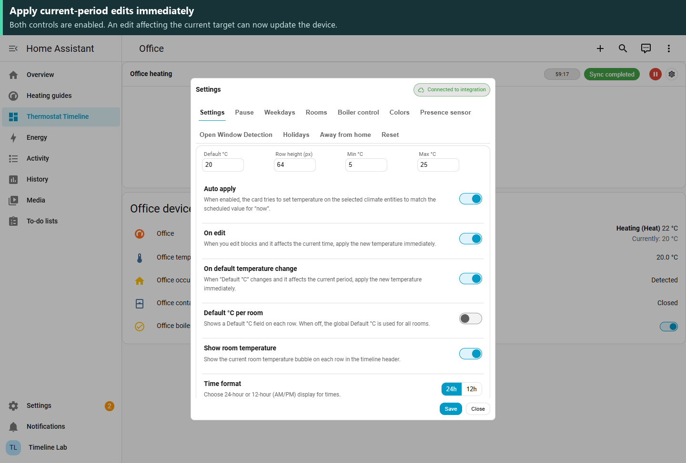
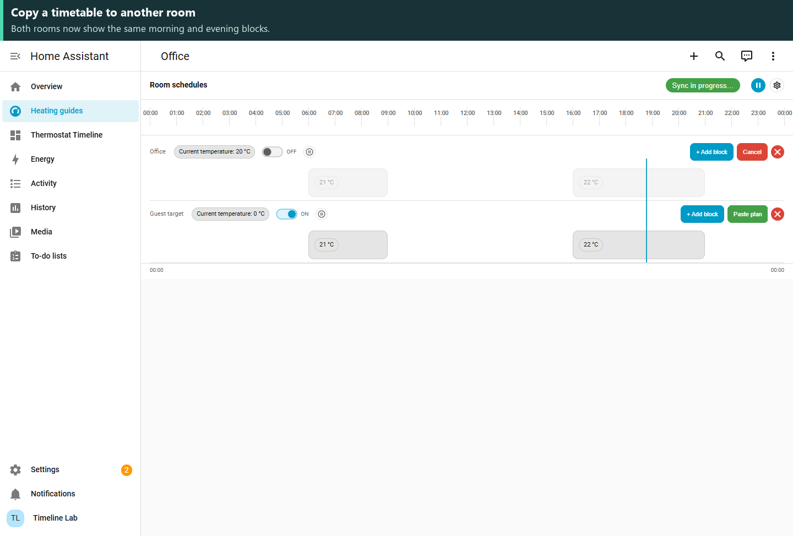

# Timeline and room controls

## Create or change a block

Choose a room and open the block editor on its timeline. Set the times and target, then save. To change an existing block, double-click it. The [desktop editing guide](../../getting-started/quick-start.md#edit-a-scheduled-block) shows a morning block changing from 21 to 23 degrees. To remove a period, open the same editor and choose **Delete**.

## Defaults and automatic control

Choose a default temperature for gaps. For an 18-degree default and a 21-degree block from 06:00 to 09:00, the thermostat targets 21 during the block and returns to 18 at its end if no other rule applies. Enable shared storage and auto-apply for control with the dashboard closed. Check the target in Home Assistant when the block starts or ends.

[Play walkthrough](../../images/defaults.gif) | [Full-size GIF](../../images/defaults.gif)

## Room labels and external thermometers

Use the room settings to give the thermostat a display name, show its current temperature and optionally select an external sensor. The Home office bubble shows the thermometer reading while each block displays its scheduled target.

[Play walkthrough](../../images/room-display.gif) | [Full-size GIF](../../images/room-display.gif)

## Merged radiators and power commands

Choose a primary thermostat and add the other radiators under its room merge. Schedule the primary row once. Check both climate entities when the block starts. Each should receive the same target. If a model needs an explicit power command, enable its turn-on option and choose whether to send it before or after the target. See the [configuration example](../examples.md) for a two-radiator room.

[Play walkthrough](../../images/merge.gif) | [Full-size GIF](../../images/merge.gif)

## Schedule a number helper

Add an `input_number` helper to the card's entities and choose a default or add blocks. With auto-apply on, open the helper in Home Assistant to read its scheduled value. The example switches the room control to **Guest target**. An automation can use that value to drive another device.

[Play walkthrough](../../images/number-helper.gif) | [Full-size GIF](../../images/number-helper.gif)

## Time, units and language

Choose Celsius or Fahrenheit, a 12- or 24-hour clock, and the time source in the card settings. For a wall dashboard in a different time zone, select Home Assistant time so the current-time marker follows the installation. See [language selection](../internationalization.md) and the [display settings](../configuration.md#rooms-and-basics).

[Play walkthrough](../../images/clock.gif) | [Full-size GIF](../../images/clock.gif)

## Keep a timetable without sending commands

Open **Settings > Rooms**, expand the thermostat and switch off **Apply schedule to this thermostat**. Save. The row keeps its blocks while the device can be managed independently. Turn the option back on when the room should follow Timeline again.

[Play walkthrough](../../images/room-apply.gif) | [Full-size GIF](../../images/room-apply.gif)

## Apply a change during the current period

In the general settings, enable **Apply on edit** for active blocks and **Apply on default change** for gaps. Save. For example, editing the current block from 20 to 21 degrees can update the thermostat immediately. Editing a block that starts tomorrow changes the future plan.

[Play walkthrough](../../images/apply-edit.gif) | [Full-size GIF](../../images/apply-edit.gif)

## Copy a plan between rooms

Expand the source row actions and choose **Copy plan**. Open the destination row and choose **Paste plan**. Check the destination blocks and use the card header Save control for pending edits. The same copy and paste controls are available between days in the weekday view.

[Play walkthrough](../../images/copy-plan.gif) | [Full-size GIF](../../images/copy-plan.gif)
