# Summer and winter schedules

1. Open the settings gear on the card and turn on **Enable summer/winter schedules**. Save the settings.

   You will find the switch on the first settings tab.

   [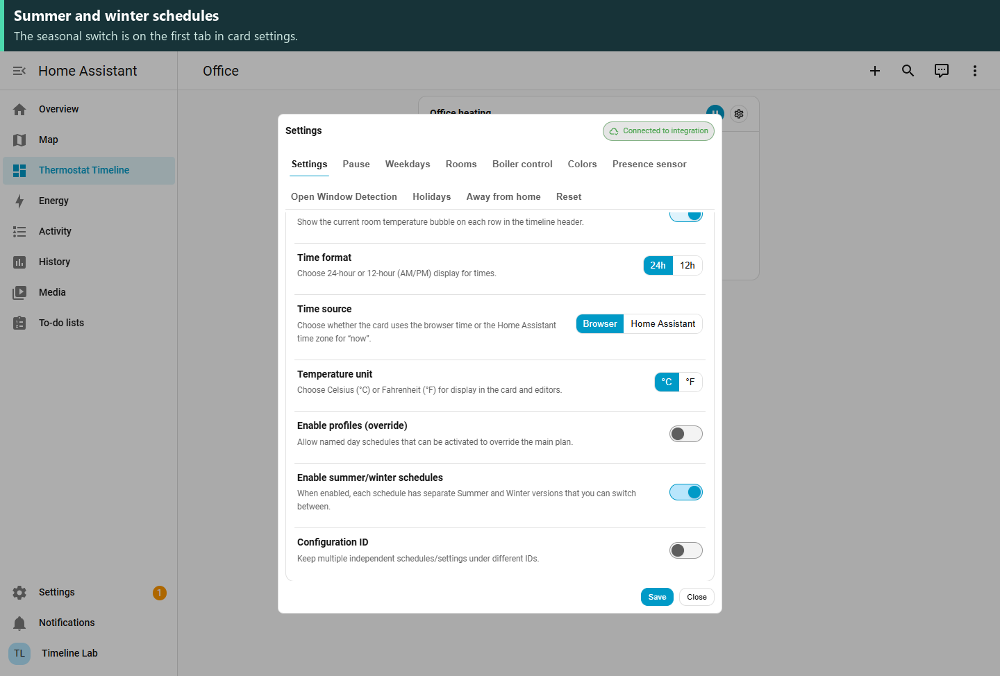](../../images/season.gif)

   [Play walkthrough](../../images/season.gif) | [Full-size GIF](../../images/season.gif)
2. Use the season selector to choose **Summer** or **Winter** before editing a room's blocks.
3. Switch seasons to inspect the other timetable. Leave the intended season selected for normal operation.

The season selects which timetable applies. To suspend schedule updates for a single room, use its [room pause](pause.md). Selecting Summer alone does not send an HVAC off command.

The stored settings are `seasonal_enabled` and `seasonal_mode` (`summer` or `winter`).

## Enable summer and winter schedules

Open the settings gear and stay on the first tab. Enable **summer/winter schedules** and save when you are ready to use separate timetables.

[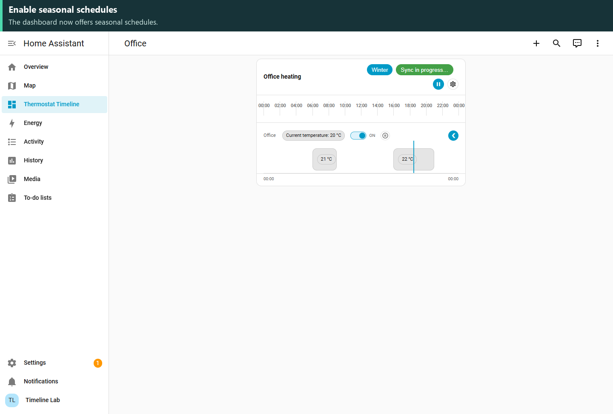](../../images/season.gif)

[Play walkthrough](../../images/season.gif) | [Full-size GIF](../../images/season.gif)

## Read the summer plan

Select Summer and save a short morning block. Here Summer calls for 19 degrees from 07:00 to 08:00. Select Winter to inspect the other timetable. Leave the season that should control the thermostat selected.

[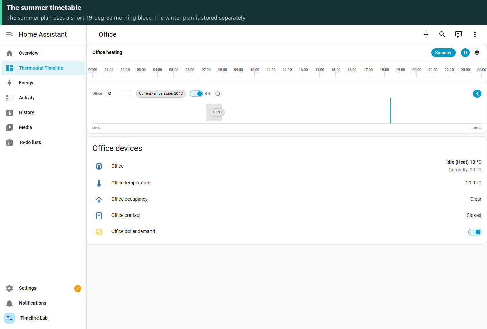](../../images/season.gif)

[Play walkthrough](../../images/season.gif) | [Full-size GIF](../../images/season.gif)

## Confirm a manual season change

The card shows **Winter** and **Summer** side by side. A checkmark marks the active plan. By default, choosing the other season switches immediately.

1. Open the card settings and enable **summer/winter schedules**.
2. On the same tab, turn on **Confirm manual season changes** and save.
3. On the card, select the other season. If seasonal sources are configured with shared storage, the dialog lists the source modes and any target temperature for the new season.
4. Choose **Switch season** to apply the plan. Choose **Cancel** or press **Escape** to keep the current season and equipment settings.

[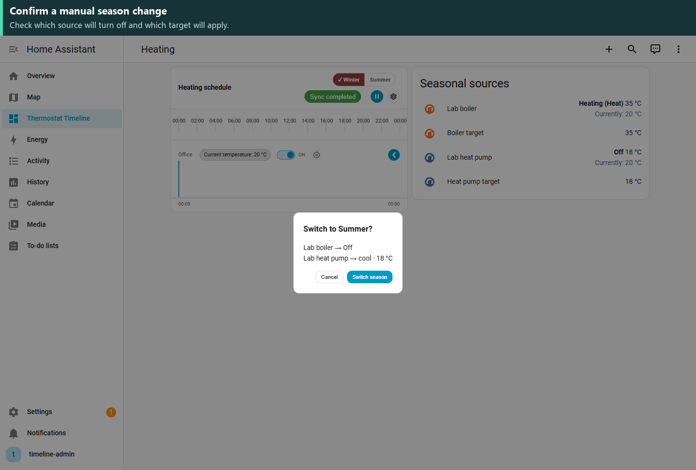](../../images/season-confirm.gif)

[Play walkthrough](../../images/season-confirm.gif) | [Full-size GIF](../../images/season-confirm.gif)

The example starts with the boiler heating in Winter. The first switch is cancelled. The second is confirmed, and Summer takes over with the heat pump cooling at 18 °C. Automatic season changes from a sensor continue without a prompt.

[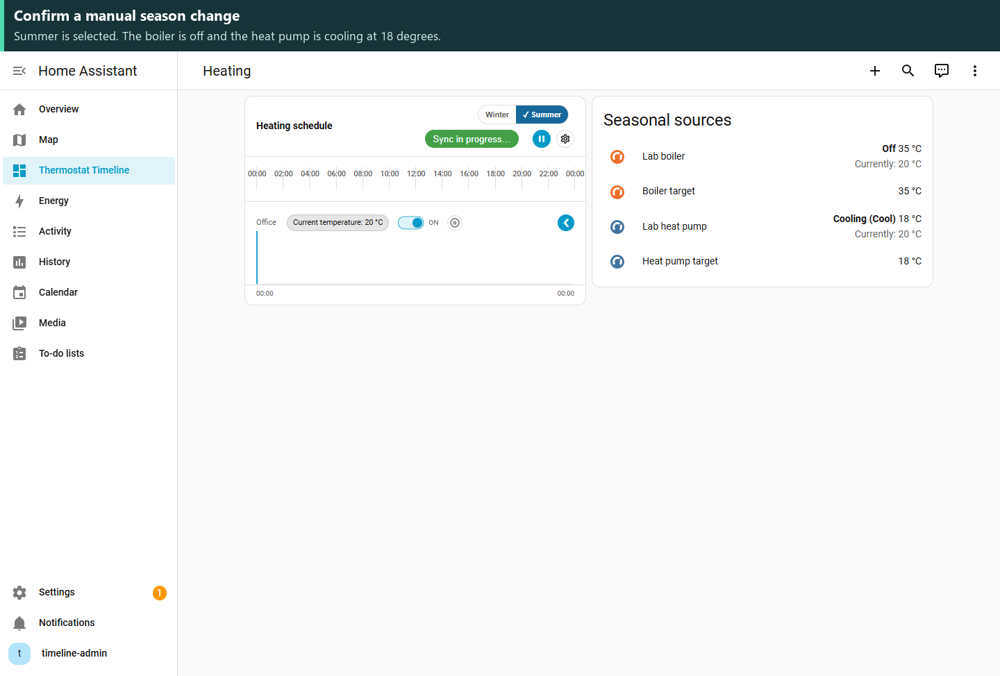](../../images/season-confirm.gif)

## Follow a season sensor

Open **Settings** and enable **summer/winter schedules**. Turn on **Follow a season sensor** and select the Home Assistant sensor that reports `spring`, `summer`, `autumn` and `winter`. Choose a schedule for spring and autumn independently and save.

Summer selects your summer plan and winter selects your winter plan. For example, mapping spring to Summer lets the office switch from its winter target of 21 °C to its summer target of 17 °C when spring begins. The selector marks the active plan with a checkmark. Its two buttons are disabled while the sensor controls the season. With shared storage and automatic temperature control enabled, the integration applies the change even with the dashboard closed.

An unavailable sensor keeps the last known plan. Until the first valid reading, the manual season is used. Disable **Follow a season sensor** and save to use the manual selector again.

[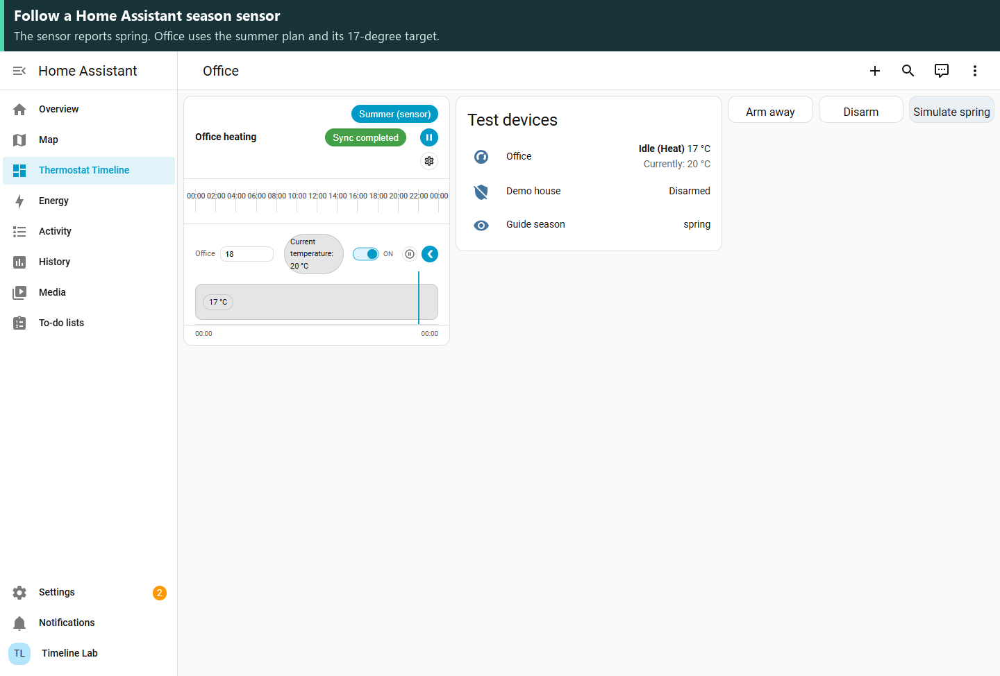](../../images/season-sensor.gif)

[Play walkthrough](../../images/season-sensor.gif) | [Full-size GIF](../../images/season-sensor.gif)

## Switch a thermostat off in summer

In **Settings**, enable summer/winter schedules. Under **Switch thermostats off in summer**, select the rooms to switch off and save. The list includes configured climate rooms whose thermostats support the HVAC `off` mode. Leave a room unchecked to run its summer timetable as usual. Automatic temperature control must be enabled.

Select **Summer** on the timeline, or let your configured season sensor select it. In the recording, Office switches to **Off** while Hall continues heating to its summer target of 18 degrees. Later blocks cannot turn Office back on. A selected room contributes no boiler demand while summer shutoff applies.

When winter begins or you deselect the room, Timeline restores the previous supported HVAC mode for a thermostat it switched off and resumes normal scheduling. With shared storage, this also works with the dashboard closed and after a Home Assistant restart. With browser storage, keep the same dashboard open for transitions. Room and global pauses still take precedence.

[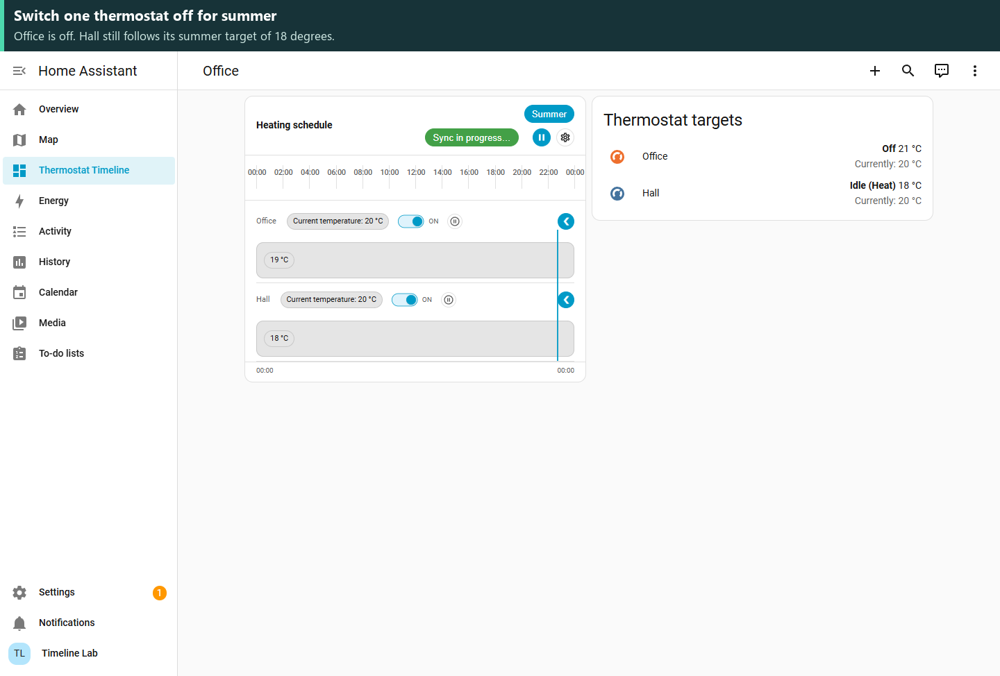](../../images/summer-off.gif)

[Play walkthrough](../../images/summer-off.gif) | [Full-size GIF](../../images/summer-off.gif)

## Switch heating and cooling sources by season

Use this option when the winter plan needs a boiler and the summer plan needs a heat pump, or when one reversible unit handles both seasons. Room schedules still set the room thermostats. A source target sets the temperature exposed by the selected climate entity. For a unit that exposes its water setpoint, this is the water target.

1. Enable **shared storage**, **auto-apply**, and **summer/winter schedules** in the card settings.
2. Under the seasonal settings, enable **Control the source when the season changes**.
3. For **Summer** and **Winter**, choose a dedicated climate entity and one of its supported modes. Choose **off** for a season when neither source should run. A reversible unit can be selected for both seasons. Thermostats already assigned to rooms or merged with a room are reserved for room control.
4. Optionally enter a source target for either season. Leave the field empty to keep the device's existing target. The field appears for devices that support setting a single target temperature.
5. Save. The active season takes effect immediately. Select **Winter** or **Summer** on the card to switch, or enable **Follow a season sensor** to switch automatically.

[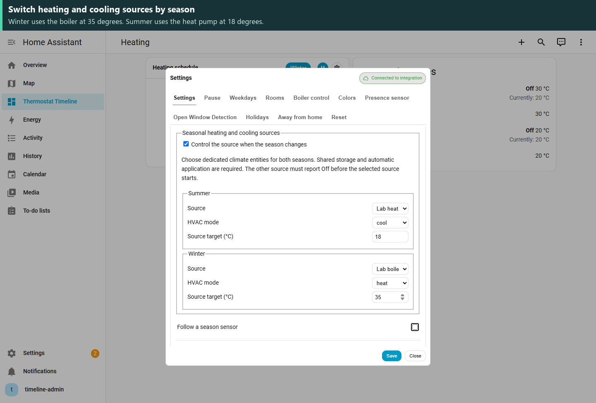](../../images/seasonal-sources.gif)

The example starts in winter with the boiler heating to 35 degrees. When Summer is selected, Home Assistant asks the boiler to switch off. Once its climate entity reports **off**, the heat pump starts cooling at 18 degrees. For a reversible unit, changing between heating and cooling also goes through **off**.

[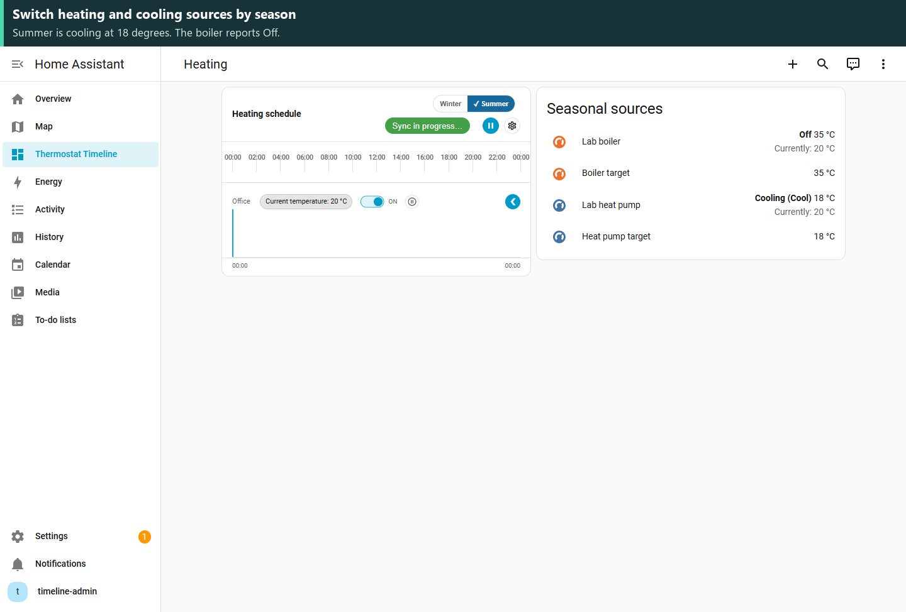](../../images/seasonal-sources.gif)

[Play walkthrough](../../images/seasonal-sources.gif) | [Full-size GIF](../../images/seasonal-sources.gif)

If the previous source is unavailable or continues to report heating, the new source waits. This check uses the HVAC mode reported by Home Assistant. It cannot verify valve position, flow or pipe temperature. The dashboard may be closed during the change. Turning source control off leaves the equipment in its current mode and returns control to you.

## Wait after a seasonal source reports Off

Use this setting to leave a gap between stopping one source and starting the next. It is off by default. The usual check that the previous source has reported **off** applies with either setting.

1. Open the card settings and enable **summer/winter schedules** and **Control the source when the season changes**. Configure both seasonal sources.
2. Turn on **Wait after the previous source reports Off**. In **Delay in minutes**, enter a whole number of at least 1 and save. The initial suggestion is 3 minutes.
3. Select the other season or let the season sensor switch. The old source switches off. The new source can start once Home Assistant has observed the full interval in the **off** state. Time already spent off counts. If the old source becomes unavailable, the interval starts again when it next reports **off**.

[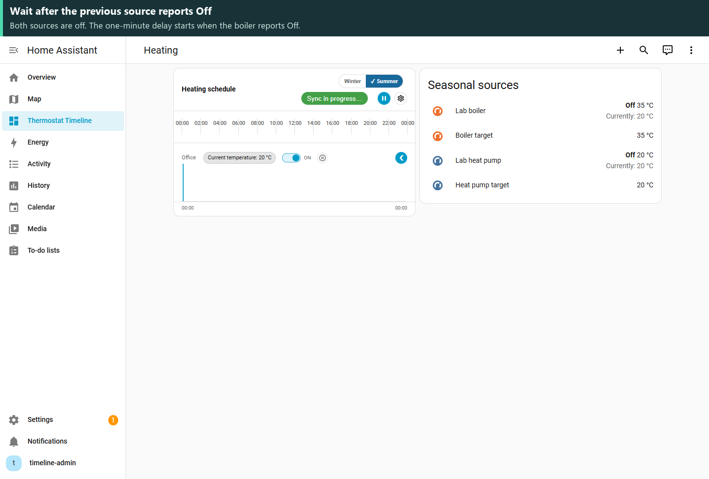](../../images/season-off-delay.gif)

[Play walkthrough](../../images/season-off-delay.gif) | [Full-size GIF](../../images/season-off-delay.gif)

In this recording the boiler stops first. One minute later, the heat pump starts cooling at 18 °C. Playback skips most of the waiting time. The same delay applies to a reversible unit switching between heating and cooling. Room schedules continue to run during the wait.

[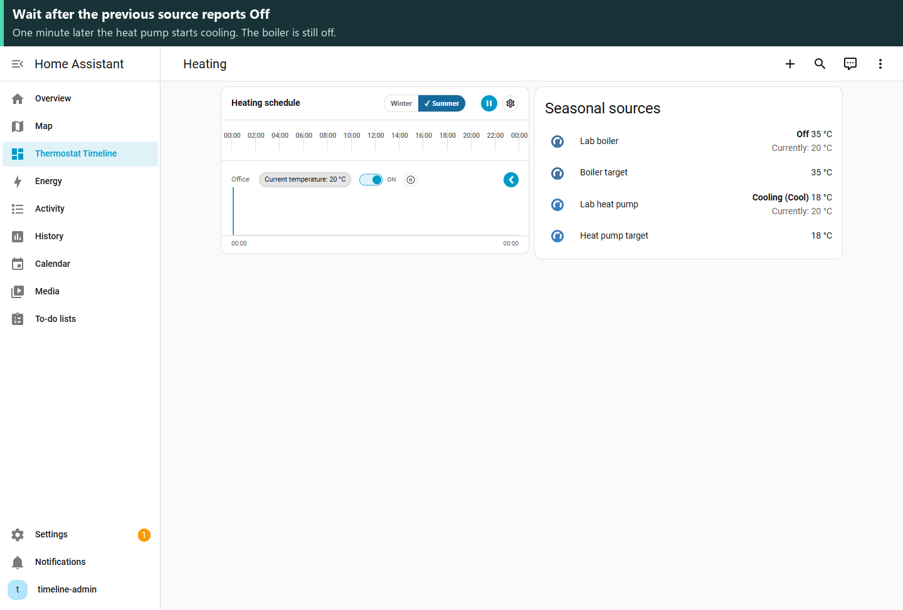](../../images/season-off-delay.gif)

If you change seasons again during the wait, the latest selection determines which source may start. To remove the extra wait, turn the option off and save. Your minute setting is kept for next time.
