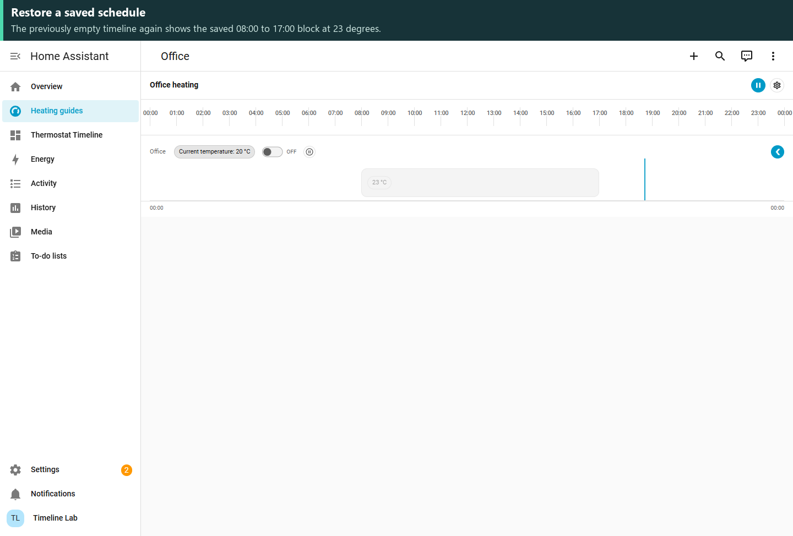
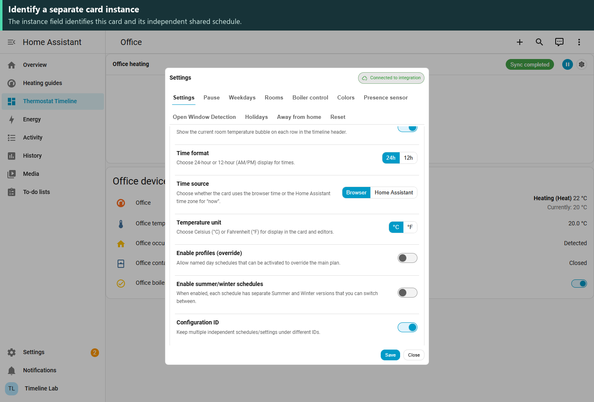
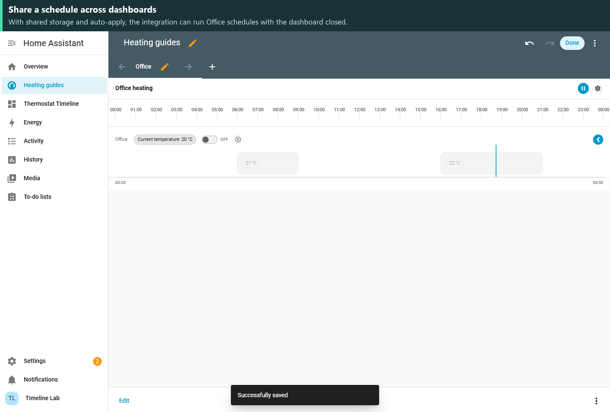
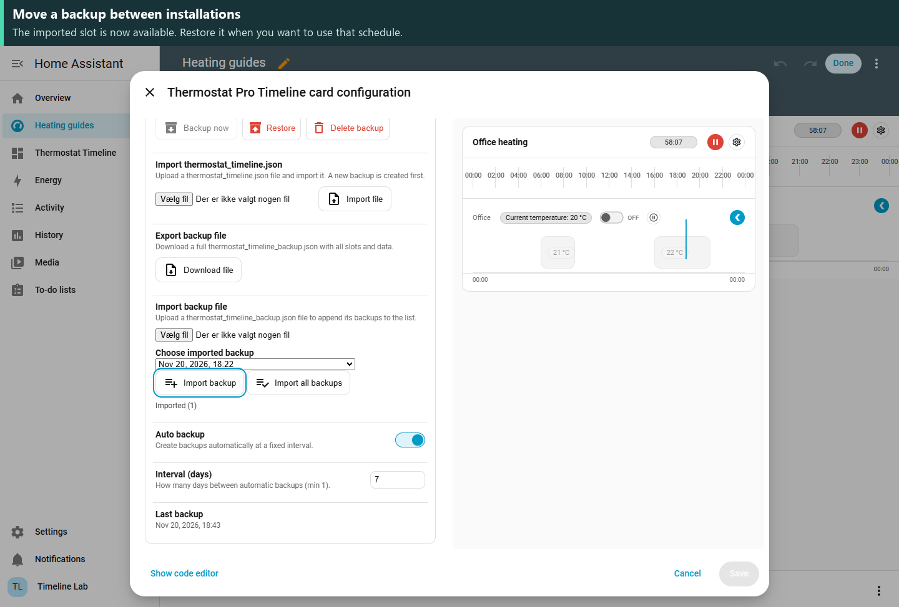
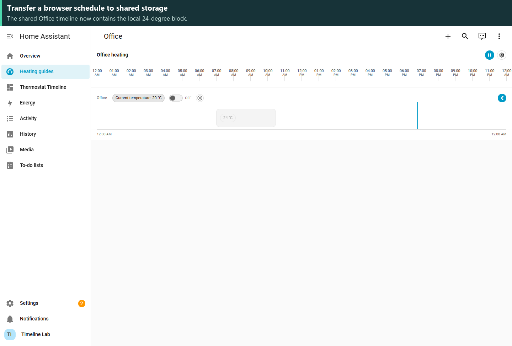
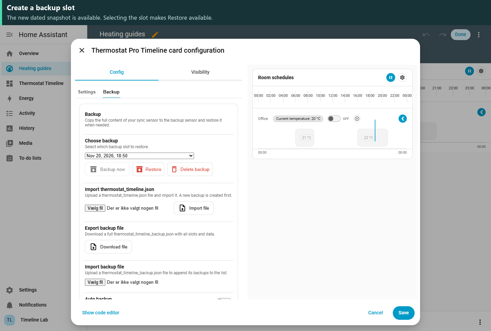

# Shared storage, sync, backup

Use shared storage when several dashboards should see the same schedule or the schedule should run with all browsers closed. Enable auto-apply for background temperature updates. Instant and delayed sync control when edits reach the shared store. A delayed write can leave another dashboard showing the previous version until the delay expires.

Before changing several rooms, create a backup with the [backup action](../../integration/services.md). Distinct instance IDs keep separate sets of schedules and settings. Check the active instance if two dashboards disagree.

## Check the restored schedule

In the dashboard card editor, open the backup controls. Choose the dated slot, select **Restore** and confirm replacement. The Office row was empty before this restore. Its 08:00 to 17:00 block now appears again at 23 degrees.

[Play walkthrough](../../images/restored.gif) | [Full-size GIF](../../images/restored.gif)

## Settings

- storage_enabled: true/false. Default on. Uses file‑based storage via the integration; no helper sensor entity needed.
- instance_enabled: true to keep separate schedules/settings by `instance_id`.
- instance_id: free text (normalized to safe id) — e.g. winter, summer.
- storage_sync_mode: instant | delay (delay batches writes)
- storage_sync_min / storage_sync_sec: delay config if `storage_sync_mode: delay` (min/sec).
- backup_auto_enabled: true/false and backup_interval_days: 1..365 for automatic backups.

## Choose an instance

Use the same instance ID on dashboards that edit the same plan. Give a second plan its own ID and use the **select_instance** action to activate it. When creating an instance, choose whether to start empty or copy the active plan.

[Play walkthrough](../../images/instance.gif) | [Full-size GIF](../../images/instance.gif)

## Save and restore a backup

Create a backup slot before making a large change. Select the sections to include, such as the main schedule, weekdays or colors. For a partial restore, call the **restore_now** integration action with the slot and the schedule sections you need. Choose **Merge** to combine the selected data with existing entries or **Replace** to replace the selected sections.

Enable automatic backups and set the interval in days to create recurring snapshots. To move a backup to another installation, export the backup, import it there and then restore the desired slot.

## Share schedules between dashboards

In dashboard edit mode, edit the card and enable **Shared storage + background control**. Save the card. Use the same instance for dashboards that should show the same schedule, and enable auto-apply for background temperature updates.

[Play walkthrough](../../images/shared-store.gif) | [Full-size GIF](../../images/shared-store.gif)

## Schedule recurring backups

Edit the dashboard card and open **Backup**. Turn on **Auto backup**, enter the interval in days and save. Reopen the tab to confirm the interval. Check the date of the newest slot after the first interval. In v3.3.3 the dashboard can save the interval in days while the shared settings still contain the older interval in minutes. To verify the backend interval, check the [authenticated state endpoint](../../integration/api.md) for `settings.backup_interval_days` or its fallback `settings.backup_interval_min`.

[Play walkthrough](../../images/auto-backup.gif) | [Full-size GIF](../../images/auto-backup.gif)

## Export and import backup slots

In the card editor, use **Backup** to download a backup file. On the destination installation, import the file, then add the selected slot or all slots. Restore the desired slot when you are ready to use its schedules. For a partial restore, use the integration action and choose the sections to merge or replace.

[Play walkthrough](../../images/backup-file.gif) | [Full-size GIF](../../images/backup-file.gif)

## Transfer a browser schedule to shared storage

On the dashboard that holds the local schedule, open the card editor and enable shared storage. Use **Transfer browser data to storage** and check the destination before confirming. This operation writes the browser copy over the destination schedules. Back up the destination first if it contains a plan you want to keep.

[Play walkthrough](../../images/transfer.gif) | [Full-size GIF](../../images/transfer.gif)

## Create a full backup slot

Edit the dashboard card, open **Backup**, choose **New backup** and select **Backup now**. A new dated slot appears. Select it to make **Restore** available. For an automation, the corresponding action is `thermostat_timeline.backup_now`.

[Play walkthrough](../../images/backup-action.gif) | [Full-size GIF](../../images/backup-action.gif)
