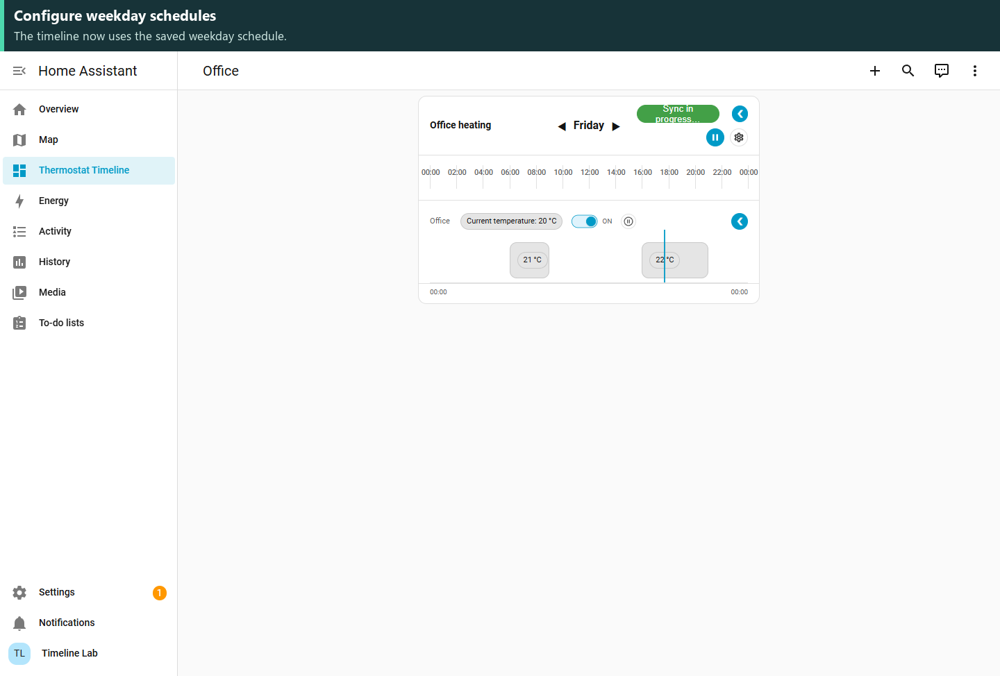
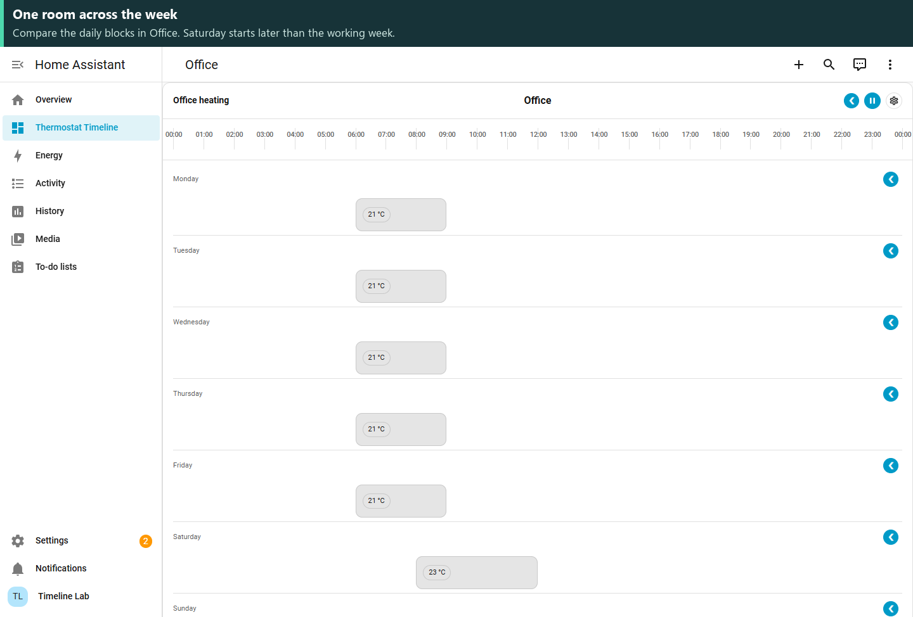

# Weekdays

Open the settings gear and choose the Weekdays tab. Start with weekday/weekend grouping if Monday to Friday share a routine. Choose separate Saturday and Sunday schedules when those days differ. Use all seven days for individual timetables.

Select the day or group before editing a block. Switch the view to compare one room across days, or several rooms on the same day.

## Choose a weekday grouping

Open **Settings > Weekdays** and enable weekday schedules. If **Copy main schedule** opens, choose which day group should receive a copy, or select **Don’t copy** to start separately. Group Monday through Friday together for a regular workweek, or choose individual days for different routines.

[Play walkthrough](../../images/weekdays.gif) | [Full-size GIF](../../images/weekdays.gif)

## Compare days for one room

Select the view for one room across all days. Here Office warms up at 06:00 on weekdays. Saturday starts at 08:00 and reaches 23 degrees. Select the corresponding day before editing a block.

[Play walkthrough](../../images/weekdays.gif) | [Full-size GIF](../../images/weekdays.gif)

## Settings

- weekdays_enabled: true/false to enable weekday schedules.
- weekdays_mode: weekday_weekend | weekday_sat_sun | all_7 to choose day groupings.
- weekdays_view: all_rooms_one_day | one_room_all_days to pick timeline browsing mode.
- weekdays_view_switch_in_timeline: true to show a toggle in the main header.
