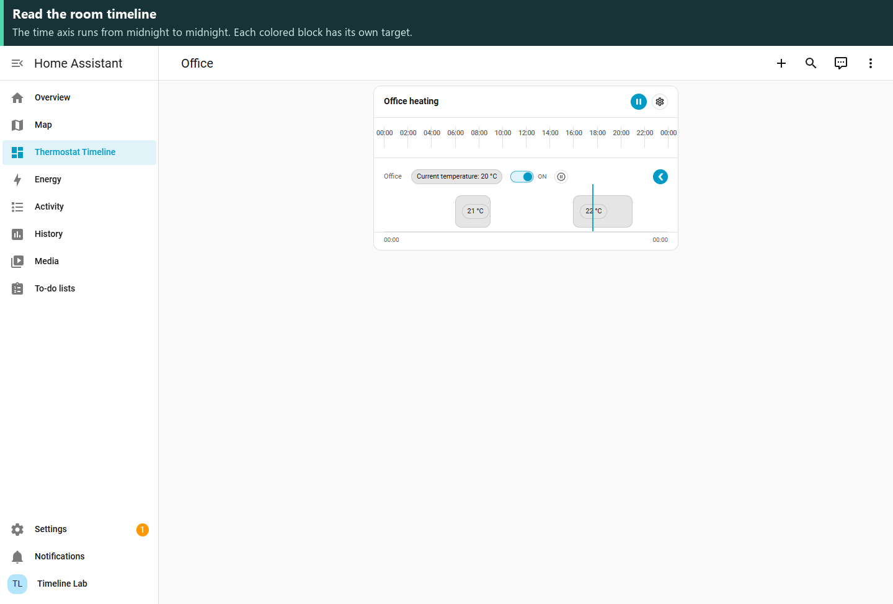
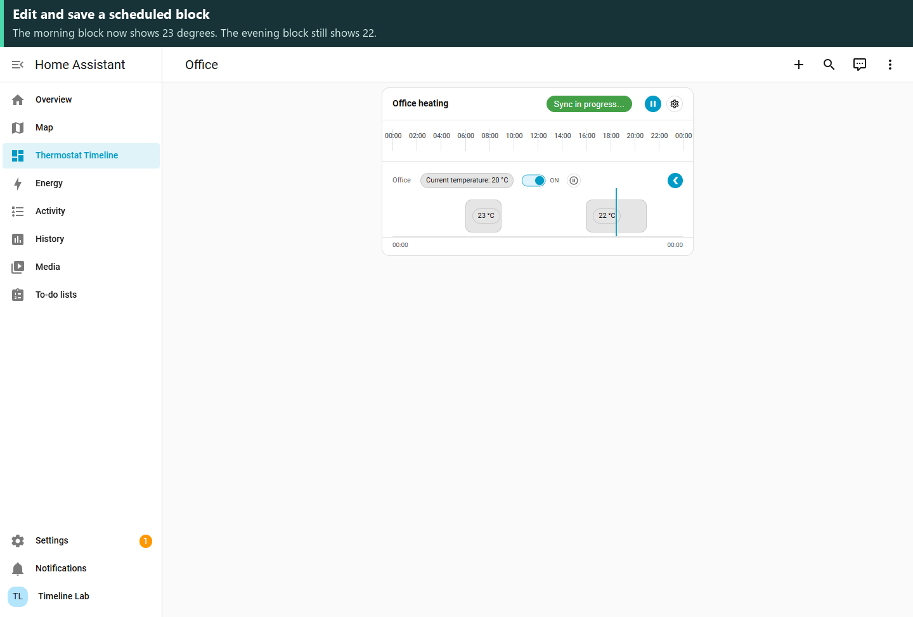

# Add your first thermostat

After [installation](installation.md), edit a dashboard and choose **Add card → Manual**. Paste this example and replace `climate.office` with your thermostat’s entity ID.

```yaml
type: custom:thermostat-timeline-card
title: Office heating
entities:
  - climate.office
default_temp: 20
storage_enabled: true
auto_apply: true
```

Save the card. Check that the room name and measured temperature appear. The small pause icon on the room row affects that room; the larger pause button in the header affects the whole schedule.



## Try a schedule

Use a test room for the first run. Add a short block that starts a few minutes ahead and choose a target different from the room default. Double-click or double-tap an existing block to edit its time and temperature. With shared storage and auto-apply active, close the dashboard and check the thermostat's **target temperature** at the boundary. The measured air temperature can take much longer to change.

[Explore card settings](../card/configuration.md) · [Pause a room](../card/features/pause.md)

## Edit a scheduled block

The walkthrough changes the 06:00 to 09:00 Office block from 21 to 23 degrees, saves it and shows the new target on the timeline. Set the start time, end time and target in the same dialog. Select **Save** in the editor, then select **Save** in the card header to write pending edits to shared storage. Choose **Cancel** in the editor to discard that edit.

[](../images/edit-block.gif)

[Play walkthrough](../images/edit-block.gif) | [Full-size GIF](../images/edit-block.gif)

## Remove a block

Double-click the block, check its start and end times, then select **Delete**. Check the gap on the timeline. With the normal room schedule active, the room default covers that period.
