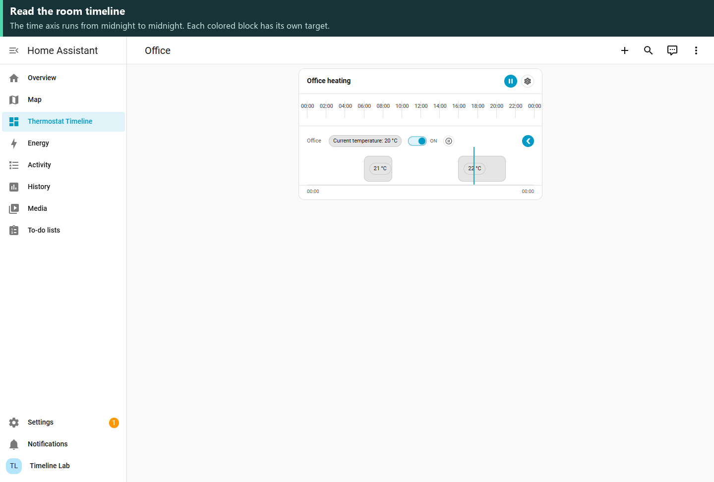
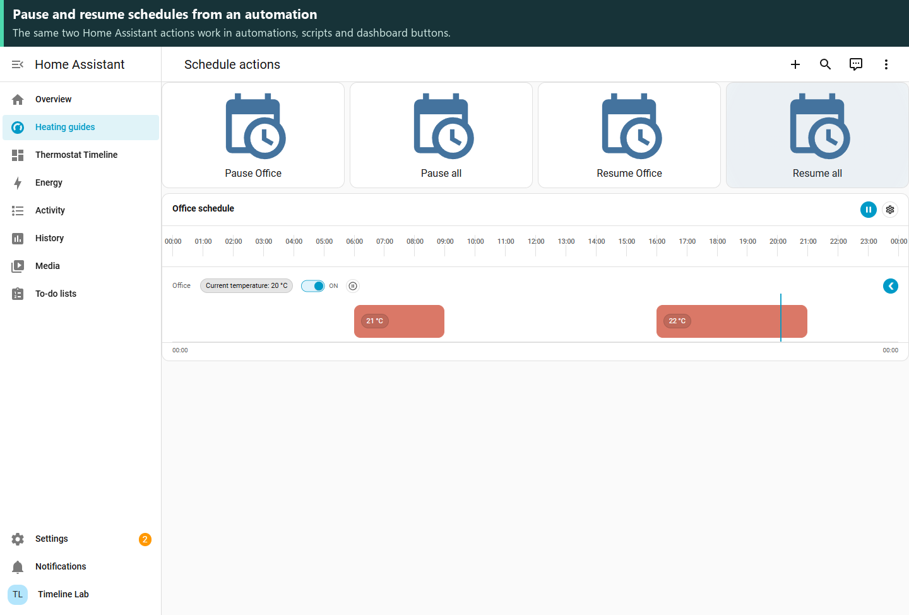
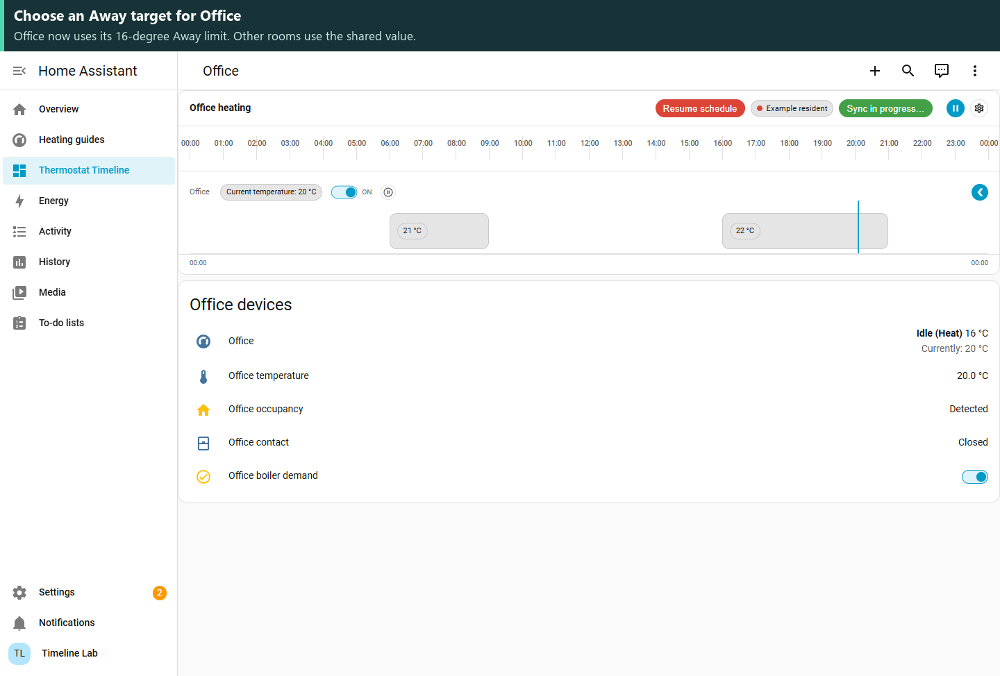
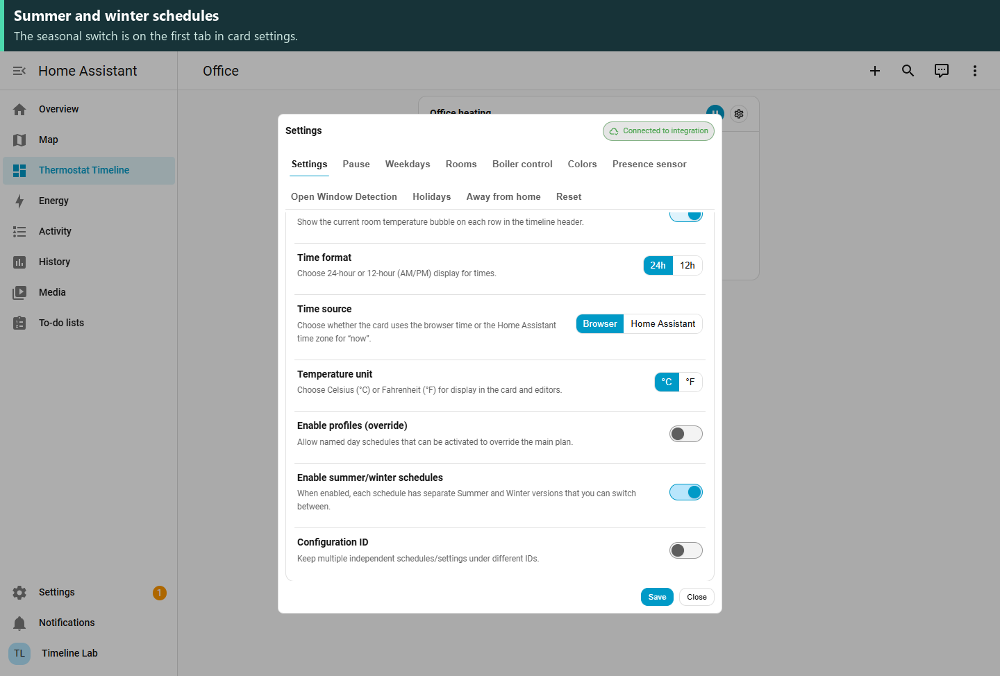

# Thermostat Pro Timeline

Build a daily heating schedule for each room. With shared storage and auto-apply enabled, Home Assistant runs your schedules while the dashboard is closed.

[Play walkthrough](images/edit-block.gif) | [Full-size GIF](images/edit-block.gif)

## Find a guide

[Explore all features](card/features/index.md) to find room controls, schedule types, sensor settings and backup tools.

Each feature guide pairs its settings with an example of the resulting timeline, thermostat target or device state.

| I want to… | Guide |
| --- | --- |
| Install the integration and bundled card | [Installation](getting-started/installation.md) |
| Put my first thermostat on a timeline | [Quick start](getting-started/quick-start.md) |
| Pause one room or adjust a thermostat manually | [Room pauses and manual targets](card/features/pause.md) |
| Switch between summer and winter schedules | [Seasonal schedules](card/features/seasonal.md) |
| Change heating when people come home | [Presence and Away](card/features/presence-away.md) |
| Use different plans by day | [Weekdays](card/features/weekdays.md), [holidays](card/features/holidays.md) and [profiles](card/features/profiles.md) |
| Link a window sensor or boiler | [Window detection](card/features/open-window.md) and [boiler control](card/features/boiler.md) |
| Configure a dashboard in YAML | [Settings](card/configuration.md) and [examples](card/examples.md) |
| Share settings or recover a backup | [Storage](card/features/storage.md) and [integration actions](integration/services.md) |
| Diagnose a missing card | [Troubleshooting](troubleshooting.md) |

## Find a control by task

### Pause Timeline when the heating is switched off

In your existing Home Assistant heating automation, add **Thermostat Timeline: Pause schedule** to the off sequence. Leave the room and duration empty to pause the whole active instance until you turn the heating back on. In the on sequence, add **Thermostat Timeline: Resume schedule**, again with the room empty. The card shows the same pause state as the automation.

[Play walkthrough](images/automation-pause.gif) | [Full-size GIF](images/automation-pause.gif)

For timed pauses, selected rooms and copyable YAML, see [integration actions](integration/services.md#pause-and-resume-schedules).

### Give one room a different Away temperature

Open the card settings, select **Away**, then enable **Use a room-specific Away target** for the room. For example, set the shared target to 17 °C and the office to 16 °C. When everyone leaves and both rooms are scheduled for 21 °C, the office uses 16 °C and the other room uses 17 °C. An office already scheduled for 15 °C stays at 15 °C.

[Play walkthrough](images/away-room-limit.gif) | [Full-size GIF](images/away-room-limit.gif)

See [Presence and Away](card/features/presence-away.md#set-a-room-specific-away-target) for person-linked rooms and departure delays.

### Find the Summer and Winter selector

Open the settings gear on the card. On the **first settings tab**, turn on **Enable summer/winter schedules** and save. The card now shows **Summer** and **Winter**. Select a season before editing its timetable. To check the result, switch to the other season and compare the same room's blocks.

[Play walkthrough](images/season.gif) | [Full-size GIF](images/season.gif)

The [seasonal schedules guide](card/features/seasonal.md) also covers automatic switching and separate heating and cooling sources.
