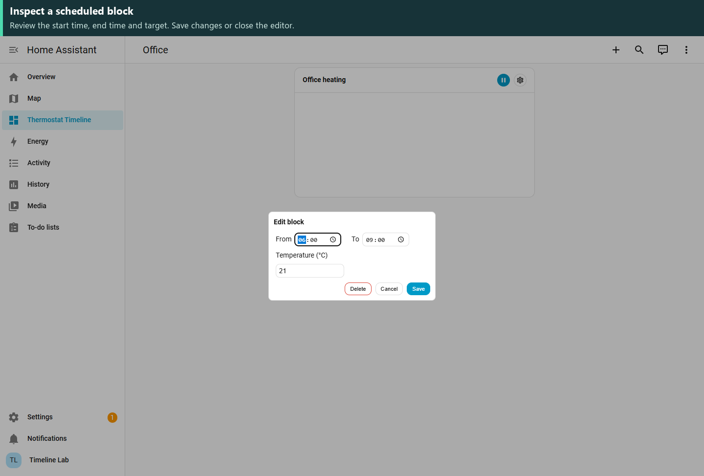
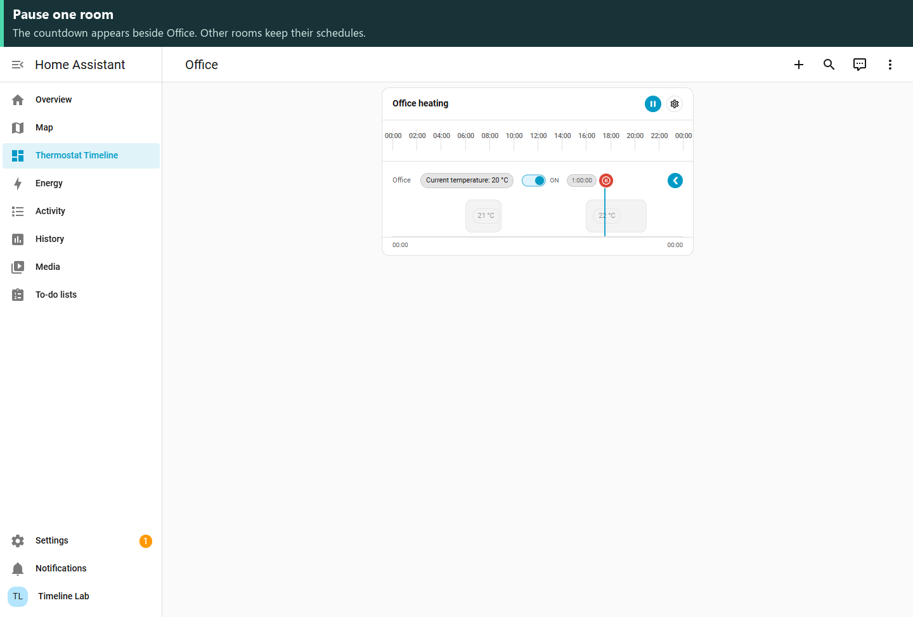

# Visual walkthroughs

Choose a task to see it in Home Assistant. Each guide pairs a desktop screenshot with an animation. Select **Play walkthrough** to follow the pointer, or **Full-size GIF** to see the original resolution.

## Start with the timeline

| Edit a block | Pause one room |
| --- | --- |
|  |  |
| [Open the block editor guide](getting-started/quick-start.md#edit-a-scheduled-block) | [Open the room pause guide](card/features/pause.md#pause-one-room-for-an-hour) |

## All walkthroughs

| Task | What to look for |
| --- | --- |
| [Edit a scheduled block](getting-started/quick-start.md#edit-a-scheduled-block) | Block times and target temperature |
| [Pause one room for an hour](card/features/pause.md#pause-one-room-for-an-hour) | Timed pause on the room row |
| [Resume a paused room](card/features/pause.md#resume-a-paused-room) | Returning to the room schedule |
| [Enable summer and winter schedules](card/features/seasonal.md#enable-summer-and-winter-schedules) | Season switch in the general settings |
| [Choose a weekday grouping](card/features/weekdays.md#choose-a-weekday-grouping) | Day grouping options |
| [Set up window detection](card/features/open-window.md#set-up-window-detection) | Sensor assignment and delays |
| [Choose a holiday source](card/features/holidays.md#choose-a-holiday-source) | Calendar or manual dates |
| [Find the boiler relay settings](card/features/boiler.md#find-the-boiler-relay-settings) | Relay and room selection |
